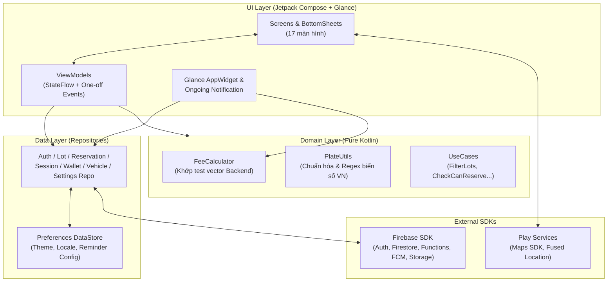
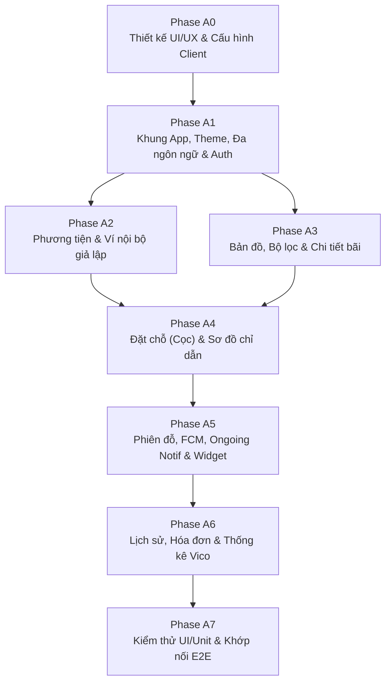

# KẾ HOẠCH PHÁT TRIỂN ỨNG DỤNG ANDROID — SMART PARKING
**Dự án:** Sa hình Mô hình Bãi đỗ xe thông minh (Smart Parking Demo)  
**Phạm vi:** Ứng dụng di động Android dành cho người dùng cuối (Kotlin + Jetpack Compose)  
**Ngày tạo:** 2026-10-30 — **Cập nhật:** 2026-10-30 (tách riêng phần Backend sang `Backend_Plan.md`)  
**Tài liệu liên quan:**
- `Backend_Plan.md` — Kiến trúc Firebase, Edge Server (MQTT + YOLO/EasyOCR), Security Rules & Web Admin
- `Note proj.md` — Ghi chú yêu cầu tính năng ban đầu

---

> [!IMPORTANT]
> Tài liệu này **chỉ đặc tả phần Ứng dụng Android (Client)**. Toàn bộ thiết kế Cloud Functions, Edge Server nhận diện biển số, giao thức MQTT với ESP32 và Web Admin nằm trong `Backend_Plan.md`. App Android **không kết nối MQTT hay gọi trực tiếp vào Edge Server** mà chỉ làm việc với hệ sinh thái Firebase thông qua hợp đồng dữ liệu tại mục 1.2.

---

## 0. CÁC QUYẾT ĐỊNH ĐÃ CHỐT (PHÍA APP ANDROID)

| # | Hạng mục | Quyết định |
|:--:|:---|:---|
| 1 | Xác thực người dùng | **Chỉ Email/Mật khẩu** qua Firebase Auth (đăng ký, xác minh email, quên mật khẩu, đổi mật khẩu) |
| 2 | Quản lý phương tiện | Thêm nhiều xe (ô tô / xe máy), chuẩn hóa biển số khớp với OCR ở backend, đặt **xe mặc định** |
| 3 | Bản đồ & Phạm vi bãi | Hiển thị **1 bãi live** (4 slot realtime từ sa hình) + **5–8 bãi giả lập** (seed data) để đầy đủ trải nghiệm tìm kiếm, lọc, sắp xếp và chỉ đường |
| 4 | Đặt chỗ & Phí cọc | Chỉ mở đặt chỗ cho bãi live. Thu cọc mặc định **5.000đ** từ ví khi đặt; giữ chỗ **15 phút** có đếm ngược. Đến đúng hạn → cọc khấu trừ vào phí đỗ; huỷ ≤ 2 phút đầu → hoàn 100%; huỷ sau 2 phút hoặc không đến → mất cọc |
| 5 | Tính phí đỗ xe | Tính theo thời gian thực theo block — mặc định **5.000đ / block 30 phút**. App tự tính và cập nhật số tiền tạm tính mỗi giây/phút ngay trên UI |
| 6 | Ví & Thẻ thanh toán | **Ví nội bộ giả lập** + quản lý **thẻ giả lập** để nạp tiền ảo. Khi xe ra nếu thiếu tiền, ví được phép **âm**; khi ví âm, App cảnh báo và **khoá nút Đặt chỗ mới** tới khi nạp bù |
| 7 | Đánh giá bãi đỗ | Tạm thời **chỉ hiển thị điểm sao & số lượt đánh giá từ dữ liệu seed**, chưa làm form chấm sao |
| 8 | Nhắc giờ thông minh | 1) Nhắc trước **5 phút** khi sắp hết giờ giữ chỗ + nút **Gia hạn nhanh +15 phút**.<br/>2) Cho đặt thời lượng đỗ dự kiến, nhắc trước **10 phút** + nút **Gia hạn +30p / +1h** |
| 9 | Cá nhân hóa UI | **Chế độ Sáng / Tối / Theo hệ thống** (Material 3) và **Đa ngôn ngữ Việt / Anh** đổi tức thì trong app |
| 10 | Tiện ích màn hình ngoài | **Widget màn hình chính (Jetpack Glance)** + **Thông báo cố định (Ongoing Notification)** hiển thị đồng hồ phiên đỗ đang chạy |
| 11 | Tiến độ triển khai | Chia theo từng Phase chức năng độc lập (A0 → A7), không gắn mốc thời gian cố định |

> [!NOTE]
> **Điều chỉnh Tech Stack so với ghi chú nháp ban đầu:**
> - **Bỏ `BiometricPrompt`:** do đã chốt chỉ dùng Email/Mật khẩu và ví giả lập, không yêu cầu sinh trắc học.
> - **Thay `EncryptedSharedPreferences` bằng Jetpack DataStore:** `EncryptedSharedPreferences` đã bị Google deprecate; token đăng nhập đã do Firebase Auth SDK tự lưu trữ an toàn.
> - **Bỏ `Retrofit`:** App giao tiếp hoàn toàn qua **Firebase Firestore SDK** (realtime listener + offline cache có sẵn) và **Firebase Cloud Functions SDK** (Callable).

---

## 1. KIẾN TRÚC ỨNG DỤNG & HỢP ĐỒNG VỚI BACKEND

### 1.1. Kiến trúc phân lớp trên Android (MVVM + Clean Data Layer)



- **Unidirectional Data Flow (UDF):** Mỗi màn hình sở hữu một `data class UiState` bất biến phát qua `StateFlow`, cập nhật tự động khi Firestore bắn snapshot mới (`callbackFlow` + `stateIn(SharingStarted.WhileSubscribed(5_000))`).
- **Tách biệt hoàn toàn khỏi tầng IoT:** App chỉ đọc/lắng nghe Firestore. Việc đồng bộ với ESP32 qua MQTT do Backend đảm nhiệm, nhờ vậy App hoạt động ổn định trên cả 4G/5G lẫn Wi-Fi bất kỳ.

### 1.2. Hợp đồng giao tiếp với Backend *(Chi tiết server xem `Backend_Plan.md`)*

#### A. Các Collection Firestore mà App truy cập
| Collection | Chế độ ở App | Mục đích sử dụng trên UI |
|:---|:---|:---|
| `users/{uid}` | Snapshot realtime + Update giới hạn | Đọc `walletBalance` realtime; cập nhật `displayName`, `defaultVehicleId`, `fcmTokens`, `locale`, `theme`, `defaultPlannedDurationMin` |
| `users/{uid}/paymentMethods/{id}` | CRUD trực tiếp | Quản lý danh sách thẻ giả lập (`brand`, `last4`, `holderName`, `isDefault`) |
| `users/{uid}/notifications/{id}` | Snapshot / Query + Update `read` | Hiển thị hộp thư thông báo và badge số thông báo chưa đọc |
| `vehicles` (`where ownerUid == uid`) | Snapshot realtime | Danh sách phương tiện của người dùng |
| `lots` & `lots/{lotId}/slots` | Snapshot realtime | Hiển thị marker bản đồ, bộ lọc, chỗ trống bãi live và sơ đồ 4 ô `A1, A2, B1, B2` (`available` / `occupied` / `reserved`) |
| `reservations` (`where uid == uid`) | Snapshot (`status == active`) + Query | Màn hình đếm ngược giữ chỗ, thẻ ghim trên Trang chủ, trạng thái cọc |
| `sessions` (`where uid == uid`) | Snapshot (`status == active`) + Phân trang (`completed`) | Màn hình Phiên đỗ hiện tại; Lịch sử đỗ xe & Thống kê theo tháng |
| `transactions` (`where uid == uid`) | Query phân trang theo `createdAt` | Chi tiết hóa đơn & lịch sử biến động số dư ví |

#### B. Các Callable Functions mà App gọi
| Callable | Khi nào gọi | Xử lý lỗi cần hiển thị rõ trên UI |
|:---|:---|:---|
| `addVehicle` | Thêm xe mới | `invalid-argument` → "Biển số không đúng định dạng VN"; `already-exists` → "Biển số này đã được đăng ký bởi tài khoản khác" |
| `removeVehicle` | Xoá xe | `failed-precondition` → "Không thể xoá xe đang đỗ hoặc đang đặt chỗ" |
| `topUpWallet` | Nạp tiền ảo từ thẻ giả lập | Hiển thị animation nạp thành công & số dư mới |
| `createReservation` | Xác nhận đặt chỗ (thu cọc) | `failed-precondition` → "Số dư ví không đủ cọc hoặc bạn đang có lượt đặt chỗ khác"; `resource-exhausted` → "Ô đỗ vừa có người đặt, vui lòng chọn ô khác" |
| `cancelReservation` | Huỷ đặt chỗ | Trước khi gọi, UI tính `now - createdAt` để bật hộp thoại cảnh báo rõ: **"Được hoàn 100% cọc (trong 2 phút đầu)"** hay **"Sẽ mất phí cọc 5.000đ"** |
| `extendReservation` | Bấm gia hạn giữ chỗ (+15p) | Disable nút khi `extendCount >= maxExtendCount` |
| `extendPlannedDuration` | Bấm dời mốc nhắc đỗ lâu (+30p/+1h) | Toast xác nhận mốc giờ nhắc mới |

### 1.3. Logic nghiệp vụ tính toán tại Client (`core/domain`)

1. **Tính phí đỗ tạm tính (`FeeCalculator.kt`):**
   - Dùng đúng công thức của Backend (và kiểm thử bằng cùng file `shared/fee_test_cases.json`):
     $$fee = \max\left(1, \left\lceil \frac{durationMin - graceMinutes}{blockMinutes} \right\rceil\right) \times pricePerBlock$$
   - Nếu phiên đỗ có `reservationId` (đã đặt cọc trước), màn hình Phiên đỗ hiển thị đồng thời:
     - **Tổng phí tạm tính:** `fee`
     - **Đã cọc trước:** `-depositAmount`
     - **Dự kiến trả thêm khi ra:** `max(0, fee - depositAmount)`
2. **Chuẩn hóa biển số (`PlateUtils.kt`):**
   - Khi người dùng gõ `51a - 123.45`, tự động preview mã chuẩn hóa `51A12345` và kiểm tra regex `^[0-9]{2}[A-Z][A-Z0-9]?[0-9]{4,5}$` ngay tại form trước khi gọi `addVehicle`.
3. **Quy tắc khoá giao diện theo trạng thái:**
   - `walletBalance < 0`: hiện banner đỏ trên Trang chủ & màn Ví ("Ví đang âm `-X đ`, vui lòng nạp thêm để đặt chỗ"), khoá nút **Đặt chỗ**.
   - `lot.isLive == false` (bãi giả lập): cho phép xem chi tiết, lọc, bấm **Chỉ đường**, nhưng nút Đặt chỗ để trạng thái disabled kèm nhãn *"Bãi mô phỏng – chỉ hỗ trợ chỉ đường"*.

---

## 2. TECH STACK & CẤU TRÚC PROJECT ANDROID

### 2.1. Bảng công nghệ sử dụng

| Nhóm | Thư viện / Công nghệ | Mục đích |
|:---|:---|:---|
| Ngôn ngữ & UI | **Kotlin 2.x**, **Jetpack Compose**, **Material 3** | Giao diện khai báo hiện đại, hỗ trợ Dynamic Color & Dark Theme |
| Kiến trúc & DI | **ViewModel**, **Lifecycle Compose**, **Hilt** | Quản lý vòng đời state theo cấu hình màn hình, Dependency Injection |
| Điều hướng | **Navigation Compose** (Type-safe Kotlin Serialization routes) | Điều hướng giữa các màn hình & xử lý Deep Link từ Notification/Widget |
| Bất đồng bộ | **Kotlin Coroutines & Flow** | Lắng nghe luồng dữ liệu thời gian thực từ Firestore & bộ đếm giây `tickerFlow` |
| Backend Client | **Firebase BoM** (`firebase-auth`, `firebase-firestore`, `firebase-functions`, `firebase-messaging`, `firebase-storage`) | Toàn bộ giao tiếp xác thực, dữ liệu realtime, gọi API và nhận thông báo đẩy |
| Lưu trữ cục bộ | **Jetpack DataStore (Preferences)** | Lưu cài đặt giao diện, ngôn ngữ, cờ hoàn tất Onboarding |
| Bản đồ & Vị trí | **Maps Compose** (Google Maps SDK), **Fused Location Provider** | Hiển thị bản đồ bãi đỗ, lấy GPS hiện tại, mở Google Maps Navigation qua Intent |
| Biểu đồ & Ảnh | **Vico** (Compose Charts), **Coil 3** | Vẽ biểu đồ cột chi tiêu theo tháng; tải ảnh bãi đỗ và ảnh chụp biển số vào/ra |
| Tiện ích ngoài | **Jetpack Glance**, **WorkManager** | Xây dựng Home Screen Widget và xử lý tác vụ nền khi bấm nút trên thông báo |
| Đa ngôn ngữ | **AppCompat Per-App Language** (`AppCompatDelegate.setApplicationLocales`) | Đổi ngôn ngữ Việt / Anh trực tiếp trong ứng dụng (tương thích Android 8.0+) |
| Kiểm thử | **JUnit 4**, **MockK**, **Turbine**, **Compose UI Test** | Kiểm thử đơn vị cho Domain/ViewModel (Flow) và kiểm thử giao diện |
| Cấu hình Build | `minSdk = 26` (Android 8.0), `targetSdk = 35`, **Gradle Version Catalog** (`libs.versions.toml`) | Quản lý phiên bản tập trung, phân tách build variant `debug` (dùng Emulator) và `release` |

### 2.2. Cấu trúc thư mục (`android-app/`)
```
android-app/
└── app/src/main/
    ├── java/com/iotparking/app/
    │   ├── core/
    │   │   ├── designsystem/     # Theme (Light/Dark), Color, Type, Common Components
    │   │   ├── domain/           # Models, FeeCalculator, PlateUtils, TimeOffsetProvider
    │   │   ├── data/             # Repositories & Firebase DataSources
    │   │   ├── location/         # FusedLocation wrapper & tính khoảng cách Haversine
    │   │   ├── notification/     # ParkingMessagingService, Channels, OngoingSessionNotifier, ActionReceiver
    │   │   └── di/               # Hilt Modules (FirebaseModule, DataStoreModule, RepoModule)
    │   ├── feature/
    │   │   ├── onboarding/       # Splash & Onboarding 3 bước + xin quyền runtime
    │   │   ├── auth/             # Login, Register, ForgotPassword, VerifyEmail
    │   │   ├── home/             # Bản đồ bãi đỗ, Search, FilterSheet, BottomSheet danh sách, ActiveBanner
    │   │   ├── lotdetail/        # Chi tiết bãi đỗ & Sơ đồ 4 slot Khu A/B realtime
    │   │   ├── reservation/      # Chọn chỗ, Xác nhận cọc, Màn đếm ngược giữ chỗ
    │   │   ├── session/          # Phiên đỗ hiện tại (Chronometer, phí realtime, sơ đồ vị trí xe)
    │   │   ├── history/          # Lịch sử theo tháng, Chi tiết hóa đơn, Biểu đồ thống kê Vico
    │   │   ├── wallet/           # Ví nội bộ, Nạp tiền ảo, Quản lý thẻ giả lập
    │   │   ├── vehicle/          # Danh sách xe, Thêm/Sửa/Xoá xe, Chọn mặc định
    │   │   ├── inbox/            # Hộp thư thông báo trong app
    │   │   └── settings/         # Hồ sơ, Đổi mật khẩu, Ngôn ngữ, Giao diện, Cài đặt nhắc giờ
    │   ├── widget/               # ParkingGlanceWidget & ParkingWidgetReceiver
    │   ├── navigation/           # AppNavHost, BottomNavBar, Route definitions
    │   ├── MainActivity.kt
    │   └── ParkingApp.kt         # @HiltAndroidApp
    └── res/
        ├── values/strings.xml    # Tiếng Anh (mặc định fallback)
        └── values-vi/strings.xml # Tiếng Việt
```

---

## 3. ĐẶC TẢ MÀN HÌNH & ĐIỀU HƯỚNG (UI/UX)

### 3.1. Cấu trúc Thanh điều hướng dưới (Bottom Navigation — 5 Tab)
1. **Khám phá (`Home`)**: Bản đồ + danh sách bãi đỗ + thẻ nổi phiên đỗ/đặt chỗ đang hoạt động.
2. **Hoạt động (`Activity`)**: Tự động hiển thị **Phiên đỗ hiện tại** hoặc **Đặt chỗ đang đếm ngược** (hoặc trạng thái rỗng kèm nút tìm bãi).
3. **Lịch sử (`History`)**: Chuyển đổi giữa danh sách hóa đơn theo tháng và tab **Thống kê chi tiêu**.
4. **Ví (`Wallet`)**: Số dư ví, nạp tiền nhanh, thẻ liên kết giả lập và lịch sử giao dịch ví.
5. **Tài khoản (`Account`)**: Quản lý phương tiện, hộp thư thông báo, cài đặt ngôn ngữ / giao diện / nhắc giờ, hồ sơ cá nhân.

### 3.2. Chi tiết 17 Màn hình chức năng

| # | Màn hình | Thành phần UI & Tương tác chính |
|:--:|:---|:---|
| 1 | **Splash & Onboarding** | 3 slide minh họa (*Đăng ký biển số → Đặt chỗ & chỉ đường → Vào/ra tự động không thẻ*); xin quyền `ACCESS_FINE_LOCATION` và `POST_NOTIFICATIONS` (Android 13+). |
| 2 | **Đăng nhập / Đăng ký / Quên MK** | Form Email + Mật khẩu có kiểm tra hợp lệ tại chỗ; gửi link khôi phục mật khẩu; banner nhắc xác minh email. |
| 3 | **Trang chủ (Bản đồ)** | Bản đồ Google Maps với custom marker hiển thị số chỗ trống (Xanh: còn nhiều, Cam: sắp đầy, Đỏ: hết chỗ); thanh tìm kiếm, dải chip lọc nhanh, `ModalBottomSheet` danh sách bãi; **Active Card** ghim trên cùng khi đang giữ chỗ hoặc đang đỗ xe. |
| 4 | **Bộ lọc & Sắp xếp** | Lọc theo: khoảng giá, bán kính khoảng cách, còn chỗ trống, loại xe (ô tô/xe máy), có mái che, có trạm sạc EV. Sắp xếp: *Gần nhất / Giá thấp nhất / Nhiều chỗ trống nhất*. |
| 5 | **Chi tiết Bãi đỗ** | Carousel ảnh bãi, địa chỉ, giờ mở cửa, bảng giá chi tiết (đơn giá block 30p + phí cọc 5.000đ), điểm sao đánh giá (seed), badge thiết bị *Trực tuyến/Ngoại tuyến*, số chỗ trống realtime; 2 CTA chính: **Chỉ đường** (mở Google Maps) & **Đặt chỗ ngay**. |
| 6 | **Sơ đồ & Chọn chỗ đỗ** | Bản vẽ mặt bằng sa hình gồm **Cổng vào → Ngã rẽ → Khu A (`A1`, `A2`) & Khu B (`B1`, `B2`)** cập nhật màu realtime (*Trống / Đã có xe / Đã đặt*). Cho phép chạm chọn 1 ô cụ thể hoặc chọn *"Để hệ thống tự gán"*. |
| 7 | **Xác nhận Đặt chỗ** | Chọn xe (mặc định lấy `defaultVehicleId`), tóm tắt bãi + ô đỗ + thời gian giữ 15 phút, hiển thị rõ **Phí cọc: 5.000đ** (trừ từ ví) và hộp lưu ý chính sách hoàn/mất cọc. Nếu chưa có xe → điều hướng nhanh sang màn Thêm xe. |
| 8 | **Đặt chỗ đang giữ** | Đồng hồ vòng tròn đếm ngược `mm:ss`, mã ô đỗ, biển số xe, tiền cọc đang tạm giữ; các nút: **Chỉ đường đến bãi**, **Gia hạn +15 phút** (1 lần), **Huỷ đặt chỗ** (hiện dialog báo rõ được hoàn hay mất cọc dựa theo mốc 2 phút). |
| 9 | **Phiên đỗ hiện tại** | Hiển thị biển số, tên bãi, ô đỗ thực tế (kèm sơ đồ mini làm nổi bật đường rẽ từ cổng tới ô đỗ để tìm xe), giờ vào, **đồng hồ đếm giờ chạy từng giây**, **tổng phí tạm tính & số tiền thực trả sau khi trừ cọc**, ảnh camera chụp lúc vào, mục cài **thời lượng đỗ dự kiến** + nút gia hạn nhắc giờ. |
| 10 | **Lịch sử đỗ xe** | Bộ chọn Tháng/Năm và bộ lọc theo từng xe; thẻ tóm tắt tổng chi tiêu trong tháng; danh sách phân trang các phiên đã hoàn tất. |
| 11 | **Chi tiết Hóa đơn** | Mã hóa đơn (`INV-...`), biển số, bãi, ô đỗ, giờ vào – giờ ra, tổng thời lượng, diễn giải tính tiền (`số block × 5.000đ`), dòng **Khấu trừ tiền cọc (`-5.000đ`)**, **Thực thu**, số dư ví sau giao dịch, xem phóng to 2 ảnh biển số lúc vào & lúc ra. |
| 12 | **Thống kê Chi tiêu** | Biểu đồ cột (Vico) so sánh chi tiêu 6 tháng gần nhất; các thẻ chỉ số: tổng số lượt đỗ, thời gian đỗ trung bình/lượt, bãi đỗ thường xuyên nhất. |
| 13 | **Ví nội bộ** | Thẻ hiển thị số dư hiện tại (đổi màu cảnh báo đỏ nếu đang âm), các nút chọn mệnh giá nạp nhanh (*20k, 50k, 100k, 200k*), chọn thẻ giả lập để nạp, danh sách lịch sử biến động số dư (*Nạp tiền, Đặt cọc, Hoàn cọc, Phí đỗ xe*). |
| 14 | **Quản lý Thẻ giả lập** | Danh sách thẻ ảo đã lưu (chỉ hiện thương hiệu Visa/Mastercard/JCB + 4 số cuối), form thêm thẻ test mới, xoá thẻ, đặt làm nguồn nạp mặc định. |
| 15 | **Quản lý Phương tiện** | Danh sách xe của user kèm nhãn *Mặc định*; màn thêm/sửa xe có ô nhập biển số tự chuẩn hóa realtime, chọn loại xe (Ô tô / Xe máy) và tên gợi nhớ. |
| 16 | **Hộp thư Thông báo** | Danh sách toàn bộ thông báo xe vào/ra, đặt chỗ, nhắc giờ, biến động ví; chạm vào tự đánh dấu đã đọc và nhảy tới màn hình chi tiết tương ứng; nút *"Đánh dấu đọc tất cả"*. |
| 17 | **Cài đặt & Hồ sơ** | Sửa tên hiển thị, đổi mật khẩu, bộ chọn **Ngôn ngữ (Tiếng Việt / English)**, bộ chọn **Giao diện (Sáng / Tối / Theo hệ thống)**, cấu hình thời lượng đỗ dự kiến mặc định, nút Đăng xuất. |

---

## 4. THÔNG BÁO (FCM), ONGOING NOTIFICATION & HOME WIDGET

### 4.1. Kênh thông báo & Xử lý tương tác nhanh
App đăng ký 5 `NotificationChannel` ngay khi khởi động:

| Channel ID | Tên hiển thị | Độ ưu tiên | Hành động khi chạm / Action Button |
|:---|:---|:--:|:---|
| `parking_events` | Sự kiện xe vào / ra bãi | High | Vào bãi → mở màn **Phiên đỗ hiện tại**; Ra bãi → mở màn **Chi tiết Hóa đơn** vừa tạo |
| `reservation` | Đặt chỗ & Giữ chỗ | High | Khi báo sắp hết hạn (còn 5p): hiển thị nút action **"Gia hạn +15p"** ngay trên thanh thông báo (gọi `BroadcastReceiver` → `WorkManager` → callable `extendReservation` không cần mở app) |
| `reminders` | Nhắc giờ đỗ xe | High | Hiển thị 2 nút action **"Gia hạn +30p"** và **"Gia hạn +1h"** gọi `extendPlannedDuration` |
| `wallet` | Biến động số dư & Cảnh báo ví | Default | Mở màn hình **Ví nội bộ** |
| `ongoing_session` | Phiên đỗ đang diễn ra | Low (không rung/kêu) | Thông báo ghim cố định suốt thời gian xe nằm trong bãi |

### 4.2. Thông báo cố định phiên đỗ (Ongoing Notification)
- Tự động bật ngay khi App phát hiện có `session` trạng thái `active` (qua FCM `VEHICLE_ENTERED` hoặc Firestore listener) và tự động tắt ngay khi phiên chuyển sang `completed`.
- Sử dụng `NotificationCompat.Builder.setOngoing(true)` kết hợp `setWhen(entryTimeMs)` và `setUsesChronometer(true)` để hệ điều hành Android tự chạy bộ đếm thời gian mượt mà mà **không tốn pin** đánh thức CPU mỗi giây.

### 4.3. Widget màn hình chính (Jetpack Glance)
Hỗ trợ kích thước `4×2` trên màn hình chính Android với 3 chế độ hiển thị:
1. **Đang đỗ xe:** Biển số, tên bãi + mã ô đỗ (vd: `Khu A - A2`), giờ vào, phí tạm tính; chạm vào mở thẳng màn Phiên đỗ.
2. **Đang giữ chỗ:** Mã ô đã đặt, giờ hết hạn giữ chỗ, nút mở nhanh Google Maps chỉ đường.
3. **Không có hoạt động:** Số dư ví hiện tại + nút tắt *"Tìm bãi đỗ gần đây"*.
- **Cơ chế làm mới:** Cập nhật tức thì mỗi khi `ParkingMessagingService` nhận bản tin FCM từ Backend, mỗi khi người dùng mở App, và định kỳ qua `WorkManager` (chu kỳ 15 phút) để làm mới số tiền tạm tính.

---

## 5. LỘ TRÌNH PHÁT TRIỂN APP ANDROID THEO GIAI ĐOẠN



> [!TIP]
> **Phát triển độc lập không bị chặn bởi phần cứng:** Ở chế độ `debug`, App trỏ thẳng vào **Firebase Emulator Suite** trên máy dev. Để test màn hình *Phiên đỗ hiện tại* (Phase A5) hay *Hóa đơn* (Phase A6) khi chưa lắp sa hình, chỉ cần sửa/thêm 1 document `sessions` mẫu trên giao diện Web của Emulator (`localhost:4000`) là App tự nhảy giao diện realtime.

---

### PHASE A0 — THIẾT KẾ UI/UX & CẤU HÌNH CLIENT
- [ ] Vẽ Wireframe / Mockup cho 17 màn hình (cả chế độ Sáng & Tối), thống nhất bảng màu và icon.
- [ ] Tạo Android App trên Firebase Console, tải `google-services.json`; đăng ký SHA-1 debug key.
- [ ] Tạo Google Maps SDK for Android API Key trên Google Cloud Console (giới hạn theo package name `com.iotparking.app` + SHA-1).
- [ ] Chuẩn bị bộ test vector dùng chung `shared/fee_test_cases.json` và `shared/plate_test_cases.json`.

**Đầu ra:** Bản thiết kế màn hình hoàn chỉnh, API key bản đồ và cấu hình Firebase sẵn sàng.

### PHASE A1 — KHUNG PROJECT, DESIGN SYSTEM, ĐA NGÔN NGỮ & AUTH
- [ ] Khởi tạo project `android-app/` với Kotlin, Compose, Material 3, Hilt, Navigation Compose, Gradle Version Catalog.
- [ ] Cấu hình kết nối tự động tới Firebase Emulator khi `BuildConfig.DEBUG == true` (có cờ bật/tắt sang môi trường demo thật).
- [ ] Xây dựng `core/designsystem`: bảng màu Sáng/Tối, Typography, các component dùng chung (`PrimaryButton`, `ParkingCard`, `LoadingOverlay`, `EmptyStateView`, `ErrorBanner`).
- [ ] Thiết lập DataStore + đổi giao diện Sáng/Tối + đổi ngôn ngữ **Việt / Anh** (`strings.xml` đầy đủ 2 thứ tiếng).
- [ ] Xây dựng màn Onboarding, Đăng nhập, Đăng ký, Quên mật khẩu, đồng bộ FCM token lên `users/{uid}.fcmTokens`.

**Đầu ra:** Đăng ký/đăng nhập thành công, đổi ngôn ngữ & Dark Mode mượt không văng state, khung 5 tab Bottom Bar chạy ổn định.

### PHASE A2 — QUẢN LÝ PHƯƠNG TIỆN & VÍ NỘI BỘ
- [ ] Hiện thực `PlateUtils.kt` + Unit Test khớp 100% bộ test case chuẩn hóa biển số VN.
- [ ] Màn Quản lý phương tiện: danh sách realtime, thêm xe (preview biển chuẩn hóa, báo lỗi trùng biển số), xoá xe, chọn xe mặc định.
- [ ] Màn Quản lý thẻ giả lập (CRUD subcollection `paymentMethods`).
- [ ] Màn Ví nội bộ: hiển thị số dư realtime, banner cảnh báo nếu ví âm, nạp tiền ảo qua callable `topUpWallet`, danh sách lịch sử giao dịch ví.

**Đầu ra:** Người dùng thêm được xe, lưu thẻ ảo, nạp tiền ảo thấy số dư nhảy tức thì.

### PHASE A3 — BẢN ĐỒ, TÌM KIẾM, BỘ LỌC & CHI TIẾT BÃI ĐỖ
- [ ] Tích hợp `FusedLocationProviderClient` lấy tọa độ người dùng, tính khoảng cách & thời gian di chuyển ước tính tới từng bãi.
- [ ] Màn Trang chủ: `GoogleMap` Compose với marker đổi màu theo tỷ lệ chỗ trống, thanh tìm kiếm, `ModalBottomSheet` danh sách bãi.
- [ ] Màn Bộ lọc & Sắp xếp (giá, khoảng cách, chỗ trống, loại xe, mái che, sạc EV).
- [ ] Màn Chi tiết bãi đỗ: hiển thị ảnh, bảng giá + phí cọc, đánh giá seed, trạng thái thiết bị, số chỗ trống nhảy realtime; nút **Chỉ đường** bắn Intent `google.navigation:q=lat,lng`.

**Đầu ra:** Bản đồ hiển thị mượt cả bãi live lẫn bãi seed, lọc/sắp xếp chính xác, bấm Chỉ đường mở đúng Google Maps.

### PHASE A4 — ĐẶT CHỖ TRƯỚC (CỌC) & CHỈ DẪN TRONG BÃI
- [ ] Màn Sơ đồ 4 slot (`A1, A2, B1, B2`) vẽ bằng Compose Canvas / Grid trực quan, đổi màu realtime theo trạng thái `available / occupied / reserved`.
- [ ] Màn Xác nhận đặt chỗ: kiểm tra điều kiện có xe & `walletBalance >= deposit`, hiển thị rõ chính sách cọc 5.000đ, gọi `createReservation`.
- [ ] Màn Đặt chỗ đang giữ: đồng hồ đếm ngược theo `expiresAt`, nút Gia hạn +15p (`extendReservation`), nút Huỷ (`cancelReservation`) kèm hộp thoại phân biệt hoàn cọc (≤ 2p) và mất cọc (> 2p).
- [ ] Component sơ đồ chỉ dẫn hướng rẽ từ cổng vào tới Khu A (trái) hoặc Khu B (phải) đến đúng ô đỗ.

**Đầu ra:** Đặt chỗ trừ cọc đúng, đếm ngược chuẩn xác, huỷ trước/sau 2 phút hiển thị đúng thông báo hoàn/mất cọc.

### PHASE A5 — PHIÊN ĐỖ HIỆN TẠI, FCM, ONGOING NOTIFICATION & WIDGET
- [ ] Hiện thực `FeeCalculator.kt` + Unit Test khớp 100% `shared/fee_test_cases.json`.
- [ ] Đồng bộ độ lệch đồng hồ thiết bị (`TimeOffsetProvider`) để tính thời gian đỗ không bị sai nếu đồng hồ điện thoại chạy lệch vài phút.
- [ ] Màn Phiên đỗ hiện tại & thẻ nổi `ActiveBanner` trên Trang chủ: đồng hồ chạy từng giây, phí tạm tính, khấu trừ cọc, ảnh biển số lúc vào, cài đặt & gia hạn thời lượng đỗ dự kiến.
- [ ] Hoàn thiện `ParkingMessagingService`, 5 kênh thông báo, Deep Link và `BroadcastReceiver` xử lý nút bấm **"Gia hạn"** trực tiếp từ thanh thông báo.
- [ ] Triển khai **Ongoing Notification** (Chronometer) và **Jetpack Glance Home Widget** + màn Hộp thư thông báo.

**Đầu ra:** Khi có phiên đỗ mới, App nổ thông báo, ghim Ongoing Notification, cập nhật Widget ngoài màn hình chính và tính tiền tạm tính khớp tuyệt đối với công thức Backend.

### PHASE A6 — LỊCH SỬ, HÓA ĐƠN CHI TIẾT & THỐNG KÊ
- [ ] Màn Lịch sử đỗ xe: lọc theo Tháng/Năm và theo biển số xe, tải phân trang (`limit` + `startAfter`).
- [ ] Màn Chi tiết Hóa đơn: trình bày đầy đủ mã HĐ, thời gian, số block, phí gốc, tiền cọc đã trừ, thực thu và trình xem ảnh biển số vào/ra (Coil zoomable).
- [ ] Màn Thống kê chi tiêu: tích hợp thư viện **Vico** vẽ biểu đồ cột chi tiêu theo tháng + các thẻ chỉ số tổng hợp.

**Đầu ra:** Dữ liệu lịch sử, hóa đơn và biểu đồ hiển thị chính xác, cuộn mượt, hỗ trợ cả giao diện Sáng và Tối.

### PHASE A7 — KIỂM THỬ TOÀN DIỆN & KHỚP NỐI E2E VỚI BACKEND THẬT
- [ ] Chạy toàn bộ Unit Test & Compose UI Test theo mục 6.
- [ ] Chuyển cấu hình từ Emulator sang Firebase Demo thật + kết nối cùng hệ thống Backend & Sa hình (`Backend_Plan.md` Phase B6).
- [ ] Tối ưu hiệu năng recompose, kiểm tra rò rỉ bộ nhớ listener, xử lý đẹp mọi trạng thái mất mạng trên điện thoại.
- [ ] Đóng gói file cài đặt `release.apk` phục vụ trình diễn demo.

---

## 6. BỘ TEST CASE KIỂM THỬ APP ANDROID

| Mã TC | Phạm vi | Kịch bản kiểm thử | Kết quả mong đợi trên App |
|:---:|:---|:---|:---|
| **APP-01** | Unit Test | Chạy `FeeCalculatorTest` & `PlateUtilsTest` với file JSON trong `shared/` | Pass 100% test cases, kết quả đồng nhất tuyệt đối với Backend |
| **APP-02** | Auth & I18n | Đăng nhập, đổi ngôn ngữ Việt ↔ Anh và chế độ Sáng ↔ Tối | Toàn bộ chuỗi văn bản, định dạng tiền tệ và màu sắc cập nhật ngay, không mất phiên đăng nhập |
| **APP-03** | Phương tiện | Nhập biển số sai định dạng (`12345`) vs đúng (`51a-123.45`) vs biển đã thuộc người khác | Sai định dạng bị chặn ngay tại nút Lưu; biển hợp lệ chuẩn hóa thành `51A12345`; biển trùng hiện đúng thông báo lỗi |
| **APP-04** | Bản đồ & Lọc | Bật lọc *"Có sạc EV"* + sắp xếp *"Giá thấp nhất"*; bấm vào bãi giả lập vs bãi live | Danh sách lọc & thứ tự đúng; bãi giả lập khoá nút Đặt chỗ nhưng vẫn mở được Google Maps Chỉ đường |
| **APP-05** | Đặt chỗ & Cọc | Ví có 20.000đ → đặt ô A1 (cọc 5.000đ) | Ví giảm ngay còn 15.000đ, chuyển sang màn đếm ngược 15:00, ô A1 trên sơ đồ đổi sang màu *Đã đặt* |
| **APP-06** | Cảnh báo Huỷ | Bấm nút *Huỷ đặt chỗ* ở giây thứ 45 vs ở phút thứ 4 | Ở giây 45: dialog ghi *"Bạn sẽ được hoàn lại 5.000đ"*; ở phút thứ 4: dialog cảnh báo đỏ *"Bạn sẽ mất phí cọc 5.000đ"* |
| **APP-07** | Action Thông báo | Nhận thông báo sắp hết hạn giữ chỗ → bấm nút **"Gia hạn +15p"** ngay trên thanh trạng thái | Không cần mở App, thời gian giữ chỗ cộng thêm 15 phút; mở App thấy đồng hồ đếm ngược đã tăng và nút gia hạn bị khóa (hết lượt) |
| **APP-08** | Phiên đỗ có cọc | Xe đã đặt cọc 5.000đ đi vào bãi, đỗ tới phút thứ 35 (sang block thứ 2 = 10.000đ) | Màn Phiên đỗ hiện đồng hồ `00:35:xx`, Tổng phí `10.000đ`, Đã trừ cọc `-5.000đ`, Dự kiến trả thêm `5.000đ` |
| **APP-09** | Ví âm | Xe ra khỏi bãi làm số dư ví tụt xuống `-5.000đ` → người dùng quay lại đặt chỗ mới | Trang chủ & màn Ví hiện cảnh báo số dư âm; nút Đặt chỗ bị vô hiệu hóa cho tới khi nạp tiền ảo lên ≥ 5.000đ |
| **APP-10** | Ongoing & Widget | Đang đỗ xe → thoát ra màn hình chính điện thoại → sau đó xe ra khỏi bãi | Lúc đang đỗ: thanh thông báo ghim đồng hồ chạy & Widget hiện đúng biển số/ô đỗ; lúc xe ra: thông báo ghim tự tắt, Widget quay về trạng thái rảnh |
| **APP-11** | Hóa đơn & Biểu đồ | Mở phiên đỗ vừa kết thúc trong Lịch sử & chuyển sang tab Thống kê | Hóa đơn hiện đủ ảnh chụp biển số vào/ra, chi tiết trừ cọc; biểu đồ Vico cộng đúng số tiền thực chi vào cột tháng hiện tại |
| **APP-12** | Mất mạng ĐT | Tắt Wi-Fi/4G trên điện thoại khi đang xem lịch sử & hồ sơ xe | Nhờ Firestore offline cache, dữ liệu cũ vẫn hiển thị kèm banner *"Đang ngoại tuyến"*, không crash ứng dụng |

---

## 7. RỦI RO KỸ THUẬT PHÍA APP & GIẢI PHÁP

| Rủi ro | Ảnh hưởng trên App | Giải pháp xử lý ở Client |
|:---|:---|:---|
| Đồng hồ trên điện thoại người dùng bị chỉnh sai lệch vài phút so với giờ chuẩn | Đồng hồ đếm ngược giữ chỗ hoặc phí tạm tính trên App bị lệch so với Backend | Tính `serverTimeOffset` khi khởi động (so sánh `System.currentTimeMillis()` với timestamp server trả về) và dùng `nowServer = System.currentTimeMillis() + offset` cho mọi bộ đếm. |
| Rò rỉ Firestore Snapshot Listener khi chuyển màn hình liên tục | Tốn pin, tốn lượt đọc Firestore và gây lag UI | Bọc mọi `addSnapshotListener` trong `callbackFlow` có `awaitClose { listener.remove() }` và thu thập trên UI bằng `collectAsStateWithLifecycle()`. |
| Người dùng từ chối quyền `POST_NOTIFICATIONS` (Android 13+) hoặc quyền Vị trí | Không nhận được báo xe vào/ra hoặc bản đồ không zoom về vị trí hiện tại | Giải thích lý do trước khi xin quyền; nếu bị từ chối vị trí thì mặc định tâm bản đồ vào tọa độ bãi live; nếu tắt thông báo hệ thống thì vẫn có **Hộp thư thông báo** và `ActiveBanner` ngay trong App. |
| Hệ điều hành Android giới hạn tần suất cập nhật Home Widget để tiết kiệm pin | Phí tạm tính trên Widget không nhảy từng phút | Không dùng timer chạy nền mỗi phút cho Widget; hiển thị rõ mốc *"Giờ vào"* và chỉ cập nhật tiền trên Widget khi có sự kiện FCM, khi mở App, hoặc theo chu kỳ `WorkManager` 15 phút. |
| Lỗi `DEVELOPER_ERROR` / bản đồ trắng khi chạy trên máy khác | Không tải được Google Maps | Hướng dẫn khai báo đủ SHA-1 của `debug.keystore` chung cho nhóm phát triển hoặc cấu hình signing key cố định cho bản demo. |
