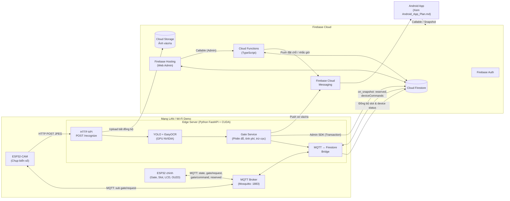
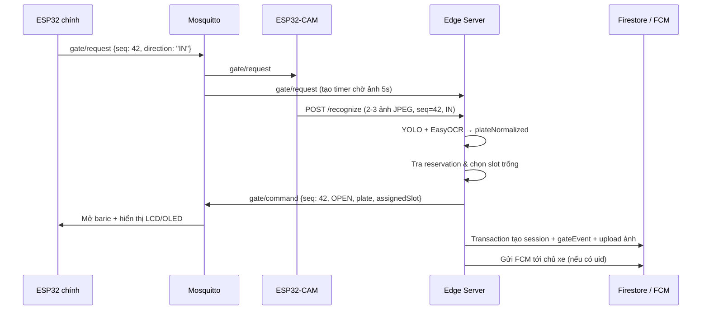
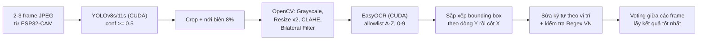
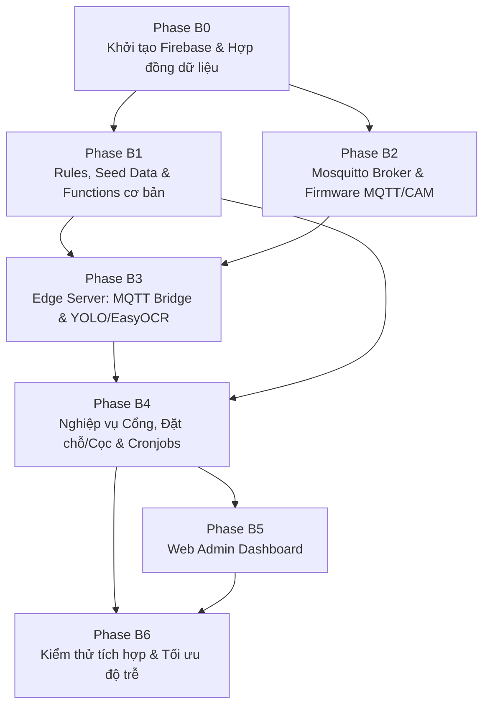

# KẾ HOẠCH PHÁT TRIỂN BACKEND & EDGE SERVER — SMART PARKING
**Dự án:** Sa hình Mô hình Bãi đỗ xe thông minh (Smart Parking Demo)  
**Phạm vi:** Firebase Backend (Auth, Firestore, Cloud Functions, Storage, FCM) + Edge Server (Python FastAPI, MQTT Bridge, YOLO + EasyOCR CUDA) + MQTT Broker & Mở rộng tích hợp Firmware + Web Admin Dashboard  
**Ngày tạo:** 2026-10-30  
**Tài liệu liên quan:**
- `Android_App_Plan.md` — Kế hoạch phát triển ứng dụng Android (Client)
- `Project_Overview.md`, `Project_Plan_Phases.md` — Thiết kế phần cứng & Firmware ESP32 gốc

---

> [!IMPORTANT]
> Tài liệu này đặc tả toàn bộ phần **Backend, Edge Server, giao thức MQTT và Web Admin**. Phần giao diện và kiến trúc ứng dụng di động đã được tách riêng sang `Android_App_Plan.md`. Hai phía giao tiếp với nhau thông qua **hợp đồng dữ liệu Firestore, Callable Functions và FCM** quy định tại mục 3 và mục 5.

---

## 0. CÁC QUYẾT ĐỊNH KỸ THUẬT ĐÃ CHỐT (PHÍA BACKEND)

| # | Hạng mục | Quyết định |
|:--:|:---|:---|
| 1 | Nền tảng Cloud | **Firebase**: Authentication (Email/Password), Cloud Firestore, Cloud Functions (TypeScript), Cloud Storage, Cloud Messaging (FCM), Hosting |
| 2 | Giao tiếp thiết bị IoT | **MQTT** qua **Eclipse Mosquitto** — kết nối với ESP32 chính và ESP32-CAM |
| 3 | Edge Server | **Python 3.11 + FastAPI** chạy trên laptop có **GPU NVIDIA (CUDA)** — đảm nhận 3 vai trò: nhận diện biển số, **MQTT ↔ Firestore Bridge**, và xử lý nghiệp vụ cổng vào/ra |
| 4 | Nhận diện biển số | Ảnh chụp từ **ESP32-CAM** → HTTP POST lên Edge Server → **YOLOv8s/YOLO11s** (detect biển) + **EasyOCR (`gpu=True`)** (đọc ký tự) |
| 5 | Công thức tính phí | Tính **hoàn toàn theo thời gian** theo block — mặc định **5.000đ / block 30 phút** (admin cấu hình được theo từng bãi) |
| 6 | Phí cọc đặt chỗ | Thu cọc khi đặt (mặc định **5.000đ**). Xe đến đúng hạn → **khấu trừ vào phí đỗ**; không đến hoặc huỷ sau 2 phút → **mất cọc**; huỷ trong 2 phút đầu → **hoàn 100%** |
| 7 | Ví & Thanh toán | **Ví nội bộ giả lập** (quản lý trên Firestore). Khi xe ra nếu thiếu tiền vẫn mở cổng và cho phép **số dư âm**; khi số dư âm thì chặn đặt chỗ mới |
| 8 | Dữ liệu bãi đỗ | **1 bãi live** (`ESP32_PARKING_01`, 4 slot A1/A2/B1/B2 đồng bộ thời gian thực) + **5–8 bãi giả lập** (seed data + job biến thiên chỗ trống) |
| 9 | Phản hồi xuống phần cứng | Backend đẩy danh sách slot `reserved` và lệnh `OPEN/DENY` kèm `assignedSlot` qua MQTT để LCD/OLED trên sa hình chỉ dẫn đúng chỗ |
| 10 | Quản trị hệ thống | **Web Admin Dashboard** (React + Vite) deploy trên Firebase Hosting |

> [!NOTE]
> **Lý do tách Backend thành 2 tầng (Firebase Cloud + Edge Server):**
> - Firebase không có MQTT Broker nội tại, và Cloud Functions chạy theo mô hình serverless ngắn hạn nên **không thể duy trì kết nối MQTT liên tục** với ESP32.
> - Server chạy YOLO + EasyOCR trên GPU NVIDIA vốn là tiến trình chạy thường trực tại mạng LAN demo → tích hợp luôn **MQTT Bridge** và **Gate Service** vào Edge Server giúp giảm độ trễ mở barie (nhận ảnh → OCR → bắn MQTT `OPEN` ngay lập tức, không tốn vòng lặp qua Cloud Functions) và loại bỏ nhu cầu dùng Firebase Realtime Database.

---

## 1. KIẾN TRÚC HỆ THỐNG BACKEND



### 1.1. Phân chia trách nhiệm giữa các dịch vụ Backend

| Thành phần | Trách nhiệm cốt lõi |
|:---|:---|
| **MQTT Broker (Mosquitto)** | Trung chuyển bản tin giữa ESP32, ESP32-CAM và Edge Server; phân quyền topic bằng ACL; phát hiện mất kết nối thiết bị qua Last Will & Testament (LWT). |
| **Edge Server (Python)** | 1) Nhận ảnh từ CAM, chạy YOLO + EasyOCR.<br/>2) Quyết định mở/từ chối cổng, chọn slot, tạo/đóng `sessions`, tính phí, khấu trừ cọc, trừ ví user.<br/>3) Đồng bộ trạng thái cảm biến slot lên Firestore và đẩy trạng thái `reserved` / lệnh điều khiển từ Firestore xuống MQTT.<br/>4) Gửi FCM thông báo xe vào/ra. |
| **Cloud Functions (TS)** | 1) Xử lý mọi yêu cầu từ App Android: thêm/xoá xe, nạp ví ảo, đặt chỗ (thu cọc), huỷ/gia hạn đặt chỗ, dời mốc nhắc giờ.<br/>2) Cronjobs (Scheduled): quét đặt chỗ hết hạn (tịch thu cọc, nhả slot), nhắc giờ đỗ lâu, giả lập biến động bãi demo.<br/>3) Nghiệp vụ Admin: sửa biển số sai, mở cổng từ xa, đóng phiên cưỡng bức, điều chỉnh ví, hoàn cọc. |
| **Firestore & Storage** | Cơ sở dữ liệu trung tâm (Single Source of Truth) cho tài khoản, xe, bãi đỗ, phiên đỗ, giao dịch ví và lưu trữ ảnh bằng chứng vào/ra. |

### 1.2. Nguyên tắc bất biến của Backend
1. **Bảo toàn tiền và trạng thái slot:** Mọi thao tác cộng/trừ `walletBalance`, tạo/huỷ `reservations` và đóng `sessions` bắt buộc chạy trong **Firestore Transaction**.
2. **Client không ghi trực tiếp dữ liệu nhạy cảm:** Security Rules chặn hoàn toàn quyền ghi từ client vào `walletBalance`, `sessions`, `reservations`, `transactions`, `gateEvents`, `devices`. Chỉ **Edge Server** và **Cloud Functions** (dùng Firebase Admin SDK) được phép ghi.
3. **Đồng bộ thời gian chuẩn:** Mọi mốc thời gian tính tiền (`entryTime`, `exitTime`, `expiresAt`) sử dụng giờ server (Firestore `serverTimestamp` hoặc đồng hồ Edge Server đã đồng bộ NTP), tuyệt đối không dùng `timestamp` từ ESP32.
4. **Idempotency theo `seq`:** Yêu cầu mở cổng từ ESP32 kèm mã tuần tự `seq`; nếu Edge Server nhận trùng `seq` đã xử lý thì trả lại quyết định cũ, không tạo hai phiên đỗ.

---

## 2. GIAO TIẾP IOT & ĐẶC TẢ MQTT

### 2.1. Cấu hình MQTT Broker
- **Phần mềm:** Eclipse Mosquitto 2.x (chạy qua Docker hoặc service trên cùng laptop với Edge Server, lắng nghe cổng `1883` trong mạng LAN).
- **Bảo mật:** Tắt `allow_anonymous false`. Tạo tài khoản riêng trong file `passwd` và phân quyền trong `acl`:
  - `esp32_gate_01`: publish `parking/ESP32_PARKING_01/state`, `.../gate/request`, `.../status`; subscribe `.../gate/command`, `.../reserved`.
  - `esp32_cam_01`: publish `parking/ESP32_CAM_01/status`; subscribe `parking/ESP32_PARKING_01/gate/request`.
  - `edge_server`: full quyền đọc/ghi trên cây `parking/#`.
- **Phương án mở rộng khác mạng:** Dùng HiveMQ Cloud / EMQX Cloud Serverless (TLS cổng `8883`, ESP32 dùng `WiFiClientSecure`).

### 2.2. Hợp đồng Topic & JSON Payload
Tiền tố cho bãi sa hình: `parking/ESP32_PARKING_01/...`

| Topic | Chiều | QoS | Retain | Cấu trúc Payload mẫu |
|:---|:---|:--:|:--:|:---|
| `.../state` | ESP32 → Server | 1 | ✅ | `{"device_id":"ESP32_PARKING_01","ts":1205,"gate":{"barrier_open":false,"last_action":"ENTER"},"slots":{"A1":true,"A2":false,"B1":false,"B2":false}}` *(gửi khi đổi trạng thái + mỗi 30s)* |
| `.../gate/request` | ESP32 → CAM, Server | 1 | ❌ | `{"seq":42,"direction":"IN"}` hoặc `"direction":"OUT"` |
| `.../gate/command` | Server → ESP32 | 1 | ❌ | Cho vào: `{"seq":42,"action":"OPEN","direction":"IN","plate":"51A12345","assignedSlot":"A2"}`<br/>Từ chối: `{"seq":42,"action":"DENY","reason":"FULL"}` |
| `.../reserved` | Server → ESP32 | 1 | ✅ | `{"A1":true,"A2":false,"B1":false,"B2":false}` |
| `.../status` | ESP32 → Server (LWT) | 1 | ✅ | `"online"` (khi connect) / `"offline"` (do Broker tự phát khi mất kết nối) |
| `parking/ESP32_CAM_01/status` | CAM → Server (LWT) | 1 | ✅ | `"online"` / `"offline"` |

### 2.3. Yêu cầu tích hợp phía Firmware (ESP32 & ESP32-CAM)
*(Dùng để nâng cấp code firmware hiện có tại gốc repo cho khớp với Backend)*
- **ESP32 chính:**
  - `NetworkClient`: chuyển từ HTTP POST sang `PubSubClient` (`setBufferSize(1024)`), cấu hình LWT, reconnect mỗi 5s bằng `millis()` (không dùng `delay()`).
  - `GateController`: thêm trạng thái `WAIT_AUTH` khi cảm biến cổng kích hoạt → phát `gate/request` → chờ `gate/command` khớp `seq`. Nếu quá **8 giây** không nhận được phản hồi (mất mạng/sập server), tự **fallback** về logic cục bộ (mở nếu còn slot trống) và đẩy sự kiện vào hàng đợi RAM để đồng bộ bù khi có mạng lại.
  - `ParkingMonitor` & `DisplayManager`: áp dụng mask `reserved` để trừ số chỗ trống công khai; khi nhận lệnh `OPEN`, LCD hiện `MOI VAO <plate>`, OLED vẽ mũi tên hướng tới khu của `assignedSlot` kèm nhãn tên ô (vd: `A2`).
- **ESP32-CAM (`firmware-cam/`):**
  - Subscribe `.../gate/request` → bật đèn flash LED (GPIO 4) → chụp liên tiếp 2–3 frame JPEG độ phân giải SVGA (800×600) → gửi `multipart/form-data` lên `POST http://<edge-ip>:8000/recognize`.

---

## 3. MÔ HÌNH DỮ LIỆU FIRESTORE & BẢO MẬT

### 3.1. Schema các Collection

#### `users/{uid}`
```json
{
  "email": "user@example.com",
  "displayName": "Nguyen Van A",
  "defaultVehicleId": "51A12345",
  "walletBalance": 45000,
  "fcmTokens": ["token_1"],
  "locale": "vi",
  "theme": "system",
  "defaultPlannedDurationMin": 120,
  "createdAt": "Timestamp"
}
```
- Subcollection `users/{uid}/paymentMethods/{methodId}`: `{ brand: "VISA", last4: "4242", holderName: "NGUYEN VAN A", isDefault: true, createdAt }` (thẻ giả lập).
- Subcollection `users/{uid}/notifications/{notifId}`: `{ type, title, body, refId, read: false, createdAt }`.

#### `vehicles/{plateNormalized}` *(Document ID chính là biển số đã chuẩn hóa để đảm bảo tính duy nhất toàn hệ thống)*
```json
{
  "ownerUid": "uid_123",
  "plateNormalized": "51A12345",
  "plateDisplay": "51A-123.45",
  "type": "car",
  "nickname": "Xe gia đình",
  "createdAt": "Timestamp"
}
```

#### `lots/{lotId}` & `lots/{lotId}/slots/{slotId}`
```json
// lots/lot_live_01
{
  "name": "Bãi xe Thông minh Khu A-B (Live)",
  "address": "Đường Hàn Thuyên, Thủ Đức, TP.HCM",
  "geo": { "lat": 10.8700, "lng": 106.8030, "geohash": "w3gv..." },
  "openingHours": "06:00 - 23:00",
  "pricing": {
    "blockMinutes": 30,
    "pricePerBlock": 5000,
    "graceMinutes": 0,
    "reservationDeposit": 5000,
    "freeCancelMinutes": 2,
    "holdDurationMinutes": 15,
    "maxExtendCount": 1
  },
  "vehicleTypes": ["car", "motorbike"],
  "covered": true,
  "evCharging": false,
  "photos": ["https://..."],
  "ratingAvg": 4.7,
  "ratingCount": 38,
  "totalSlots": 4,
  "availableSlots": 2,
  "isLive": true,
  "deviceId": "ESP32_PARKING_01"
}

// lots/lot_live_01/slots/A1
{
  "zone": "A",
  "sensorOccupied": false,
  "status": "reserved",
  "reservationId": "res_001",
  "sessionId": null,
  "updatedAt": "Timestamp"
}
```
*(Quy tắc suy diễn `status` của slot: nếu `sensorOccupied == true` → `"occupied"`; ngược lại nếu có `reservationId` đang active → `"reserved"`; ngược lại → `"available"`).*

#### `reservations/{reservationId}`
```json
{
  "uid": "uid_123",
  "lotId": "lot_live_01",
  "slotId": "A1",
  "plate": "51A12345",
  "status": "active",
  "createdAt": "Timestamp",
  "expiresAt": "Timestamp",
  "remindedExpiring": false,
  "extendCount": 0,
  "depositAmount": 5000,
  "depositStatus": "held"
}
```
- `status`: `"active"` | `"fulfilled"` | `"expired"` | `"cancelled"`.
- `depositStatus`: `"held"` | `"applied"` | `"refunded"` | `"forfeited"`.

#### `sessions/{sessionId}`
```json
{
  "uid": "uid_123",
  "plate": "51A12345",
  "lotId": "lot_live_01",
  "assignedSlotId": "A1",
  "actualSlotId": "A1",
  "reservationId": "res_001",
  "status": "completed",
  "entryTime": "Timestamp",
  "exitTime": "Timestamp",
  "plannedEndTime": "Timestamp",
  "remindedLongParking": false,
  "durationMin": 45,
  "fee": 10000,
  "depositApplied": 5000,
  "amountCharged": 5000,
  "entryImageUrl": "gs://...",
  "exitImageUrl": "gs://...",
  "flags": [],
  "transactionId": "txn_999"
}
```
- `flags` có thể chứa: `"unrecognized"`, `"guest"`, `"slot_mismatch"`, `"reserved_slot_substituted"`, `"manual_closed"`, `"plate_corrected"`.

#### `transactions/{transactionId}`
```json
{
  "uid": "uid_123",
  "type": "parking_fee",
  "amount": -5000,
  "balanceAfter": 40000,
  "sessionId": "ses_100",
  "reservationId": "res_001",
  "methodLabel": "Ví nội bộ",
  "invoiceNo": "INV-20261030-0042",
  "description": "Phí đỗ xe 51A-123.45 (45 phút: 10.000đ - cọc 5.000đ)",
  "createdAt": "Timestamp"
}
```
- `type`: `"topup"` | `"reservation_deposit"` | `"deposit_refund"` | `"parking_fee"` | `"adjustment"`.

#### Các Collection vận hành & quản trị
- `gateEvents/{eventId}`: `{ deviceId, seq, direction, plateRaw, plateNormalized, confidence, imageUrl, cropImageUrl, decision, status: "ok"|"unrecognized"|"unmatched"|"corrected", sessionId?, latencyMs, createdAt }`.
- `devices/{deviceId}`: `{ type: "gate"|"camera"|"edge", lotId, online, lastSeen, meta }`.
- `deviceCommands/{cmdId}`: `{ deviceId, action: "OPEN_GATE", payload, status: "pending"|"sent"|"failed", createdBy, createdAt }`.

### 3.2. Firestore Composite Indexes cần khai báo (`firestore.indexes.json`)
1. `sessions`: `uid` (ASC) + `status` (ASC) + `entryTime` (DESC) — lấy phiên đang đỗ & phân trang lịch sử theo tháng.
2. `sessions`: `plate` (ASC) + `status` (ASC) + `entryTime` (DESC) — Edge Server tìm phiên active khi xe ra.
3. `reservations`: `uid` (ASC) + `status` (ASC) — kiểm tra user có đang giữ chỗ khác không.
4. `reservations`: `plate` (ASC) + `lotId` (ASC) + `status` (ASC) — Edge Server khớp đặt chỗ khi xe vào cổng.
5. `reservations`: `status` (ASC) + `expiresAt` (ASC) — Cronjob quét đặt chỗ sắp hết hạn / quá hạn.
6. `sessions`: `status` (ASC) + `plannedEndTime` (ASC) — Cronjob nhắc đỗ xe quá lâu.
7. `transactions`: `uid` (ASC) + `createdAt` (DESC) — lịch sử biến động ví.

### 3.3. Quy tắc chuẩn hóa biển số (Dùng chung toàn hệ thống)
- Chuyển in hoa, loại bỏ khoảng trắng, dấu `-`, dấu `.`, dấu `/`: `51A-123.45` → `51A12345`; `59-X1 123.45` → `59X112345`.
- Regex biển số dân sự VN hợp lệ: `^[0-9]{2}[A-Z][A-Z0-9]?[0-9]{4,5}$`.

### 3.4. Đặc tả Security Rules (`firestore.rules` & `storage.rules`)
- Hàm helper: `isSignedIn()`, `isOwner(uid)`, `isAdmin()` (`request.auth.token.admin == true`).
- `users/{uid}`: chủ tài khoản được `read`; chỉ được `update` các trường cấu hình (`displayName`, `defaultVehicleId`, `fcmTokens`, `locale`, `theme`, `defaultPlannedDurationMin`), **cấm** sửa `walletBalance` (kiểm tra `!request.resource.data.diff(resource.data).affectedKeys().hasAny(['walletBalance'])`). Khi tạo mới user (`create`), ép `walletBalance == 0`.
- `users/{uid}/paymentMethods/{id}`: chủ tài khoản được đọc/ghi.
- `users/{uid}/notifications/{id}`: chủ tài khoản được đọc và chỉ được cập nhật trường `read`.
- `vehicles/{plate}`: user đã đăng nhập chỉ được đọc xe có `ownerUid == auth.uid` (admin đọc tất cả); mọi thao tác thêm/xoá đi qua Callable Function.
- `lots/{lotId}` và `slots/{slotId}`: user đã đăng nhập được `read`; chỉ `isAdmin()` được ghi cấu hình bãi.
- `reservations`, `sessions`, `transactions`: user chỉ được `read` document có `resource.data.uid == request.auth.uid`; `isAdmin()` đọc tất cả; `write: if false` (chỉ Admin SDK ghi).
- `gateEvents`, `devices`, `deviceCommands`: chỉ `isAdmin()` được `read`; `write: if false`.
- **Storage (`gate/{date}/{file}`):** admin đọc mọi ảnh; user chỉ đọc được ảnh gắn với session của mình (dùng Firebase Download URL sinh từ backend lưu vào `session.entryImageUrl` hoặc custom metadata `ownerUid`).

---

## 4. LUỒNG XỬ LÝ NGHIỆP VỤ CỐT LÕI

### 4.1. Nghiệp vụ Cổng Vào (Edge Server — `gate_service.py`)



**Thuật toán phân bổ Slot khi xe vào:**
1. Tra `reservations` có `plate == plateNormalized`, `lotId == liveLotId`, `status == "active"`, `expiresAt > now`:
   - Nếu có và slot đã đặt đang trống (`!sensorOccupied`): gán đúng `slotId` đó; chuyển reservation → `fulfilled`, `depositStatus = "applied"`.
   - Nếu có nhưng slot đã đặt lỡ bị xe khác đỗ đè (`sensorOccupied == true`): tìm slot trống không bị reserved khác để gán thay thế (gắn cờ `reserved_slot_substituted`). Nếu cả bãi đã hết sạch chỗ → trả `DENY`, tự động hoàn cọc (`depositStatus = "refunded"`, tạo transaction `deposit_refund`, gắn cờ `reserved_slot_taken`).
2. Nếu không có reservation: chọn slot đầu tiên có `sensorOccupied == false` **và** không có reservation `active` của người khác, theo thứ tự ưu tiên `A1 → A2 → B1 → B2`.
3. Nếu không tìm được slot nào → phát lệnh `DENY` (`reason: "FULL"`), ghi `gateEvent` nhưng không tạo `session`.

**Xử lý các trường hợp ngoại lệ tại cổng vào:**
- **OCR thất bại / confidence dưới ngưỡng / quá 5s không nhận được ảnh từ CAM:** Nếu bãi còn slot trống không bị reserved → vẫn phát `OPEN`, tạo `session` với `plate = "UNKNOWN_<seq>"`, cờ `["unrecognized"]` để không kẹt cổng vật lý; Admin sửa biển số sau trên Web.
- **Biển số hợp lệ nhưng chưa ai đăng ký trên App:** Tra `vehicles/{plate}` không có → tạo `session` với `uid = null`, cờ `["guest"]`, vẫn mở cổng bình thường.
- **Xác nhận vị trí đỗ thực tế:** Sau khi xe qua cổng, khi nhận bản tin `state` đầu tiên có một slot chuyển từ `false → true`, Edge Server gán `actualSlotId` cho session vừa vào (trong cửa sổ 60s). Nếu `actualSlotId != assignedSlotId`, thêm cờ `"slot_mismatch"`.

### 4.2. Nghiệp vụ Cổng Ra & Khấu trừ cọc
1. Nhận `gate/request {seq, direction: "OUT"}` + ảnh từ CAM → nhận diện `plateNormalized`.
2. Tìm `sessions` có `plate == plateNormalized` và `status == "active"` (lấy bản mới nhất):
   - **Không tìm thấy** (do lúc vào hoặc lúc ra đọc sai biển): vẫn phát `OPEN` để giải phóng xe, ghi `gateEvent` với `status = "unmatched"` cho Admin đối soát.
   - **Tìm thấy:** chạy **Firestore Transaction**:
     - `durationMin = max(1, ceil((exitTime - entryTime) / 60s))`.
     - Tính `fee` theo công thức mục 4.3.
     - Kiểm tra cọc: nếu session có `reservationId` với `depositStatus == "applied"`, đặt `depositApplied = reservation.depositAmount`, ngược lại `0`.
     - Số tiền thực thu lúc ra: `amountCharged = max(0, fee - depositApplied)` *(nếu `fee < depositApplied`, không hoàn phần thừa — cọc đóng vai trò phí tối thiểu)*.
     - Nếu `session.uid != null`: trừ `users/{uid}.walletBalance -= amountCharged` (cho phép âm), sinh bản ghi `transactions` kiểu `parking_fee` kèm mã hóa đơn `INV-YYYYMMDD-XXXX`.
     - Cập nhật `session.status = "completed"`.
3. Phát MQTT `gate/command {seq, action: "OPEN", direction: "OUT", plate}`.
4. Upload ảnh lúc ra lên Storage và bắn FCM báo chi tiết phí đỗ, tiền cọc đã khấu trừ và số dư ví còn lại.

### 4.3. Công thức tính phí chuẩn

Nếu `graceMinutes > 0` và `durationMin <= graceMinutes` thì `fee = 0`. Ngược lại:

$$
fee = \max\left(1, \left\lceil \frac{durationMin - graceMinutes}{blockMinutes} \right\rceil\right) \times pricePerBlock
$$

- Mặc định bãi live: `blockMinutes = 30`, `pricePerBlock = 5000`, `graceMinutes = 0`. (Ví dụ: đỗ 1–30 phút = 5.000đ; 31–60 phút = 10.000đ).
- Lưu bộ test vector tại `shared/fee_test_cases.json` để chạy Unit Test đồng nhất giữa Python (`edge-server`), TypeScript (`functions`) và Kotlin (`android-app`).

### 4.4. Nghiệp vụ Đặt chỗ & Chính sách Phí cọc (Cloud Functions)

| Sự kiện | Điều kiện kiểm tra | Biến động Ví & Trạng thái | Đồng bộ MQTT |
|:---|:---|:---|:---|
| `createReservation` | Bãi `isLive`, user chưa có reservation/session active cho xe đó, `walletBalance >= deposit`, slot đang `available` | Ví `−5.000đ` (`reservation_deposit`); tạo reservation (`status=active`, `depositStatus=held`, `expiresAt = now + 15p`); slot → `reserved` | Listener ở Edge Server thấy slot đổi → publish retained `reserved` |
| `extendReservation` | `status == active`, `extendCount < maxExtendCount (1)` | Miễn phí; `expiresAt += 15p`, `extendCount += 1` | Không đổi |
| `cancelReservation` (≤ 2 phút đầu) | `now - createdAt <= freeCancelMinutes (2p)` | Ví `+5.000đ` (`deposit_refund`); `status=cancelled`, `depositStatus=refunded`; slot → `available` | Edge Server publish lại `reserved` |
| `cancelReservation` (> 2 phút) | `now - createdAt > 2p` | Không hoàn tiền; `status=cancelled`, `depositStatus=forfeited`; slot → `available` | Edge Server publish lại `reserved` |
| Quá hạn 15 phút (`reservationScheduler`) | `status == active` và `now >= expiresAt` | Không hoàn tiền; `status=expired`, `depositStatus=forfeited`; slot → `available`; gửi FCM báo hết hạn & mất cọc | Edge Server publish lại `reserved` |

---

## 5. ĐẶC TẢ CLOUD FUNCTIONS (TYPESCRIPT)

### 5.1. Cấu trúc thư mục `functions/`
```
functions/
├── src/
│   ├── index.ts                 # Export toàn bộ callable & scheduled functions
│   ├── config.ts                # Region (asia-southeast1), hằng số mặc định
│   ├── domain/
│   │   ├── feeCalculator.ts     # Tính phí (test với shared/fee_test_cases.json)
│   │   └── plateUtils.ts        # Chuẩn hóa & regex biển số
│   ├── callable/
│   │   ├── vehicle.ts           # addVehicle, removeVehicle
│   │   ├── wallet.ts            # topUpWallet
│   │   ├── reservation.ts       # createReservation, cancelReservation, extendReservation
│   │   ├── session.ts           # extendPlannedDuration
│   │   └── admin.ts             # adminCorrectPlate, adminOpenGate, adminCloseSession,
│   │                            # adminAdjustBalance, adminRefundDeposit
│   └── scheduled/
│       ├── reservationCron.ts   # reservationScheduler (mỗi 1 phút)
│       ├── reminderCron.ts      # longParkingReminder (mỗi 5 phút)
│       └── mockLotsCron.ts      # simulateMockLots (mỗi 5 phút)
├── test/
└── package.json
```

### 5.2. Hợp đồng API (Callable Functions)

| Tên Function | Tham số đầu vào (`request.data`) | Kết quả trả về | Mã lỗi chính (`HttpsError`) |
|:---|:---|:---|:---|
| `addVehicle` | `{ plateDisplay, type: "car"\|"motorbike", nickname, setDefault?: boolean }` | `{ plateNormalized, plateDisplay }` | `invalid-argument` (sai định dạng biển), `already-exists` (biển đã thuộc người khác) |
| `removeVehicle` | `{ plateNormalized }` | `{ success: true }` | `failed-precondition` (xe đang trong phiên đỗ hoặc đang giữ chỗ) |
| `topUpWallet` | `{ amount: number, methodId?: string }` *(10.000 ≤ amount ≤ 5.000.000)* | `{ transactionId, balanceAfter }` | `invalid-argument` |
| `createReservation` | `{ lotId, slotId?: string, plateNormalized }` *(nếu bỏ trống `slotId` → server tự chọn A1→B2)* | `{ reservationId, slotId, expiresAtMs, depositAmount, balanceAfter }` | `failed-precondition` (ví không đủ cọc, ví đang âm, hoặc đã có đặt chỗ khác), `resource-exhausted` (hết slot) |
| `cancelReservation` | `{ reservationId }` | `{ refunded: boolean, refundAmount, balanceAfter }` | `not-found`, `failed-precondition` |
| `extendReservation` | `{ reservationId }` | `{ expiresAtMs, extendCount }` | `failed-precondition` (đã hết lượt gia hạn hoặc đã quá hạn) |
| `extendPlannedDuration` | `{ sessionId, addMinutes: 30 \| 60 }` | `{ plannedEndTimeMs }` | `not-found`, `permission-denied` |
| `adminCorrectPlate` | `{ gateEventId, newPlateDisplay }` | `{ sessionId, linkedUid }` | `permission-denied`, `invalid-argument` |
| `adminOpenGate` | `{ deviceId, direction?: "IN"\|"OUT" }` | `{ commandId }` | `permission-denied` |
| `adminCloseSession` | `{ sessionId, exitTimeMs?: number, waiveFee?: boolean }` | `{ fee, amountCharged }` | `permission-denied`, `not-found` |
| `adminAdjustBalance` | `{ targetUid, deltaAmount, reason }` | `{ balanceAfter, transactionId }` | `permission-denied` |
| `adminRefundDeposit` | `{ reservationId, reason }` | `{ balanceAfter, transactionId }` | `permission-denied`, `failed-precondition` (cọc đã hoàn/đã khấu trừ) |

> [!WARNING]
> Triển khai Cloud Functions ở region `asia-southeast1` (Singapore) cùng region với Firestore để giảm độ trễ. Project Firebase cần nâng lên **gói Blaze** khi deploy thật (thiết lập Budget Alert ở mức 1–2 USD); toàn bộ quá trình phát triển dùng **Firebase Emulator Suite** hoàn toàn miễn phí.

### 5.3. Chuẩn Payload FCM gửi xuống App Android
Mọi push notification gửi kèm trường `data` thống nhất để App định tuyến deep link và hiển thị nút bấm nhanh:
```json
{
  "type": "VEHICLE_ENTERED | VEHICLE_EXITED | RESERVATION_EXPIRING | RESERVATION_EXPIRED | LONG_PARKING | WALLET_LOW",
  "refId": "<sessionId hoặc reservationId>",
  "lotId": "lot_live_01",
  "slotId": "A2",
  "plate": "51A-123.45",
  "amount": "5000"
}
```

---

## 6. EDGE SERVER (PYTHON FASTAPI + MQTT + YOLO + EASYOCR)

### 6.1. Tech Stack & Môi trường chạy
- **Runtime:** Python 3.11, PyTorch bản hỗ trợ **CUDA** (khớp driver GPU NVIDIA trên laptop).
- **Web & Async:** FastAPI + Uvicorn.
- **MQTT:** `paho-mqtt` 2.x (chạy `client.loop_start()` trên background thread, đẩy sự kiện sang async queue hoặc xử lý thread-safe).
- **Thị giác máy tính:**
  - `ultralytics` — model **YOLOv8s** hoặc **YOLO11s** fine-tune riêng 1 class `license_plate` trên CUDA.
  - `easyocr` — `easyocr.Reader(['en'], gpu=True)` với `allowlist='0123456789ABCDEFGHIJKLMNOPQRSTUVWXYZ'`.
  - `opencv-python-headless` — tiền xử lý ảnh vùng biển số.
- **Cloud SDK:** `firebase-admin` (kết nối bằng file `serviceAccountKey.json` đặt ngoài git, truyền đường dẫn qua biến môi trường `GOOGLE_APPLICATION_CREDENTIALS`).

### 6.2. Cấu trúc thư mục `edge-server/`
```
edge-server/
├── app/
│   ├── main.py                # Khởi tạo FastAPI; lifespan: warm-up GPU, start MQTT & Firestore listeners
│   ├── config.py              # Pydantic Settings đọc từ .env (MQTT, API_KEY, LOT_ID, THRESHOLDS)
│   ├── state_cache.py         # Bộ nhớ đệm trạng thái 4 slot, reserved map, pending gate requests
│   ├── api/
│   │   ├── recognize.py       # POST /recognize (nhận multipart từ ESP32-CAM)
│   │   └── health.py          # GET /health (trạng thái GPU, MQTT, Firebase)
│   ├── recognition/
│   │   ├── detector.py        # YOLO inference trên CUDA + crop có padding
│   │   ├── ocr.py             # Tiền xử lý OpenCV + EasyOCR + ghép biển 1/2 dòng
│   │   └── plate_utils.py     # Hậu xử lý sửa ký tự dễ nhầm theo vị trí + regex
│   ├── mqtt/
│   │   └── bridge.py          # Kết nối Mosquitto, parse state/request/status, publish command/reserved
│   ├── listeners/
│   │   └── firestore_sync.py  # on_snapshot theo dõi slots (reserved) & deviceCommands
│   └── services/
│       ├── gate_service.py    # Điều phối luồng vào/ra, timeout 5s, khớp actualSlotId
│       ├── fee_calculator.py  # Công thức tính phí (test với shared/fee_test_cases.json)
│       ├── storage_uploader.py# ThreadPool upload ảnh gốc & ảnh crop lên Firebase Storage
│       └── fcm_notifier.py    # Gửi FCM & ghi subcollection notifications
├── models/
│   └── plate_yolo_s.pt        # Trọng số YOLO đã fine-tune
├── mosquitto/
│   ├── mosquitto.conf
│   ├── passwd
│   └── acl
├── scripts/
│   ├── capture_dataset.py     # Script thu ảnh từ ESP32-CAM để gán nhãn train
│   └── benchmark_ocr.py       # Đo accuracy & latency trên tập test
├── tests/
├── docker-compose.yml         # Chạy Mosquitto (+ Edge Server vớigpus: all nếu dùng Docker)
├── .env.example
└── requirements.txt
```

### 6.3. Chi tiết Pipeline Nhận diện Biển số & Tối ưu Độ trễ



- **Quy tắc sửa ký tự dễ nhầm theo cấu trúc biển số VN:**
  - Vị trí 1–2 (mã tỉnh — bắt buộc là chữ số): `O/D/Q → 0`, `I/L → 1`, `Z → 2`, `S → 5`, `B → 8`, `G → 6`.
  - Vị trí 3 (seri chữ cái): `0 → D`, `8 → B`, `5 → S`, `1 → T` (hoặc giữ nguyên nếu không khớp).
  - Cụm 4–5 ký tự cuối (bắt buộc là chữ số): áp dụng bảng ánh xạ chữ → số như vị trí 1–2.
- **Tối ưu tốc độ mở cổng (< 0.5s xử lý AI, < 2.5s tổng từ lúc che cảm biến):**
  1. **CUDA Warm-up:** Ngay trong `lifespan` lúc khởi động server, chạy thử YOLO + EasyOCR trên một mảng ảnh trắng `640x640` để nạp sẵn kernel CUDA vào VRAM, tránh bị khựng 3–5 giây ở lượt xe đầu tiên.
  2. **Mở cổng trước, lưu trữ sau:** Ngay khi chọn được slot (hoặc tính xong phí), publish bản tin MQTT `gate/command` ngay lập tức, sau đó mới đẩy tác vụ upload ảnh lên Cloud Storage vào background task.
- **Đặc tả HTTP Endpoint cho ESP32-CAM:**
  - `POST /recognize`
  - Header: `X-API-Key: <CAM_SHARED_SECRET>`
  - Form-data: `device_id` (`ESP32_PARKING_01`), `seq` (`int`), `direction` (`IN` | `OUT`), `images` (1–3 file JPEG).
  - Response `200 OK`: `{"seq": 42, "plate": "51A12345", "confidence": 0.91, "decision": "OPEN", "assignedSlot": "A2", "latencyMs": 310}`.

---

## 7. WEB ADMIN DASHBOARD (`admin-web/`)

- **Công nghệ:** React 18 + Vite + TypeScript + TailwindCSS + Firebase Web SDK v10; deploy lên **Firebase Hosting**.
- **Xác thực:** Đăng nhập bằng Firebase Auth, kiểm tra `idTokenResult.claims.admin === true` (tài khoản thường bị từ chối ngay tại màn login).

| Phân hệ | Tính năng chi tiết |
|:---|:---|
| **1. Giám sát Realtime** | Sơ đồ 4 ô (A1, A2, B1, B2) đổi màu trực tiếp theo Firestore; đèn báo Online/Offline của `ESP32_PARKING_01`, `ESP32_CAM_01` và `Edge Server`; thẻ KPI xe đang đỗ & doanh thu trong ngày. |
| **2. Sự kiện cổng & Đối soát OCR** | Bảng realtime `gateEvents` hiển thị ảnh chụp gốc, ảnh cắt biển số, chuỗi OCR, độ tự tin, thời gian xử lý (`latencyMs`). Nút **"Sửa biển số"** cho các dòng `unrecognized` / `unmatched` (gọi `adminCorrectPlate`). |
| **3. Quản lý Phiên đỗ** | Lọc phiên `active` / `completed`, tìm theo biển số; nút **"Đóng phiên thủ công"** (`adminCloseSession`) khi xe ra lúc mất điện/mạng. |
| **4. Quản lý Đặt chỗ & Cọc** | Theo dõi các lượt giữ chỗ, trạng thái cọc (`held`, `applied`, `refunded`, `forfeited`); nút huỷ hoặc **hoàn cọc thủ công** (`adminRefundDeposit`). |
| **5. Cấu hình Bãi & Giá** | Chỉnh sửa thông tin bãi live và các bãi demo; cập nhật `blockMinutes`, `pricePerBlock`, `graceMinutes`, `reservationDeposit` áp dụng ngay cho lượt xe tiếp theo. |
| **6. Người dùng & Ví** | Tra cứu user, danh sách xe đăng ký, lịch sử giao dịch; nút điều chỉnh số dư (`adminAdjustBalance`). |
| **7. Điều khiển Thiết bị** | Nút **"Mở Barie khẩn cấp"** gọi `adminOpenGate` → ghi `deviceCommands` → Edge Server bắn MQTT mở cổng. |
| **8. Báo cáo Thống kê** | Biểu đồ doanh thu theo ngày/tháng (tách rõ doanh thu phí đỗ và doanh thu cọc `forfeited`), tổng lượt xe, tỷ lệ nhận diện biển số thành công (% `status == ok`). |

---

## 8. LỘ TRÌNH TRIỂN KHAI BACKEND THEO GIAI ĐOẠN



> **Điểm mốc phối hợp với nhóm làm App Android:** Ngay khi hoàn thành **Phase B1** (có Emulator, Security Rules, Seed Data và các Callable Xe/Ví), phía App Android đã có thể phát triển và test độc lập từ Phase A1 đến Phase A3; khi xong phần Functions Đặt chỗ ở **Phase B4**, App có thể ráp toàn bộ luồng còn lại mà không cần chờ phần cứng vật lý.

---

### PHASE B0 — KHỞI TẠO FIREBASE & HỢP ĐỒNG DỮ LIỆU
- [ ] Tạo Firebase Project, bật Auth (Email/Password), Firestore (`asia-southeast1`), Storage, FCM, Hosting.
- [ ] Sinh `serviceAccountKey.json` cho Edge Server (thêm vào `.gitignore`).
- [ ] Khởi tạo cấu trúc thư mục Backend trong repo: `functions/`, `edge-server/`, `admin-web/`, `firmware-cam/`, `shared/`.
- [ ] Viết `shared/fee_test_cases.json` và `shared/plate_test_cases.json` làm chuẩn kiểm thử chung với App Android.

**Đầu ra:** Cấu hình Firebase Emulator Suite chạy ổn định trên máy local (`firebase emulators:start`).

### PHASE B1 — SECURITY RULES, SEED DATA & CLOUD FUNCTIONS CƠ BẢN
- [ ] Viết `firestore.rules`, `firestore.indexes.json`, `storage.rules` + bộ unit test kiểm tra phân quyền (đảm bảo user không tự sửa được `walletBalance`).
- [ ] Triển khai `feeCalculator.ts`, `plateUtils.ts` + pass toàn bộ test vector trong `shared/`.
- [ ] Triển khai Callable: `addVehicle`, `removeVehicle`, `topUpWallet`.
- [ ] Viết script `seed.ts`: tạo 1 bãi live (`lot_live_01` với 4 slot `A1..B2`), 6 bãi giả lập có tọa độ thực tế, 1 tài khoản Admin (gắn custom claim `admin: true`) và tài khoản user mẫu.
- [ ] Triển khai `simulateMockLots`.

**Đầu ra:** Dữ liệu mẫu lên đủ trên Emulator/Firestore, các API Xe & Ví gọi thành công và chặn đúng các trường hợp gian lận quyền.

### PHASE B2 — HẠ TẦNG MQTT & MỞ RỘNG FIRMWARE (ESP32 + ESP32-CAM)
- [ ] Dựng Mosquitto Broker (`mosquitto.conf`, `passwd`, `acl`), kiểm thử phân quyền bằng `mosquitto_pub/sub`.
- [ ] Nâng cấp Firmware ESP32 chính sang MQTT non-blocking, thêm trạng thái `WAIT_AUTH` + fallback 8s, mask `reserved`, hiển thị biển số & ô đỗ được gán trên LCD/OLED.
- [ ] Viết Firmware cho `ESP32-CAM`: nhận MQTT `gate/request`, nháy flash, chụp 2–3 ảnh SVGA, gửi HTTP POST multipart.

**Đầu ra:** Gửi lệnh giả lập qua `mosquitto_pub` điều khiển được barie, LCD, OLED; che cảm biến cổng kích hoạt được ESP32-CAM chụp và gửi ảnh về máy tính.

### PHASE B3 — EDGE SERVER: MQTT BRIDGE & NHẬN DIỆN BIỂN SỐ (CUDA)
- [ ] Xây dựng khung FastAPI + `lifespan` kết nối Mosquitto và `firebase-admin`.
- [ ] Hoàn thiện `mqtt/bridge.py` và `listeners/firestore_sync.py`: đồng bộ 2 chiều trạng thái 4 cảm biến slot, LWT `devices/{id}.online`, danh sách `reserved` và `deviceCommands`.
- [ ] Dùng `scripts/capture_dataset.py` chụp 200–300 ảnh biển số xe mô hình qua ESP32-CAM, gán nhãn và fine-tune YOLOv8s/YOLO11s trên GPU NVIDIA.
- [ ] Hoàn thiện pipeline `detector.py` + `ocr.py` (EasyOCR CUDA) + `plate_utils.py` + warm-up khi boot + endpoint `POST /recognize`.

**Đầu ra:** Độ chính xác nhận diện biển số trên sa hình đạt **≥ 90%**, thời gian xử lý AI **< 0.5s/lượt**; che cảm biến slot trên sa hình thấy trạng thái đổi ngay trên Firestore trong < 1s.

### PHASE B4 — NGHIỆP VỤ CỔNG, ĐẶT CHỖ / PHÍ CỌC & CRONJOBS
- [ ] Triển khai `gate_service.py` trên Edge Server: luồng xe vào/ra đầy đủ (mục 4.1 & 4.2), chọn slot, khấu trừ cọc, trừ ví âm, timeout chờ ảnh 5s, khớp `actualSlotId`, upload Storage bất đồng bộ, gửi FCM.
- [ ] Triển khai Cloud Functions đặt chỗ: `createReservation` (thu cọc 5.000đ), `cancelReservation` (logic hoàn/mất cọc mốc 2 phút), `extendReservation`.
- [ ] Triển khai `reservationScheduler` (nhắc trước 5p, hết hạn → `forfeited` + nhả slot) và `longParkingReminder` + `extendPlannedDuration`.

**Đầu ra:** Toàn bộ vòng đời Đặt chỗ (thu cọc) → Xe vào (OLED chỉ đúng slot) → Xe ra (trừ phí sau khi khấu trừ cọc) → Gửi FCM hoạt động trơn tru.

### PHASE B5 — WEB ADMIN DASHBOARD
- [ ] Khởi tạo `admin-web/` (React + Vite), tích hợp đăng nhập Admin claim.
- [ ] Xây dựng 8 phân hệ theo mục 7 và các Callable Admin (`adminCorrectPlate`, `adminOpenGate`, `adminCloseSession`, `adminAdjustBalance`, `adminRefundDeposit`).
- [ ] Deploy lên Firebase Hosting.

**Đầu ra:** Admin giám sát được sa hình realtime, sửa được biển số nhận diện lỗi (tự động gắn lại phiên đỗ về đúng user) và mở được barie từ trình duyệt.

### PHASE B6 — KIỂM THỬ TÍCH HỢP HỆ THỐNG & TỐI ƯU
- [ ] Chạy toàn bộ bảng Test Case mục 9.
- [ ] Kiểm thử chịu lỗi: rút nguồn CAM, tắt Wi-Fi ESP32, tắt Edge Server, gửi 2 request liên tiếp.
- [ ] Viết script khởi động nhanh toàn bộ cụm local (`Mosquitto` + `Edge Server`) bằng 1 lệnh cho buổi demo.

---

## 9. BỘ TEST CASE KIỂM THỬ BACKEND & THIẾT BỊ

| Mã TC | Hạng mục | Kịch bản kiểm thử | Kết quả mong đợi |
|:---:|:---|:---|:---|
| **BE-01** | Security Rules | Client cố tình gửi request sửa `users/{uid}.walletBalance` lên 1.000.000đ | Firestore từ chối (`PERMISSION_DENIED`) |
| **BE-02** | Xe duy nhất | Hai tài khoản khác nhau gọi `addVehicle` cùng biển `51A-123.45` và `51a12345` | Người thứ 2 nhận lỗi `already-exists` |
| **BE-03** | Đặt chỗ & Cọc | User có 10.000đ đặt slot A1 → huỷ trong 90 giây vs huỷ sau 3 phút | ≤ 2p: ví hoàn về 10.000đ (`deposit_refund`); > 2p: ví còn 5.000đ (`forfeited`); MQTT `reserved` cập nhật về `false` ở cả 2 TH |
| **BE-04** | Quá hạn giữ chỗ | Đặt chỗ xong không đưa xe vào sau 15 phút | Cronjob chuyển `expired`, `depositStatus = forfeited`, nhả slot A1 trên Firestore & LCD/OLED, gửi FCM |
| **BE-05** | Khấu trừ cọc | Đặt chỗ (cọc 5.000đ) → xe vào → xe ra sau 45 phút (2 block = 10.000đ) | `fee = 10000`, `depositApplied = 5000`, ví chỉ bị trừ thêm `5000`, hóa đơn ghi rõ cọc |
| **BE-06** | Ví âm & Khoá đặt | Ví còn 2.000đ, xe không đặt trước đỗ 45 phút (phí 10.000đ) rồi ra; sau đó gọi `createReservation` | Lúc ra cổng vẫn `OPEN`, ví = `-8000`; gọi `createReservation` bị chặn `failed-precondition` |
| **BE-07** | Giữ slot đã đặt | Bãi còn trống duy nhất A1 đang `reserved` cho xe X; xe Y đi tới cổng | Server trả `DENY`, barie không mở, LCD báo đầy; ngay sau đó xe X tới thì trả `OPEN` chỉ vào A1 |
| **BE-08** | OCR lỗi / Tắt CAM | Rút nguồn ESP32-CAM rồi cho xe qua cảm biến cổng vào (bãi còn chỗ) | Sau 5s timeout, Edge Server vẫn gửi `OPEN`, tạo session cờ `unrecognized`; Admin thấy trạng thái CAM `offline` |
| **BE-09** | Đối soát biển số | Admin gọi `adminCorrectPlate` sửa sự kiện ở BE-08 thành `51A-123.45` của User A | Session tự động cập nhật `plate` và gắn `uid` của User A; App User A hiện ngay phiên đỗ |
| **BE-10** | Sập Edge Server | Tắt Edge Server khi xe tới cổng; bật lại sau 30 giây | Sau 8s ESP32 tự fallback mở cổng cục bộ; khi server sống lại, nhận trạng thái slot mới nhất và hàng đợi sự kiện bù |
| **BE-11** | Reset ESP32 | Đang có A1 `reserved`, nhấn nút Reset trên ESP32 | Vừa kết nối lại Mosquitto, ESP32 nhận ngay bản tin retained `reserved` và hiển thị trừ chỗ chính xác |
| **BE-12** | Hiệu năng GPU | Gửi 20 lượt nhận diện liên tiếp lên `POST /recognize` | Độ trễ trung bình < 500ms, không rò rỉ VRAM, không tạo trùng session khi retry cùng `seq` |

---

## 10. RỦI RO KỸ THUẬT BACKEND & GIẢI PHÁP

| Rủi ro | Tác động | Biện pháp giảm thiểu |
|:---|:---|:---|
| Biển số in giấy nhỏ trên mô hình bị lóa đèn flash hoặc nhòe khi xe chạy | EasyOCR đọc sai ký tự | Đặt góc nghiêng ESP32-CAM ~15–20° tránh phản xạ thẳng từ flash; chụp 2–3 frame để voting; hậu xử lý sửa ký tự theo vị trí; có công cụ sửa nhanh trên Web Admin. |
| Lượt nhận diện đầu tiên bị trễ 3–5s do khởi tạo context CUDA | Xe chờ lâu trước barie | Thực hiện **GPU Warm-up** trong hàm `lifespan` của FastAPI trước khi mở cổng nhận traffic. |
| Xung đột đồng thời khi 2 user cùng bấm đặt 1 slot cuối cùng | Ghi đè đặt chỗ | Kiểm tra và ghi trạng thái `lots/{id}/slots/{slotId}` bên trong cùng 1 **Firestore Transaction** của `createReservation`. |
| Laptop chạy Edge Server đổi IP khi kết nối lại Wi-Fi | ESP32 và ESP32-CAM mất kết nối tới Broker & API | Gán **Static IP / DHCP Reservation** trên router hoặc phát Wi-Fi Hotspot cố định từ chính laptop demo; cấu hình mDNS (`edge-parking.local`) làm dự phòng. |
| Vòng lặp vô hạn giữa Firestore Listener và MQTT | Tốn quota đọc/ghi Firestore | Phân tách rõ chiều dữ liệu: cảm biến vật lý chỉ cập nhật trường `sensorOccupied` (từ MQTT → Firestore), còn listener chiều ngược lại chỉ lắng nghe thay đổi của trường `reservationId` / `status == reserved`. |

