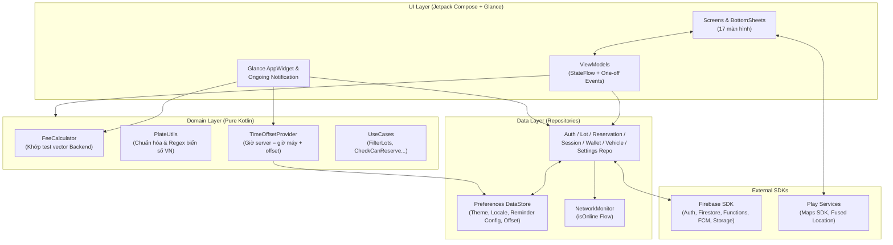
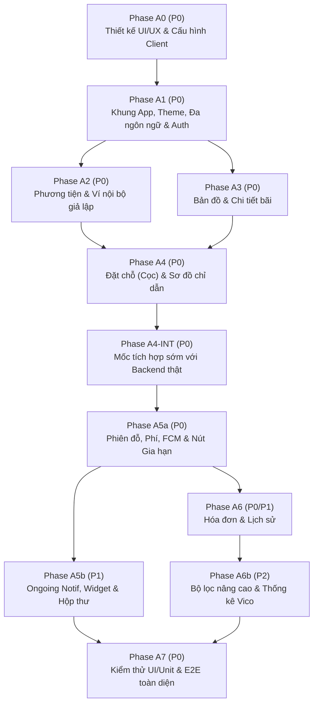

# KẾ HOẠCH PHÁT TRIỂN ỨNG DỤNG ANDROID — SMART PARKING (v1.1)
**Dự án:** Sa hình Mô hình Bãi đỗ xe thông minh (Smart Parking Demo)  
**Phạm vi:** Ứng dụng di động Android dành cho người dùng cuối (Kotlin + Jetpack Compose)  
**Ngày tạo:** 2026-10-30 — **Cập nhật:** 2026-10-31 (v1.1: vá các lỗ hổng sau đánh giá; thêm mục 1.4, mục 8 và mốc tích hợp sớm)  
**Tài liệu liên quan:**
- `Backend_Plan.md` — Kiến trúc Firebase, Edge Server (MQTT + YOLO/EasyOCR), Security Rules & Web Admin
- `Note proj.md` — Ghi chú yêu cầu tính năng ban đầu

---

> [!IMPORTANT]
> Tài liệu này **chỉ đặc tả phần Ứng dụng Android (Client)**. Toàn bộ thiết kế Cloud Functions, Edge Server nhận diện biển số, giao thức MQTT với ESP32 và Web Admin nằm trong `Backend_Plan.md`. App Android **không kết nối MQTT hay gọi trực tiếp vào Edge Server** mà chỉ làm việc với hệ sinh thái Firebase thông qua hợp đồng dữ liệu tại mục 1.2. Các yêu cầu **bổ sung cho Backend** phát sinh từ v1.1 được gom ở **mục 8**.

---

## 0.1. NHẬT KÝ THAY ĐỔI v1.0 → v1.1

| # | Vấn đề phát hiện khi đánh giá | Cách xử lý trong v1.1 | Mục |
|:--:|:---|:---|:--:|
| 1 | Ongoing Notification có thể bị kẹt khi app bị kill; Android 14+ cho phép vuốt tắt; `setWhen` dùng đồng hồ máy | Thêm FCM data-only `VEHICLE_EXITED`, cơ chế đối soát, xử lý vuốt tắt, tính `setWhen` theo offset kèm `serverTs` trong mọi bản tin | 1.2.C, 4.2 |
| 2 | Không rõ ai kích hoạt nhắc 5 phút / 10 phút | **Backend lên lịch**, gửi FCM data-only; app không đặt báo thức chính xác | 0 (#14), 1.2.C |
| 3 | `theme`/`locale` có hai nguồn sự thật | **DataStore là nguồn duy nhất**; `users/{uid}.locale` chỉ là bản sao một chiều cho backend; bỏ `theme` khỏi Firestore | 0 (#13), 1.2.A |
| 4 | Bảo mật nằm ở UI; chưa xoá FCM token khi đăng xuất | Server ép khoá ví âm; whitelist field của `users/{uid}`; quy trình đăng xuất xoá token | 1.4 |
| 5 | Công thức phí mơ hồ với `graceMinutes`; chưa xử lý `fee < deposit` | Công thức mới tường minh, hoàn cọc dư, cập nhật test vector | 0 (#5), 1.3 |
| 6 | Race ở mốc huỷ 2 phút | Hộp thoại chỉ là **dự báo**, kết quả thật do callable trả về, có vùng đệm sát mốc | 0 (#4), 1.3 |
| 7 | Thiếu VerifyEmail, đổi mật khẩu, Settings, seed data; khoảng trống 0 ≤ số dư < cọc; chưa chốt chính sách email | Gán vào Phase A1/A5b, chốt chính sách, thêm hợp đồng `lots`, thống nhất quy tắc khoá ví | 0, 1.2.D, 1.3 |
| 8 | A5 quá tải; E2E chỉ ở A7 | Tách A5a/A5b, thêm **mốc tích hợp sớm A4-INT**, gắn nhãn ưu tiên MVP (P0/P1/P2) | 5 |
| 9 | Edge-to-edge, per-app language, ảnh Storage, fallback Maps, offline ghi | Bổ sung vào tech stack và Phase A1 | 2, 5 |
| 10 | Bộ test thiếu kịch bản, chưa phân loại | Thêm APP-13 → APP-24, thêm cột **Loại test** | 6 |

---

## 0. CÁC QUYẾT ĐỊNH ĐÃ CHỐT (PHÍA APP ANDROID)

> Mục đánh dấu **(đề xuất)** là quyết định mới của v1.1, cần bạn xác nhận hoặc điều chỉnh.

| # | Hạng mục | Quyết định |
|:--:|:---|:---|
| 1 | Xác thực người dùng | **Chỉ Email/Mật khẩu** qua Firebase Auth (đăng ký, xác minh email, quên mật khẩu, đổi mật khẩu). Chính sách email chưa xác minh xem #12 |
| 2 | Quản lý phương tiện | Thêm nhiều xe (ô tô / xe máy), chuẩn hóa biển số khớp với OCR ở backend, đặt **xe mặc định** |
| 3 | Bản đồ & Phạm vi bãi | Hiển thị **1 bãi live** (4 slot realtime từ sa hình) + **5–8 bãi giả lập** (seed data do **Backend tạo**, xem 1.2.D) để đầy đủ trải nghiệm tìm kiếm, lọc, sắp xếp và chỉ đường |
| 4 | Đặt chỗ & Phí cọc | Chỉ mở đặt chỗ cho bãi live. Thu cọc mặc định **5.000đ** từ ví khi đặt; giữ chỗ **15 phút** có đếm ngược. Đến đúng hạn → cọc khấu trừ vào phí đỗ; huỷ ≤ 2 phút đầu → hoàn 100%; huỷ sau 2 phút hoặc không đến → mất cọc. **Máy chủ là bên quyết định hoàn/mất cọc**; hộp thoại trên app chỉ là dự báo (xem 1.3) |
| 5 | Tính phí đỗ xe | Theo block, mặc định **5.000đ / block 30 phút**, `graceMinutes` mặc định **0**. Công thức tường minh ở 1.3. Nếu phí < cọc thì **hoàn phần cọc dư** vào ví. App cập nhật số tiền tạm tính theo phút/mốc block (không cần mỗi giây) |
| 6 | Ví & Thẻ thanh toán | **Ví nội bộ giả lập** + **thẻ giả lập** để nạp tiền ảo. Khi xe ra nếu thiếu tiền, ví được phép **âm**. Khi ví âm: App cảnh báo, **khoá nút Đặt chỗ mới** và **server cũng từ chối** `createReservation` (không chỉ khoá ở UI) |
| 7 | Đánh giá bãi đỗ | Tạm thời **chỉ hiển thị điểm sao & số lượt đánh giá từ dữ liệu seed**, chưa làm form chấm sao |
| 8 | Nhắc giờ thông minh | 1) Nhắc trước **5 phút** khi sắp hết giờ giữ chỗ + nút **Gia hạn nhanh +15 phút**.<br/>2) Cho đặt thời lượng đỗ dự kiến, nhắc trước **10 phút** + nút **Gia hạn +30p / +1h**.<br/>Cả hai nhắc do **Backend lên lịch và gửi FCM data-only** (xem #14) |
| 9 | Cá nhân hóa UI | **Chế độ Sáng / Tối / Theo hệ thống** (Material 3) và **Đa ngôn ngữ Việt / Anh** đổi tức thì trong app |
| 10 | Tiện ích màn hình ngoài | **Widget màn hình chính (Jetpack Glance)** + **Thông báo cố định (Ongoing Notification)** hiển thị đồng hồ phiên đỗ. Lưu ý: từ Android 14 người dùng có thể vuốt tắt thông báo này, app **không ép** hiện lại (xem 4.2) |
| 11 | Tiến độ triển khai | Chia theo Phase chức năng độc lập (A0 → A7), không gắn mốc thời gian cố định. Có nhãn ưu tiên **P0 (MVP) / P1 / P2** và mốc tích hợp sớm **A4-INT** |
| 12 | Email chưa xác minh **(đề xuất)** | Vẫn đăng nhập và dùng app bình thường; hiện **banner nhắc xác minh** kèm nút gửi lại. Không chặn đặt chỗ (để demo mượt). Có thể siết chặt sau bằng cách để server kiểm tra `email_verified` |
| 13 | Nguồn sự thật cấu hình giao diện **(đề xuất)** | **Jetpack DataStore là nguồn duy nhất** cho `theme`, `locale`, cấu hình nhắc giờ cục bộ. Firestore chỉ giữ `users/{uid}.locale` như **bản sao một chiều** (app ghi, không đọc ngược) cho các nội dung do backend tạo. Bỏ `theme` khỏi Firestore |
| 14 | Nguồn kích hoạt thông báo **(đề xuất)** | Mọi thông báo sự kiện/nhắc giờ do **Backend gửi FCM data-only**; app tự dựng nội dung bằng `strings.xml` theo ngôn ngữ hiện tại. App **không** dùng `AlarmManager` chính xác (tránh xin quyền exact alarm) |
| 15 | Quy tắc "một hoạt động" **(đề xuất)** | Mỗi tài khoản chỉ có tối đa **1 reservation `active`** và **không được đặt mới khi đang có `session` active**. Server trả `failed-precondition`; UI vô hiệu nút kèm nhãn giải thích |
| 16 | Hành vi offline **(đề xuất)** | Đọc dữ liệu cũ nhờ Firestore cache; **mọi thao tác ghi/callable bị vô hiệu hoá khi offline** kèm banner *"Đang ngoại tuyến"* (xem 1.3) |
| 17 | Phạm vi demo | **MVP (P0):** Auth → Xe → Ví → Bản đồ/Chi tiết bãi live → Đặt chỗ → Phiên đỗ → Hóa đơn. **P1:** Ongoing, Widget, Inbox, Lịch sử đầy đủ. **P2:** Bộ lọc/sắp xếp nâng cao, Thống kê Vico |

> [!NOTE]
> **Điều chỉnh Tech Stack so với ghi chú nháp ban đầu:**
> - **Bỏ `BiometricPrompt`:** do đã chốt chỉ dùng Email/Mật khẩu và ví giả lập, không yêu cầu sinh trắc học.
> - **Thay `EncryptedSharedPreferences` bằng Jetpack DataStore:** `EncryptedSharedPreferences` đã bị Google deprecate; token đăng nhập đã do Firebase Auth SDK tự lưu trữ an toàn.
> - **Bỏ `Retrofit`:** App giao tiếp hoàn toàn qua **Firebase Firestore SDK** (realtime listener + offline cache có sẵn) và **Firebase Cloud Functions SDK** (Callable).

---

## 1. KIẾN TRÚC ỨNG DỤNG & HỢP ĐỒNG VỚI BACKEND

### 1.1. Kiến trúc phân lớp trên Android (MVVM + Clean Data Layer)



- **Unidirectional Data Flow (UDF):** Mỗi màn hình sở hữu một `data class UiState` bất biến phát qua `StateFlow`, cập nhật tự động khi Firestore bắn snapshot mới (`callbackFlow` + `stateIn(SharingStarted.WhileSubscribed(5_000))`).
- **Tách biệt hoàn toàn khỏi tầng IoT:** App chỉ đọc/lắng nghe Firestore và nhận FCM. Việc đồng bộ với ESP32 qua MQTT do Backend đảm nhiệm, nhờ vậy App hoạt động ổn định trên cả 4G/5G lẫn Wi-Fi bất kỳ.
- **Trạng thái do server quyết định:** App **không tự suy ra** các chuyển trạng thái nghiệp vụ (hết hạn giữ chỗ, kết thúc phiên, hoàn/mất cọc). App chỉ hiển thị trạng thái khi snapshot/callable xác nhận.

### 1.2. Hợp đồng giao tiếp với Backend *(Chi tiết server xem `Backend_Plan.md`)*

#### A. Các Collection Firestore mà App truy cập
| Collection | Chế độ ở App | Mục đích sử dụng trên UI |
|:---|:---|:---|
| `users/{uid}` | Snapshot realtime + Update **giới hạn theo whitelist** | Đọc `walletBalance` realtime. Chỉ được ghi: `displayName`, `defaultVehicleId`, `fcmTokens`, `locale` (bản sao một chiều), `defaultPlannedDurationMin`. **Cấm ghi** `walletBalance` và mọi field khác (ép bằng Security Rules) |
| `users/{uid}/paymentMethods/{id}` | CRUD trực tiếp | Quản lý danh sách thẻ giả lập (`brand`, `last4`, `holderName`, `isDefault`) |
| `users/{uid}/notifications/{id}` | Snapshot / Query + Update `read` | Hộp thư thông báo và badge chưa đọc. Chỉ được sửa field `read` |
| `vehicles` (`where ownerUid == uid`) | Snapshot realtime | Danh sách phương tiện của người dùng |
| `lots` & `lots/{lotId}/slots` | Snapshot realtime (**chỉ đọc**) | Marker bản đồ, bộ lọc, chỗ trống bãi live và sơ đồ 4 ô `A1, A2, B1, B2` (`available` / `occupied` / `reserved`) |
| `reservations` (`where uid == uid`) | Snapshot (`status == active`) + Query | Màn đếm ngược giữ chỗ, thẻ ghim Trang chủ, trạng thái cọc |
| `sessions` (`where uid == uid`) | Snapshot (`status == active`) + Phân trang (`completed`) | Màn Phiên đỗ hiện tại; Lịch sử đỗ xe & Thống kê theo tháng |
| `transactions` (`where uid == uid`) | Query phân trang theo `createdAt` | Chi tiết hóa đơn & lịch sử biến động số dư ví |

#### B. Các Callable Functions mà App gọi
| Callable | Khi nào gọi | Kết quả / Xử lý lỗi cần hiển thị rõ trên UI |
|:---|:---|:---|
| `getServerTime` *(mới)* | Khi khởi động app và khi app quay lại foreground | Trả `{ nowMs }`; app tính offset theo trung điểm RTT (xem 1.3) |
| `addVehicle` | Thêm xe mới | `invalid-argument` → "Biển số không đúng định dạng VN"; `already-exists` → "Biển số này đã được đăng ký bởi tài khoản khác" |
| `removeVehicle` | Xoá xe | `failed-precondition` → "Không thể xoá xe đang đỗ hoặc đang đặt chỗ" |
| `topUpWallet` | Nạp tiền ảo từ thẻ giả lập | Animation nạp thành công & số dư mới |
| `createReservation` | Xác nhận đặt chỗ (thu cọc) | `failed-precondition` có `details.reason`: `INSUFFICIENT_BALANCE`, `NEGATIVE_BALANCE`, `HAS_ACTIVE_RESERVATION`, `HAS_ACTIVE_SESSION` → app hiển thị thông điệp riêng cho từng lý do; `resource-exhausted` → "Ô đỗ vừa có người đặt, vui lòng chọn ô khác" |
| `cancelReservation` | Huỷ đặt chỗ | Trả `{ refunded: Boolean, refundAmount: Int }`. App hiển thị **kết quả thật** này sau khi gọi. Trước khi gọi, hộp thoại chỉ là dự báo (xem 1.3) |
| `extendReservation` | Bấm gia hạn giữ chỗ (+15p) | Disable nút khi `extendCount >= maxExtendCount`; lỗi `failed-precondition` → "Đã hết lượt gia hạn hoặc giữ chỗ đã hết hạn" |
| `extendPlannedDuration` | Bấm dời mốc nhắc đỗ lâu (+30p/+1h) | Toast xác nhận mốc giờ nhắc mới |
| *(mọi callable khi mất mạng)* | — | Lỗi `unavailable` → "Không có kết nối, vui lòng thử lại". Nút ghi đã bị vô hiệu sẵn khi offline (quyết định #16) |

#### C. Bản tin FCM data-only mà App xử lý *(mới)*
Mọi bản tin là **data-only** (không có block `notification`) để `onMessageReceived` luôn được gọi kể cả khi app bị kill. Mọi payload **bắt buộc có `serverTs`** (epoch ms của server lúc gửi) để app hiệu chỉnh đồng hồ khi chưa kịp gọi `getServerTime`.

| `type` | Payload chính | Hành động của app |
|:---|:---|:---|
| `VEHICLE_ENTERED` | `sessionId`, `lotName`, `slotCode`, `plate`, `entryTimeMs`, `serverTs` | Dựng thông báo `parking_events`, bật Ongoing Notification, làm mới Widget |
| `VEHICLE_EXITED` | `sessionId`, `invoiceId`, `amountPaid`, `serverTs` | Dựng thông báo `parking_events` (mở Chi tiết Hóa đơn), **huỷ Ongoing Notification**, làm mới Widget |
| `RESERVATION_EXPIRING` | `reservationId`, `expiresAtMs`, `canExtend`, `serverTs` | Thông báo `reservation` + nút "Gia hạn +15p" (ẩn nút nếu `canExtend=false`) |
| `RESERVATION_EXPIRED` | `reservationId`, `depositForfeited`, `serverTs` | Thông báo `reservation`, làm mới Widget |
| `PLANNED_DURATION_NEAR` | `sessionId`, `plannedEndMs`, `serverTs` | Thông báo `reminders` + 2 nút "Gia hạn +30p" / "Gia hạn +1h" |
| `WALLET_CHANGED` | `delta`, `newBalance`, `reason`, `serverTs` | Thông báo `wallet` |

> Nội dung hiển thị do app dựng từ `strings.xml` theo ngôn ngữ trong DataStore. Khi chạy trong `ParkingMessagingService`, app phải bọc `Context` bằng locale đã lưu (`createConfigurationContext`) vì trên Android < 13 service có thể không nhận per-app locale.

#### D. Hợp đồng dữ liệu `lots` *(mới — do Backend seed)*
Backend tạo bãi live và 5–8 bãi seed bằng script chạy được trên Emulator lẫn môi trường demo. Các field app dựa vào:

| Field | Ý nghĩa |
|:---|:---|
| `name`, `address`, `location` (GeoPoint), `photos[]` (đường dẫn Storage) | Hiển thị cơ bản |
| `isLive` | `true` chỉ với bãi sa hình; quyết định cho phép đặt chỗ |
| `deviceOnline` | Badge Trực tuyến / Ngoại tuyến |
| `totalSlots`, `availableSlots` | Màu marker và số chỗ trống |
| `pricePerBlock`, `blockMinutes`, `graceMinutes`, `depositAmount` | Hiển thị bảng giá và dùng cho `FeeCalculator` |
| `vehicleTypes[]`, `hasRoof`, `hasEv`, `openHours` | Bộ lọc và chi tiết |
| `rating`, `ratingCount` | Điểm sao seed |

### 1.3. Logic nghiệp vụ tính toán tại Client (`core/domain`)

1. **Tính phí đỗ tạm tính (`FeeCalculator.kt`)** — công thức tường minh (**thay công thức v1.0**):
   $$fee = \begin{cases} 0 & durationMin \le graceMinutes \\ \left\lceil \dfrac{durationMin - graceMinutes}{blockMinutes} \right\rceil \times pricePerBlock & durationMin > graceMinutes \end{cases}$$
   - Với `graceMinutes = 0`, mọi phiên có thời lượng > 0 phút đều tính tối thiểu 1 block (tương đương hành vi cũ trong thực tế).
   - **Phải đồng bộ** với `Backend_Plan.md` và cập nhật `shared/fee_test_cases.json` (thêm ca `duration <= grace`, `duration = grace`, `duration = grace + 1`, ranh giới block).
   - Nếu phiên đỗ có `reservationId` (đã đặt cọc), màn Phiên đỗ hiển thị:
     - **Tổng phí tạm tính:** `fee`
     - **Đã cọc trước:** `-depositAmount`
     - **Dự kiến trả thêm khi ra:** `max(0, fee - depositAmount)`
     - Nếu `fee < depositAmount`: hiển thị dòng **"Dự kiến hoàn lại cọc dư: `depositAmount - fee`"**.
   - **Tần suất cập nhật:** bộ đếm giờ chạy mỗi giây (`tickerFlow`), nhưng phí chỉ tính lại khi phút đổi (`distinctUntilChanged`) để giảm recomposition.
2. **Chuẩn hóa biển số (`PlateUtils.kt`):**
   - Khi người dùng gõ `51a - 123.45`, tự động preview mã chuẩn hóa `51A12345` và kiểm tra regex `^[0-9]{2}[A-Z][A-Z0-9]?[0-9]{4,5}$` ngay tại form trước khi gọi `addVehicle`.
3. **Đồng hồ máy chủ (`TimeOffsetProvider.kt`):**
   - Khi khởi động và khi quay lại foreground: gọi `getServerTime`, ghi `t0` trước và `t1` sau; `offset = nowMs - (t0 + t1) / 2`. **Lưu offset vào DataStore** để dùng khi app bị kill.
   - `nowServer = System.currentTimeMillis() + offset` dùng cho mọi bộ đếm UI.
   - Trong `ParkingMessagingService` (chưa kịp gọi `getServerTime`): tính offset tạm từ `serverTs` của bản tin (`offset = serverTs - System.currentTimeMillis()` tại thời điểm nhận).
   - Ongoing Notification dùng đồng hồ máy nên phải đặt `setWhen(entryTimeServer - offset)`.
4. **Hộp thoại huỷ đặt chỗ (dự báo, không phải cam kết):**
   - Tính `elapsed = nowServer - createdAt`.
   - `elapsed < 110 giây` → "Bạn sẽ được hoàn lại 5.000đ (dự kiến)".
   - `110 ≤ elapsed ≤ 130 giây` (**vùng sát mốc**) → "Bạn đang sát mốc 2 phút. Kết quả hoàn/mất cọc do hệ thống xác định khi xử lý."
   - `elapsed > 130 giây` → cảnh báo đỏ "Bạn sẽ mất phí cọc 5.000đ (dự kiến)".
   - Sau khi `cancelReservation` trả về, **hiển thị kết quả thật** theo `refunded` và `refundAmount`.
5. **Hết hạn giữ chỗ:**
   - Khi đồng hồ đếm về `00:00`, UI chuyển sang trạng thái *"Đang xác nhận hết hạn…"* và **chờ snapshot** `status == expired` (không tự kết luận). Khi nhận được, hiển thị hộp thoại *"Giữ chỗ đã hết hạn, bạn mất cọc 5.000đ"* rồi đưa về Trang chủ.
6. **Quy tắc khoá giao diện theo trạng thái (thống nhất v1.1):**
   - `walletBalance < 0`: banner đỏ trên Trang chủ & màn Ví (*"Ví đang âm `-X đ`, vui lòng nạp thêm để đặt chỗ"*), **khoá nút Đặt chỗ**.
   - `0 ≤ walletBalance < depositAmount`: **không khoá cứng** nút Đặt chỗ; ở màn Xác nhận, nút **Xác nhận** bị vô hiệu kèm nút phụ **"Nạp thêm"** dẫn sang Ví.
   - Đang có reservation `active` hoặc session `active`: vô hiệu nút Đặt chỗ mới kèm nhãn *"Bạn đang có hoạt động đang diễn ra"* (quyết định #15).
   - `lot.isLive == false`: cho phép xem chi tiết, lọc, **Chỉ đường**, nhưng nút Đặt chỗ disabled kèm nhãn *"Bãi mô phỏng – chỉ hỗ trợ chỉ đường"*.
   - `isOnline == false`: vô hiệu mọi nút gọi callable (Đặt chỗ, Huỷ, Gia hạn, Nạp tiền, Thêm/Xoá xe) và hiện banner *"Đang ngoại tuyến"*.
7. **Chỉ đường:** ưu tiên Intent `google.navigation:q=lat,lng`; nếu máy không có Google Maps thì **fallback** sang `geo:lat,lng?q=lat,lng` hoặc mở URL web.
8. **Khoảng cách / thời gian di chuyển:** dùng Haversine nên chỉ là **ước tính đường chim bay**, nhãn UI ghi *"~ X km"*; thời gian ước tính dùng vận tốc trung bình cố định và ghi rõ là ước lượng.

### 1.4. Bảo mật & vòng đời phiên phía Client *(mới)*

1. **Firestore Security Rules (yêu cầu Backend):** `users/{uid}` chỉ cho client cập nhật whitelist field ở 1.2.A, tuyệt đối không cho ghi `walletBalance`. `notifications` chỉ cho sửa `read`. `lots`, `slots`, `reservations`, `sessions`, `transactions` là **chỉ đọc** với client.
2. **Server ép mọi ràng buộc nghiệp vụ:** khoá ví âm, một hoạt động tại một thời điểm, số dư đủ cọc, hoàn/mất cọc. UI chỉ là lớp hỗ trợ trải nghiệm.
3. **Quy trình đăng xuất:**
   1. Nếu online: `arrayRemove(currentToken)` khỏi `users/{uid}.fcmTokens` (khi vẫn còn xác thực).
   2. `FirebaseMessaging.deleteToken()`.
   3. Huỷ Ongoing Notification, xoá cache widget, xoá `serverTimeOffset` và dữ liệu phiên cục bộ.
   4. `FirebaseAuth.signOut()`.
   5. Nếu offline: vẫn cho đăng xuất nhưng cần backend **tự loại token không hợp lệ** khi FCM trả `UNREGISTERED` (xem mục 8).
4. **Token mới:** `onNewToken` chỉ cập nhật `fcmTokens` khi đang đăng nhập; nếu chưa, lưu tạm DataStore rồi đồng bộ sau khi đăng nhập.

---

## 2. TECH STACK & CẤU TRÚC PROJECT ANDROID

### 2.1. Bảng công nghệ sử dụng

| Nhóm | Thư viện / Công nghệ | Mục đích |
|:---|:---|:---|
| Ngôn ngữ & UI | **Kotlin 2.x**, **Jetpack Compose**, **Material 3** | Giao diện khai báo hiện đại, hỗ trợ Dynamic Color & Dark Theme. **Bật edge-to-edge** (`enableEdgeToEdge()`, xử lý `WindowInsets`) vì `targetSdk 35` bắt buộc |
| Kiến trúc & DI | **ViewModel**, **Lifecycle Compose**, **Hilt** (+ `hilt-work` cho Worker, `EntryPoint` cho Glance) | Quản lý vòng đời state, Dependency Injection |
| Điều hướng | **Navigation Compose** (Type-safe Kotlin Serialization routes) | Điều hướng & xử lý Deep Link từ Notification/Widget (kể cả khi app bị kill: dựng back stack hợp lý) |
| Bất đồng bộ | **Kotlin Coroutines & Flow** | Luồng realtime từ Firestore & `tickerFlow` |
| Backend Client | **Firebase BoM** (`firebase-auth`, `firebase-firestore`, `firebase-functions`, `firebase-messaging`, `firebase-storage`) | Xác thực, dữ liệu realtime, gọi API, thông báo đẩy |
| Lưu trữ cục bộ | **Jetpack DataStore (Preferences)** | Theme, locale, cờ Onboarding, `serverTimeOffset`, cờ vuốt tắt Ongoing |
| Mạng | **ConnectivityManager.NetworkCallback** (`NetworkMonitor`) | Phát `isOnline` để vô hiệu thao tác ghi và hiện banner ngoại tuyến |
| Bản đồ & Vị trí | **Maps Compose**, **Fused Location Provider** | Bản đồ, GPS, mở Google Maps (có fallback `geo:`) |
| Biểu đồ & Ảnh | **Vico**, **Coil 3** | Biểu đồ chi tiêu; ảnh bãi/biển số. Ảnh trên Firebase Storage tải qua **`getDownloadUrl()` có cache** hoặc `Fetcher` riêng cho `StorageReference` |
| Tiện ích ngoài | **Jetpack Glance**, **WorkManager** (`@HiltWorker`) | Widget và tác vụ nền. Glance **không có Chronometer**, widget hiển thị *"Giờ vào"* thay vì đồng hồ chạy |
| Đa ngôn ngữ | **AppCompat Per-App Language** (`AppCompatDelegate.setApplicationLocales`) | `MainActivity` **phải kế thừa `AppCompatActivity`** (để chạy trên Android < 13); khai báo `res/xml/locales_config.xml` + `android:localeConfig`; bật `AppLocalesMetadataHolderService` với `autoStoreLocales` |
| Kiểm thử | **JUnit 4**, **MockK**, **Turbine**, **Compose UI Test** | Unit cho Domain/ViewModel, UI test |
| Cấu hình Build | `minSdk = 26`, `targetSdk = 35`, **Gradle Version Catalog** | Quản lý phiên bản; build variant `debug` (Emulator) / `release`. Demo cài APK trực tiếp; nếu sau này phát hành Google Play, kiểm tra lại yêu cầu `targetSdk` hiện hành |

### 2.2. Cấu trúc thư mục (`android-app/`)
```
android-app/
└── app/src/main/
    ├── java/com/iotparking/app/
    │   ├── core/
    │   │   ├── designsystem/     # Theme (Light/Dark), Color, Type, Common Components
    │   │   ├── domain/           # Models, FeeCalculator, PlateUtils, TimeOffsetProvider
    │   │   ├── data/             # Repositories & Firebase DataSources
    │   │   ├── network/          # NetworkMonitor (isOnline Flow)
    │   │   ├── location/         # FusedLocation wrapper & tính khoảng cách Haversine
    │   │   ├── notification/     # ParkingMessagingService, Channels, OngoingSessionNotifier, ActionReceiver, ExtendWorker
    │   │   └── di/               # Hilt Modules (FirebaseModule, DataStoreModule, RepoModule)
    │   ├── feature/
    │   │   ├── onboarding/       # Splash & Onboarding 3 bước + xin quyền runtime
    │   │   ├── auth/             # Login, Register, ForgotPassword, VerifyEmail
    │   │   ├── home/             # Bản đồ bãi đỗ, Search, FilterSheet, BottomSheet danh sách, ActiveBanner
    │   │   ├── lotdetail/        # Chi tiết bãi đỗ & Sơ đồ 4 slot Khu A/B realtime
    │   │   ├── reservation/      # Chọn chỗ, Xác nhận cọc, Màn đếm ngược giữ chỗ
    │   │   ├── session/          # Phiên đỗ hiện tại (Chronometer, phí realtime, sơ đồ vị trí xe)
    │   │   ├── history/          # Lịch sử theo tháng, Chi tiết hóa đơn, Biểu đồ thống kê Vico
    │   │   ├── wallet/           # Ví nội bộ, Nạp tiền ảo, Quản lý thẻ giả lập
    │   │   ├── vehicle/          # Danh sách xe, Thêm/Sửa/Xoá xe, Chọn mặc định
    │   │   ├── inbox/            # Hộp thư thông báo trong app
    │   │   └── settings/         # Hồ sơ, Đổi mật khẩu, Ngôn ngữ, Giao diện, Cài đặt nhắc giờ, Đăng xuất
    │   ├── widget/               # ParkingGlanceWidget & ParkingWidgetReceiver
    │   ├── navigation/           # AppNavHost, BottomNavBar, Route definitions
    │   ├── MainActivity.kt       # extends AppCompatActivity
    │   └── ParkingApp.kt         # @HiltAndroidApp
    └── res/
        ├── values/strings.xml    # Tiếng Anh (mặc định fallback)
        ├── values-vi/strings.xml # Tiếng Việt
        └── xml/locales_config.xml
```

---

## 3. ĐẶC TẢ MÀN HÌNH & ĐIỀU HƯỚNG (UI/UX)

### 3.1. Cấu trúc Thanh điều hướng dưới (Bottom Navigation — 5 Tab)
1. **Khám phá (`Home`)**: Bản đồ + danh sách bãi đỗ + thẻ nổi phiên đỗ/đặt chỗ đang hoạt động.
2. **Hoạt động (`Activity`)**: Tự động hiển thị **Phiên đỗ hiện tại** hoặc **Đặt chỗ đang đếm ngược** (hoặc trạng thái rỗng kèm nút tìm bãi).
3. **Lịch sử (`History`)**: Chuyển đổi giữa danh sách hóa đơn theo tháng và tab **Thống kê chi tiêu**.
4. **Ví (`Wallet`)**: Số dư ví, nạp tiền nhanh, thẻ liên kết giả lập và lịch sử giao dịch ví.
5. **Tài khoản (`Account`)**: Quản lý phương tiện, hộp thư thông báo, cài đặt ngôn ngữ / giao diện / nhắc giờ, hồ sơ cá nhân.

### 3.2. Chi tiết 17 Màn hình chức năng

| # | Màn hình | Thành phần UI & Tương tác chính |
|:--:|:---|:---|
| 1 | **Splash & Onboarding** | 3 slide minh họa (*Đăng ký biển số → Đặt chỗ & chỉ đường → Vào/ra tự động không thẻ*); xin quyền `ACCESS_FINE_LOCATION` và `POST_NOTIFICATIONS` (Android 13+), có giải thích lý do trước khi xin. |
| 2 | **Đăng nhập / Đăng ký / Quên MK / Xác minh email** | Form Email + Mật khẩu có kiểm tra hợp lệ tại chỗ; gửi link khôi phục mật khẩu; **banner nhắc xác minh email kèm nút "Gửi lại"** (không chặn sử dụng, theo quyết định #12). |
| 3 | **Trang chủ (Bản đồ)** | Bản đồ Google Maps với custom marker hiển thị số chỗ trống (Xanh: còn nhiều, Cam: sắp đầy, Đỏ: hết chỗ); thanh tìm kiếm, dải chip lọc nhanh, `ModalBottomSheet` danh sách bãi; **Active Card** ghim trên cùng khi đang giữ chỗ hoặc đang đỗ xe; **banner ngoại tuyến** khi mất mạng. |
| 4 | **Bộ lọc & Sắp xếp** *(P2)* | Lọc theo: khoảng giá, bán kính khoảng cách, còn chỗ trống, loại xe (ô tô/xe máy), có mái che, có trạm sạc EV. Sắp xếp: *Gần nhất / Giá thấp nhất / Nhiều chỗ trống nhất*. |
| 5 | **Chi tiết Bãi đỗ** | Carousel ảnh bãi, địa chỉ, giờ mở cửa, bảng giá chi tiết (đơn giá block 30p + phí cọc 5.000đ), điểm sao đánh giá (seed), badge thiết bị *Trực tuyến/Ngoại tuyến*, số chỗ trống realtime; 2 CTA chính: **Chỉ đường** (có fallback `geo:`) & **Đặt chỗ ngay** (trạng thái theo mục 1.3.6). |
| 6 | **Sơ đồ & Chọn chỗ đỗ** | Bản vẽ mặt bằng sa hình gồm **Cổng vào → Ngã rẽ → Khu A (`A1`, `A2`) & Khu B (`B1`, `B2`)** cập nhật màu realtime (*Trống / Đã có xe / Đã đặt*). Cho phép chạm chọn 1 ô cụ thể hoặc chọn *"Để hệ thống tự gán"*. |
| 7 | **Xác nhận Đặt chỗ** | Chọn xe (mặc định lấy `defaultVehicleId`), tóm tắt bãi + ô đỗ + thời gian giữ 15 phút, **Phí cọc: 5.000đ** (trừ từ ví) và hộp lưu ý chính sách hoàn/mất cọc. Có dòng nhắc **"Chỉ xe biển số `XXX` được vào ô này"**. Nếu chưa có xe → điều hướng nhanh sang màn Thêm xe. Nếu số dư < cọc: vô hiệu nút Xác nhận kèm nút **Nạp thêm**. Hiển thị mã lỗi chi tiết theo `details.reason`. |
| 8 | **Đặt chỗ đang giữ** | Đồng hồ vòng tròn đếm ngược `mm:ss`, mã ô đỗ, biển số xe, tiền cọc đang tạm giữ; nút **Chỉ đường đến bãi**, **Gia hạn +15 phút** (1 lần), **Huỷ đặt chỗ** (hộp thoại dự báo theo 1.3.4, hiển thị kết quả thật sau khi gọi). Khi đếm về 0 hiện *"Đang xác nhận hết hạn…"* chờ server (1.3.5). |
| 9 | **Phiên đỗ hiện tại** | Biển số, tên bãi, ô đỗ thực tế (sơ đồ mini làm nổi bật đường rẽ từ cổng tới ô đỗ), giờ vào, **đồng hồ đếm giờ chạy từng giây** (theo `nowServer`), **tổng phí tạm tính, tiền cọc đã trừ và số tiền thực trả** (kèm dòng hoàn cọc dư nếu có), ảnh camera chụp lúc vào, mục cài **thời lượng đỗ dự kiến** + nút gia hạn nhắc giờ. |
| 10 | **Lịch sử đỗ xe** | Bộ chọn Tháng/Năm và bộ lọc theo từng xe; thẻ tóm tắt tổng chi tiêu trong tháng; danh sách phân trang các phiên đã hoàn tất. |
| 11 | **Chi tiết Hóa đơn** | Mã hóa đơn (`INV-...`), biển số, bãi, ô đỗ, giờ vào – giờ ra, tổng thời lượng, diễn giải tính tiền (`số block × 5.000đ`), dòng **Khấu trừ tiền cọc (`-5.000đ`)**, **Hoàn cọc dư** (nếu có), **Thực thu**, số dư ví sau giao dịch, xem phóng to 2 ảnh biển số lúc vào & lúc ra. |
| 12 | **Thống kê Chi tiêu** *(P2)* | Biểu đồ cột (Vico) so sánh chi tiêu 6 tháng gần nhất; thẻ chỉ số: tổng số lượt đỗ, thời gian đỗ trung bình/lượt, bãi đỗ thường xuyên nhất. |
| 13 | **Ví nội bộ** | Thẻ số dư (đổi màu đỏ nếu âm), nạp nhanh (*20k, 50k, 100k, 200k*), chọn thẻ giả lập để nạp, lịch sử biến động (*Nạp tiền, Đặt cọc, Hoàn cọc, Phí đỗ xe, Hoàn cọc dư*). Nút nạp bị vô hiệu khi offline. |
| 14 | **Quản lý Thẻ giả lập** | Danh sách thẻ ảo đã lưu (chỉ hiện thương hiệu Visa/Mastercard/JCB + 4 số cuối), form thêm thẻ test mới, xoá thẻ, đặt làm nguồn nạp mặc định. |
| 15 | **Quản lý Phương tiện** | Danh sách xe kèm nhãn *Mặc định*; thêm/sửa xe có ô nhập biển số tự chuẩn hóa realtime, chọn loại xe (Ô tô / Xe máy) và tên gợi nhớ. |
| 16 | **Hộp thư Thông báo** | Danh sách thông báo xe vào/ra, đặt chỗ, nhắc giờ, biến động ví; chạm vào tự đánh dấu đã đọc và nhảy tới màn hình tương ứng; nút *"Đánh dấu đọc tất cả"*. |
| 17 | **Cài đặt & Hồ sơ** | Sửa tên hiển thị, đổi mật khẩu (yêu cầu xác thực lại), bộ chọn **Ngôn ngữ (Tiếng Việt / English)**, bộ chọn **Giao diện (Sáng / Tối / Theo hệ thống)**, cấu hình thời lượng đỗ dự kiến mặc định, nút Đăng xuất (theo quy trình 1.4.3). |

---

## 4. THÔNG BÁO (FCM), ONGOING NOTIFICATION & HOME WIDGET

### 4.1. Kênh thông báo & Xử lý tương tác nhanh
App đăng ký 5 `NotificationChannel` ngay khi khởi động. Nội dung do app dựng từ bản tin FCM data-only (mục 1.2.C):

| Channel ID | Tên hiển thị | Độ ưu tiên | Hành động khi chạm / Action Button |
|:---|:---|:--:|:---|
| `parking_events` | Sự kiện xe vào / ra bãi | High | Vào bãi → mở **Phiên đỗ hiện tại**; Ra bãi → mở **Chi tiết Hóa đơn** vừa tạo |
| `reservation` | Đặt chỗ & Giữ chỗ | High | Khi báo sắp hết hạn (còn 5p): nút **"Gia hạn +15p"** (ẩn nếu `canExtend=false`) |
| `reminders` | Nhắc giờ đỗ xe | High | 2 nút **"Gia hạn +30p"** và **"Gia hạn +1h"** gọi `extendPlannedDuration` |
| `wallet` | Biến động số dư & Cảnh báo ví | Default | Mở màn hình **Ví nội bộ** |
| `ongoing_session` | Phiên đỗ đang diễn ra | Low (không rung/kêu) | Thông báo ghim suốt thời gian xe nằm trong bãi (xem 4.2) |

**Xử lý nút "Gia hạn" từ thanh thông báo (độ tin cậy):**
- Luồng: `BroadcastReceiver` → `OneTimeWorkRequest` **expedited** (`setExpedited(RUN_AS_NON_EXPEDITED_WORK_REQUEST)`, ràng buộc `CONNECTED`) → callable tương ứng. Worker cần `getForegroundInfo()` cho Android < 12.
- Firebase Auth lưu phiên cục bộ nên callable chạy được khi app không mở.
- **Khi thất bại** (không mạng, hết lượt, đã hết hạn): cập nhật chính thông báo đó thành *"Gia hạn không thành công, chạm để mở app"* thay vì im lặng.
- Khi thành công: cập nhật thông báo (ví dụ *"Đã gia hạn, giữ chỗ đến HH:mm"*) và làm mới widget.

### 4.2. Thông báo cố định phiên đỗ (Ongoing Notification)

**Vòng đời (đã vá v1.1):**
1. **Bật:** khi nhận FCM `VEHICLE_ENTERED`, hoặc khi Firestore listener thấy `session.status == active`.
2. **Tắt:** khi nhận FCM `VEHICLE_EXITED`, hoặc listener thấy phiên `completed`.
3. **Đối soát (chống kẹt):** mỗi lần mở app, mỗi lần FCM đến và mỗi chu kỳ `WorkManager` 15 phút, app truy vấn phiên `active` của người dùng. Nếu **không còn** phiên active mà thông báo vẫn hiện thì huỷ ngay; đồng thời làm mới widget.
4. **Vuốt tắt (Android 14+):** đặt `setDeleteIntent`; khi người dùng vuốt tắt, lưu cờ `ongoingDismissed(sessionId)` vào DataStore và **không tự hiện lại** cho phiên đó. Thẻ `ActiveBanner` và tab Hoạt động vẫn luôn có. Cờ được xoá khi phiên kết thúc.

**Chi tiết kỹ thuật:**
- `NotificationCompat.Builder.setOngoing(true)` + `setUsesChronometer(true)`.
- **`setWhen(entryTimeServer - offset)`**: Chronometer chạy theo đồng hồ máy, nên phải quy đổi giờ vào của server sang giờ máy bằng `serverTimeOffset` (mục 1.3.3); khi app bị kill dùng offset đã lưu hoặc suy từ `serverTs` của bản tin.
- Hệ điều hành tự chạy bộ đếm nên không tốn pin đánh thức CPU mỗi giây.

### 4.3. Widget màn hình chính (Jetpack Glance)
Hỗ trợ kích thước `4×2` với 3 chế độ hiển thị:
1. **Đang đỗ xe:** Biển số, tên bãi + mã ô đỗ (vd: `Khu A - A2`), **giờ vào**, phí tạm tính; chạm vào mở thẳng màn Phiên đỗ.
2. **Đang giữ chỗ:** Mã ô đã đặt, giờ hết hạn giữ chỗ, nút mở nhanh Google Maps chỉ đường.
3. **Không có hoạt động:** Số dư ví hiện tại + nút tắt *"Tìm bãi đỗ gần đây"*.

- **Cơ chế làm mới:** tức thì khi `ParkingMessagingService` nhận FCM, khi mở app, và định kỳ qua `WorkManager` (15 phút, là mức tối thiểu của periodic work).
- Glance không hỗ trợ đồng hồ chạy; widget chỉ hiển thị giờ vào, tiền tạm tính cập nhật theo các sự kiện trên.
- Worker dùng `@HiltWorker`; Glance lấy dependency qua Hilt `EntryPoint`.

---

## 5. LỘ TRÌNH PHÁT TRIỂN APP ANDROID THEO GIAI ĐOẠN

Nhãn ưu tiên: **P0** = MVP bắt buộc cho demo, **P1** = nên có, **P2** = làm nếu còn thời gian.



> [!TIP]
> **Phát triển độc lập không bị chặn bởi phần cứng:** Ở chế độ `debug`, App trỏ vào **Firebase Emulator Suite**. Để test màn *Phiên đỗ hiện tại* (A5a) hay *Hóa đơn* (A6) khi chưa lắp sa hình, thêm/sửa 1 document `sessions` mẫu trên giao diện Emulator (`localhost:4000`). Lưu ý: Emulator **không gửi email thật**; link xác minh email và đặt lại mật khẩu xem trong giao diện Emulator Auth. FCM không chạy trên Emulator nên cần script giả lập bản tin data-only (hoặc test trực tiếp trên môi trường demo thật ở mốc A4-INT).

---

### PHASE A0 — THIẾT KẾ UI/UX & CẤU HÌNH CLIENT (P0)
- [ ] Vẽ Wireframe / Mockup cho 17 màn hình (cả chế độ Sáng & Tối), thống nhất bảng màu và icon.
- [ ] Tạo Android App trên Firebase Console, tải `google-services.json`; đăng ký SHA-1 debug key.
- [ ] Tạo Google Maps SDK for Android API Key (giới hạn theo package `com.iotparking.app` + SHA-1).
- [ ] Chuẩn bị `shared/fee_test_cases.json` (**đã cập nhật công thức grace, mục 1.3.1**) và `shared/plate_test_cases.json`.
- [ ] Chốt hợp đồng dữ liệu `lots` (1.2.D), bản tin FCM (1.2.C) và callable `getServerTime` với Backend; xác nhận các điểm ở **mục 8**.

**Đầu ra:** Bản thiết kế hoàn chỉnh, API key bản đồ, cấu hình Firebase và hợp đồng hai phía đã thống nhất.

### PHASE A1 — KHUNG PROJECT, DESIGN SYSTEM, ĐA NGÔN NGỮ & AUTH (P0)
- [ ] Khởi tạo project `android-app/` với Kotlin, Compose, Material 3, Hilt, Navigation Compose, Gradle Version Catalog; **bật edge-to-edge**.
- [ ] Cấu hình kết nối Firebase Emulator khi `BuildConfig.DEBUG == true` (có cờ chuyển sang môi trường demo thật).
- [ ] `core/designsystem`: bảng màu Sáng/Tối, Typography, component dùng chung (`PrimaryButton`, `ParkingCard`, `LoadingOverlay`, `EmptyStateView`, `ErrorBanner`, `OfflineBanner`).
- [ ] DataStore + đổi Sáng/Tối + đổi ngôn ngữ **Việt / Anh** (`MainActivity` kế thừa `AppCompatActivity`, `locales_config.xml`, `strings.xml` đủ 2 thứ tiếng).
- [ ] `NetworkMonitor` phát `isOnline`; áp dụng quy tắc vô hiệu thao tác ghi khi offline.
- [ ] Onboarding, Đăng nhập, Đăng ký, Quên mật khẩu, **Xác minh email (banner + gửi lại)**.
- [ ] **Settings cơ bản:** sửa tên, **đổi mật khẩu**, ngôn ngữ, giao diện, **Đăng xuất theo quy trình 1.4.3** (xoá FCM token).
- [ ] Đồng bộ FCM token lên `users/{uid}.fcmTokens` (xử lý `onNewToken` khi chưa đăng nhập).

**Đầu ra:** Đăng ký/đăng nhập/đăng xuất đúng quy trình, đổi ngôn ngữ & Dark Mode mượt không văng state, khung 5 tab chạy ổn định.

### PHASE A2 — QUẢN LÝ PHƯƠNG TIỆN & VÍ NỘI BỘ (P0)
- [ ] `PlateUtils.kt` + Unit Test khớp 100% bộ test case biển số VN.
- [ ] Quản lý phương tiện: danh sách realtime, thêm xe (preview chuẩn hóa, báo lỗi trùng), xoá xe, chọn mặc định.
- [ ] Quản lý thẻ giả lập (CRUD `paymentMethods`).
- [ ] Ví nội bộ: số dư realtime, banner ví âm, nạp tiền ảo qua `topUpWallet`, lịch sử giao dịch ví.

**Đầu ra:** Thêm được xe, lưu thẻ ảo, nạp tiền ảo thấy số dư nhảy tức thì.

### PHASE A3 — BẢN ĐỒ & CHI TIẾT BÃI ĐỖ (P0)
- [ ] `FusedLocationProviderClient`: tọa độ người dùng, khoảng cách ước tính (nhãn *"~"*).
- [ ] Trang chủ: `GoogleMap` Compose, marker đổi màu theo tỷ lệ chỗ trống, thanh tìm kiếm, `ModalBottomSheet` danh sách bãi (hiển thị cả bãi live và bãi seed).
- [ ] Chi tiết bãi đỗ: ảnh (qua Coil + Storage), bảng giá + cọc, đánh giá seed, trạng thái thiết bị, chỗ trống realtime; **Chỉ đường** bằng `google.navigation:` có fallback `geo:`.

**Đầu ra:** Bản đồ hiển thị mượt bãi live và bãi seed; Chỉ đường mở đúng ứng dụng bản đồ.

### PHASE A4 — ĐẶT CHỖ TRƯỚC (CỌC) & CHỈ DẪN TRONG BÃI (P0)
- [ ] Sơ đồ 4 slot (`A1, A2, B1, B2`) bằng Compose Canvas/Grid, đổi màu realtime.
- [ ] Màn Xác nhận đặt chỗ: kiểm tra có xe, số dư (quy tắc 1.3.6), chính sách cọc, gọi `createReservation`, hiển thị lỗi theo `details.reason`.
- [ ] Màn Đặt chỗ đang giữ: đếm ngược theo `expiresAt` + `TimeOffsetProvider`, Gia hạn +15p, Huỷ (hộp thoại **dự báo** + kết quả thật), xử lý hết hạn chờ snapshot.
- [ ] `TimeOffsetProvider` (đưa lên sớm vì đồng hồ đếm ngược cần ngay từ phase này) + callable `getServerTime`.
- [ ] Component sơ đồ chỉ dẫn hướng rẽ từ cổng vào tới Khu A (trái) hoặc Khu B (phải).

**Đầu ra:** Đặt chỗ trừ cọc đúng, đếm ngược chuẩn, huỷ trước/sau 2 phút hiển thị đúng dự báo và đúng kết quả server.

### PHASE A4-INT — MỐC TÍCH HỢP SỚM VỚI BACKEND THẬT (P0) *(mới)*
- [ ] Chuyển build `debug` sang môi trường Firebase demo thật (hoặc cờ chuyển nhanh) và chạy thử luồng: đăng ký → thêm xe → nạp tiền → đặt chỗ → huỷ.
- [ ] Kiểm tra Security Rules thực tế: thử ghi `walletBalance` từ client phải bị từ chối.
- [ ] Nhận thử FCM data-only thật từ Backend (`RESERVATION_EXPIRING`), xác nhận payload có `serverTs`.
- [ ] Đối chiếu `shared/fee_test_cases.json` hai phía; xác nhận seed `lots` đúng hợp đồng 1.2.D.
- [ ] Ghi lại các sai lệch hợp đồng và chốt sửa với Backend **trước khi** làm các phase sau.

**Đầu ra:** Biên bản khớp hợp đồng, không còn bất ngờ lớn ở giai đoạn E2E cuối.

### PHASE A5a — PHIÊN ĐỖ HIỆN TẠI, PHÍ, FCM & NÚT GIA HẠN (P0)
- [ ] `FeeCalculator.kt` (công thức mới) + Unit Test khớp 100% `shared/fee_test_cases.json`.
- [ ] Màn Phiên đỗ hiện tại & `ActiveBanner`: đồng hồ giây, phí tạm tính (cập nhật theo phút), khấu trừ cọc, hoàn cọc dư, ảnh biển số vào, cài đặt và gia hạn thời lượng dự kiến.
- [ ] `ParkingMessagingService` xử lý **toàn bộ 6 loại bản tin data-only** (1.2.C), 5 kênh thông báo, Deep Link (dựng back stack khi app bị kill).
- [ ] `BroadcastReceiver` + `ExtendWorker` (expedited) cho nút **Gia hạn**, có phản hồi thất bại trên thông báo.
- [ ] Bao `Context` theo locale đã lưu khi dựng thông báo trong service.

**Đầu ra:** Có phiên đỗ mới thì app nổ thông báo đúng ngôn ngữ, phí tạm tính khớp tuyệt đối với Backend, nút Gia hạn chạy được khi app đóng.

### PHASE A5b — ONGOING NOTIFICATION, WIDGET & HỘP THƯ (P1)
- [ ] `OngoingSessionNotifier`: bật/tắt/đối soát/vuốt tắt theo mục 4.2, `setWhen` quy đổi offset.
- [ ] Jetpack Glance Widget 3 chế độ, làm mới bằng FCM + mở app + WorkManager 15 phút.
- [ ] Màn Hộp thư thông báo (đánh dấu đã đọc, nhảy tới màn tương ứng, đọc tất cả).
- [ ] Cài đặt nhắc giờ trong Settings.

**Đầu ra:** Ongoing Notification không bao giờ kẹt, Widget đúng trạng thái ở cả ba chế độ.

### PHASE A6 — HÓA ĐƠN & LỊCH SỬ (P0 cho Hóa đơn, P1 cho Lịch sử)
- [ ] **(P0)** Chi tiết Hóa đơn: mã HĐ, thời gian, số block, phí gốc, cọc đã trừ, hoàn cọc dư, thực thu, ảnh biển số vào/ra (Coil zoomable).
- [ ] **(P1)** Lịch sử đỗ xe: lọc Tháng/Năm và theo xe, phân trang (`limit` + `startAfter`).

**Đầu ra:** Hóa đơn và lịch sử hiển thị chính xác, cuộn mượt, hỗ trợ Sáng và Tối.

### PHASE A6b — BỘ LỌC NÂNG CAO & THỐNG KÊ (P2)
- [ ] Màn Bộ lọc & Sắp xếp (giá, khoảng cách, chỗ trống, loại xe, mái che, sạc EV).
- [ ] Màn Thống kê chi tiêu bằng **Vico** + các thẻ chỉ số tổng hợp.

**Đầu ra:** Lọc/sắp xếp đúng, biểu đồ cộng đúng số tiền thực chi.

### PHASE A7 — KIỂM THỬ TOÀN DIỆN & E2E (P0)
- [ ] Chạy toàn bộ Unit Test & Compose UI Test; thực hiện các ca **Manual E2E** ở mục 6.
- [ ] Kết nối cùng Backend & Sa hình (`Backend_Plan.md` Phase B6).
- [ ] Tối ưu recompose, kiểm tra rò rỉ listener, xử lý đẹp mọi trạng thái mất mạng.
- [ ] Đóng gói `release.apk` phục vụ demo.

---

## 6. BỘ TEST CASE KIỂM THỬ APP ANDROID

Loại test: **U** = Unit, **UI** = Compose UI Test, **M** = Manual/E2E trên máy hoặc sa hình thật.

| Mã TC | Loại | Phạm vi | Kịch bản kiểm thử | Kết quả mong đợi trên App |
|:---:|:--:|:---|:---|:---|
| **APP-01** | U | Unit Test | Chạy `FeeCalculatorTest` & `PlateUtilsTest` với JSON trong `shared/` (gồm ca `duration ≤ grace`) | Pass 100%, đồng nhất tuyệt đối với Backend |
| **APP-02** | UI/M | Auth & I18n | Đăng nhập, đổi Việt ↔ Anh và Sáng ↔ Tối | Chuỗi, định dạng tiền tệ và màu cập nhật ngay, không mất phiên |
| **APP-03** | UI | Phương tiện | Nhập biển sai (`12345`) vs đúng (`51a-123.45`) vs biển đã thuộc người khác | Sai định dạng bị chặn tại nút Lưu; hợp lệ chuẩn hóa `51A12345`; trùng hiện đúng lỗi |
| **APP-04** | UI/M | Bản đồ & Lọc | Lọc *"Có sạc EV"* + sắp xếp *"Giá thấp nhất"*; bấm bãi seed vs bãi live | Danh sách/thứ tự đúng; bãi seed khoá Đặt chỗ nhưng vẫn Chỉ đường |
| **APP-05** | M | Đặt chỗ & Cọc | Ví 20.000đ → đặt ô A1 (cọc 5.000đ) | Ví còn 15.000đ, màn đếm ngược 15:00, ô A1 đổi sang *Đã đặt* |
| **APP-06** | UI/M | Cảnh báo Huỷ | Huỷ ở giây 45 vs phút thứ 4 | Giây 45: *"hoàn lại 5.000đ (dự kiến)"*; phút 4: cảnh báo đỏ *"mất cọc (dự kiến)"*; kết quả thật khớp |
| **APP-07** | M | Action Thông báo | Nhận thông báo sắp hết hạn → bấm **"Gia hạn +15p"** | Không cần mở app, giữ chỗ +15 phút; mở app thấy đồng hồ tăng, nút gia hạn khoá |
| **APP-08** | U/M | Phiên đỗ có cọc | Đã cọc 5.000đ, đỗ tới phút 35 | `00:35:xx`, Tổng phí `10.000đ`, cọc `-5.000đ`, trả thêm `5.000đ` |
| **APP-09** | UI/M | Ví âm | Ví tụt `-5.000đ` → quay lại đặt chỗ | Cảnh báo âm, nút Đặt chỗ khoá; nạp tới ≥ 0 thì mở khoá nhưng màn Xác nhận vẫn yêu cầu ≥ 5.000đ kèm nút **Nạp thêm** |
| **APP-10** | M | Ongoing & Widget | Đang đỗ → ra màn hình chính → xe ra bãi | Thông báo ghim đồng hồ chạy & Widget đúng; xe ra: thông báo tắt, Widget về trạng thái rảnh |
| **APP-11** | M | Hóa đơn & Biểu đồ | Mở phiên vừa kết thúc, sang tab Thống kê | Đủ ảnh biển số vào/ra, chi tiết trừ cọc; biểu đồ cộng đúng cột tháng |
| **APP-12** | UI/M | Mất mạng ĐT | Tắt Wi-Fi/4G khi xem lịch sử & xe | Dữ liệu cũ vẫn hiển thị kèm banner *"Đang ngoại tuyến"*, không crash |
| **APP-13** | M | Hết hạn giữ chỗ | Đặt chỗ rồi không đến, để đếm về 0 | Hiện *"Đang xác nhận hết hạn…"*, sau khi nhận snapshot `expired` hiện thông báo mất cọc, về Trang chủ; ví đúng |
| **APP-14** | UI/M | Giới hạn gia hạn | Gia hạn lần 2 khi `extendCount = maxExtendCount` | Nút bị khoá; nếu gọi từ thông báo cũ → báo *"Gia hạn không thành công"* |
| **APP-15** | M | Race đặt ô | Hai tài khoản cùng đặt ô A1 | Một bên nhận `resource-exhausted` với thông báo chọn ô khác, ví bên thua không bị trừ cọc |
| **APP-16** | U/UI | Lệch đồng hồ | Chỉnh đồng hồ máy lệch +5 phút / −5 phút | Đồng hồ đếm ngược, phiên đỗ và Chronometer thông báo vẫn khớp giờ server (sai số < vài giây) |
| **APP-17** | M | Kill app & Deep Link | Kill app, nhận thông báo vào bãi/ra bãi, chạm thông báo | Mở đúng màn Phiên đỗ / Hóa đơn, back stack hợp lý, không crash |
| **APP-18** | M | Ongoing chống kẹt | Kill app khi đang đỗ, xe ra bãi | Nhận `VEHICLE_EXITED` thì thông báo ghim tự tắt; nếu mất bản tin, lần mở app hoặc chu kỳ 15 phút sau sẽ đối soát và tắt |
| **APP-19** | M | Vuốt tắt Ongoing (Android 14+) | Vuốt tắt thông báo ghim khi đang đỗ | Không tự hiện lại cho phiên đó; `ActiveBanner` và tab Hoạt động vẫn hiển thị; phiên mới lại hiện bình thường |
| **APP-20** | UI/M | Offline ghi | Tắt mạng rồi thử Đặt chỗ, Nạp tiền, Gia hạn | Các nút bị vô hiệu kèm banner; không gọi callable; bật mạng lại thì dùng được |
| **APP-21** | M | Đăng xuất & FCM | Đăng xuất rồi gửi FCM tới token cũ | Token đã bị gỡ khỏi `fcmTokens`; thiết bị không nhận thông báo của tài khoản cũ; đăng nhập tài khoản khác không thấy dữ liệu cũ |
| **APP-22** | M | Bảo mật Rules | Dùng client gọi ghi `walletBalance` hoặc sửa `reservations` | Bị Security Rules từ chối; UI không thể bypass khoá ví âm (thử gọi `createReservation` khi ví âm → server từ chối) |
| **APP-23** | M | Một hoạt động | Đang có reservation hoặc session active, thử đặt chỗ mới | Nút vô hiệu kèm nhãn; nếu ép gọi, server trả `HAS_ACTIVE_*` và app hiện đúng thông điệp |
| **APP-24** | M | Khác biển số *(phụ thuộc Backend)* | Đặt chỗ bằng xe A nhưng xe B vào bãi | Hành vi theo quy định Backend; app hiển thị nhắc *"Chỉ xe biển số XXX…"* ở màn Xác nhận và cập nhật theo snapshot |

---

## 7. RỦI RO KỸ THUẬT PHÍA APP & GIẢI PHÁP

| Rủi ro | Ảnh hưởng trên App | Giải pháp xử lý ở Client |
|:---|:---|:---|
| Đồng hồ điện thoại lệch so với giờ chuẩn | Đếm ngược, phí tạm tính và **Chronometer của thông báo** lệch so với Backend | `TimeOffsetProvider` (RTT midpoint, lưu DataStore), mọi bộ đếm dùng `nowServer`; thông báo dùng `setWhen(entryServer - offset)`; mọi bản tin FCM kèm `serverTs` |
| Ongoing Notification bị kẹt hoặc bị vuốt tắt | Thông báo hiển thị sai trạng thái hoặc biến mất | FCM `VEHICLE_EXITED`, đối soát khi mở app/WorkManager, `setDeleteIntent` + cờ `ongoingDismissed` (mục 4.2) |
| Bản tin FCM trễ hoặc mất (Doze, tiết kiệm pin) | Thông báo nhắc/ vào/ra chậm | Dùng data-only + ưu tiên cao; luôn có `ActiveBanner`, Hộp thư và đối soát khi mở app làm lưới an toàn |
| Nút Gia hạn trên thông báo thất bại âm thầm | Người dùng tưởng đã gia hạn | Worker expedited + cập nhật thông báo báo lỗi/thành công rõ ràng (mục 4.1) |
| Race tại mốc huỷ 2 phút | Hộp thoại nói hoàn nhưng server tính mất | Hộp thoại chỉ là dự báo, có vùng đệm sát mốc, hiển thị kết quả thật từ callable (1.3.4) |
| Client bị bypass UI (khoá ví âm, ghi `walletBalance`) | Sai lệch tiền ảo | Server ép ràng buộc + Security Rules whitelist (1.4); test APP-22 |
| Token FCM còn sót sau đăng xuất | Máy dùng chung nhận thông báo của tài khoản cũ | Quy trình đăng xuất 1.4.3 + backend dọn token `UNREGISTERED` |
| Rò rỉ Firestore Snapshot Listener | Tốn pin, tốn lượt đọc, lag UI | `callbackFlow` + `awaitClose { listener.remove() }`, thu thập bằng `collectAsStateWithLifecycle()` |
| Từ chối quyền `POST_NOTIFICATIONS` hoặc Vị trí | Không nhận thông báo / bản đồ không zoom về vị trí | Giải thích trước khi xin; từ chối vị trí thì tâm bản đồ ở bãi live; tắt thông báo thì vẫn có Hộp thư và `ActiveBanner` |
| Hệ điều hành giới hạn tần suất làm mới Widget | Phí trên Widget không nhảy từng phút | Không timer nền; hiển thị *"Giờ vào"*; cập nhật theo FCM, mở app, WorkManager 15 phút |
| Layout vỡ do edge-to-edge (`targetSdk 35`) | Nội dung bị che bởi thanh trạng thái/điều hướng | Bật `enableEdgeToEdge()`, dùng `WindowInsets` trong Scaffold từ Phase A1 |
| Per-App Language không hoạt động trên Android < 13 | Đổi ngôn ngữ không có hiệu lực | `AppCompatActivity`, `locales_config.xml`, `AppLocalesMetadataHolderService`; test APP-02 trên cả Android 12 và 13+ |
| Máy không có Google Maps | Nút Chỉ đường không phản hồi | Fallback Intent `geo:` hoặc URL web |
| Lỗi `DEVELOPER_ERROR` / bản đồ trắng trên máy khác | Không tải được Google Maps | Khai báo đủ SHA-1 của `debug.keystore` chung hoặc cấu hình signing key cố định cho bản demo |
| Emulator không gửi email/FCM thật | Không test được xác minh email, nhắc giờ | Dùng link trong giao diện Emulator Auth; script giả lập FCM; chuyển môi trường thật ở A4-INT |

---

## 8. YÊU CẦU BỔ SUNG CHO `Backend_Plan.md` *(mới)*

Các điểm dưới đây phát sinh từ v1.1 và **cần Backend xác nhận/triển khai** (chốt ở Phase A0, kiểm tra ở A4-INT):

1. **Callable `getServerTime`** trả `{ nowMs }` (rất nhẹ, không cần quyền đặc biệt ngoài đăng nhập).
2. **FCM data-only** cho 6 loại bản tin ở 1.2.C, **mọi bản tin kèm `serverTs`**; `RESERVATION_EXPIRING` kèm `canExtend`.
3. **Backend lên lịch** nhắc 5 phút trước hết hạn giữ chỗ và 10 phút trước `plannedEndMs` (Cloud Tasks hoặc scheduled function); huỷ/dời lịch khi gia hạn, huỷ đặt chỗ hoặc xe ra.
4. **`cancelReservation`** trả `{ refunded, refundAmount }`; mốc 2 phút do server quyết định theo `createdAt` của server.
5. **`createReservation`** trả `failed-precondition` kèm `details.reason` ∈ {`INSUFFICIENT_BALANCE`, `NEGATIVE_BALANCE`, `HAS_ACTIVE_RESERVATION`, `HAS_ACTIVE_SESSION`}; **server ép khoá ví âm**.
6. **Công thức phí mới** (có `durationMin ≤ graceMinutes → 0`), cập nhật `shared/fee_test_cases.json`; khi `fee < deposit` thì tạo giao dịch **hoàn cọc dư** (loại giao dịch riêng, ví dụ `deposit_refund`).
7. **Security Rules** theo whitelist ở 1.2.A / 1.4.1.
8. **Dọn FCM token** không hợp lệ (`UNREGISTERED`/`INVALID_ARGUMENT`) khỏi `users/{uid}.fcmTokens` khi gửi thất bại.
9. **Script seed `lots`** (1 bãi live + 5–8 bãi seed) theo hợp đồng 1.2.D, chạy được trên Emulator và môi trường demo.
10. **Quy định khác biển số** (đặt chỗ xe A nhưng xe B vào bãi): Backend chốt hành vi (từ chối, tính như xe thường, hay giữ chỗ) và báo lại để app cập nhật nội dung cảnh báo (test APP-24).
11. **Trạng thái do server chuyển:** `reservations.status` (`active` → `expired`/`cancelled`/`completed`) và `sessions.status` chỉ do server cập nhật; app không suy diễn.
