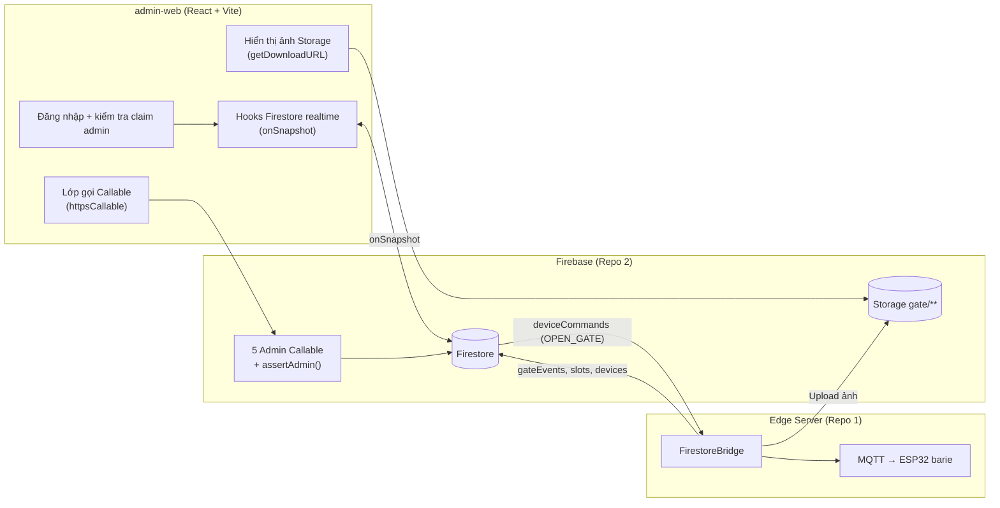
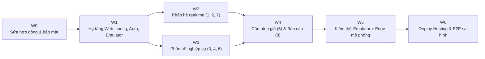

# KẾ HOẠCH: KẾT NỐI WEB ADMIN (`admin-web/`) VỚI FIREBASE & TRẠM REPO 1

**Mục tiêu:** Chuyển Web Admin từ **dữ liệu giả (mock React state)** sang **dữ liệu thật**: đọc Firestore realtime, gọi 5 Admin Callable, xem ảnh camera trên Storage, và điều khiển barie thật của Repo 1 (`lot_live_01`).  
**Phạm vi:** `PARKING_APP/admin-web/`, `PARKING_APP/functions/src/callable/admin.ts`, `firestore.rules`, `storage.rules`, `functions/scripts/` (+ chỉnh nhỏ hợp đồng với `IOT-Parking/edge-backend`).  
**Các quyết định đã chốt:**
1. `deviceId` chuẩn: **`ESP32_PARKING_01`** (đồng bộ chuẩn Repo 1).
2. Phân quyền: **Chỉ 1 vai trò `admin` duy nhất** (xác thực qua Firebase Auth Custom Claim `admin: true`).
3. Báo cáo thống kê: **Tính toán phía client (React)** tổng hợp từ `transactions` và `gateEvents` (đủ cho quy mô vận hành & demo).

---

## 0. CÁC LỖI LỆCH HỢP ĐỒNG ĐÃ PHÁT HIỆN (PHẢI SỬA TRƯỚC)

Khi đối chiếu code Repo 2 với code thật của Edge Server (Repo 1), có các điểm sau sẽ làm luồng thật **không chạy**, dù giao diện vẫn hiển thị bình thường:

| # | Vấn đề | Bằng chứng | Hậu quả | Cách sửa |
|:-:|:---|:---|:---|:---|
| B1 | **Sai tên action mở barie** | [admin.ts](file:///f:/CodePJ/IOT+APP/PARKING_APP/functions/src/callable/admin.ts#L84-L93) ghi `action: "open_barrier"`; Edge chỉ nhận `action == "OPEN_GATE"` ([firestore_bridge.py](file:///f:/CodePJ/IOT+APP/IOT-Parking/edge-backend/app/cloud/firestore_bridge.py#L457-L461)) | Bấm "Mở barie" → Edge log *"Action chưa hỗ trợ"*, barie **không mở** | Đổi thành `OPEN_GATE` |
| B2 | **Lệch `deviceId`** | Seed ghi `lots/lot_live_01.deviceId = "ESP32_STATION_01"` ([seed.ts](file:///f:/CodePJ/IOT+APP/PARKING_APP/functions/scripts/seed.ts#L22)); Edge lọc lệnh theo `settings.DEVICE_ID` (Plan Repo 1 dùng `ESP32_PARKING_01`) | Lệnh không khớp listener → không bao giờ được thực thi | Thống nhất `ESP32_PARKING_01`; Web đọc `deviceId` từ document `lots/lot_live_01`, không ghi cứng |
| B3 | **Admin Callable không kiểm tra quyền admin** | Cả 5 hàm chỉ kiểm tra `request.auth` | **Bất kỳ người dùng App nào** cũng gọi được `adminAdjustBalance` để tự cộng tiền | Thêm `assertAdmin()` kiểm tra `request.auth.token.admin === true` → `permission-denied` |
| B4 | **Storage rules không phủ thư mục ảnh của Edge** | Edge upload vào `gate/{date}/..._full.jpg` ([storage_uploader.py](file:///f:/CodePJ/IOT+APP/IOT-Parking/edge-backend/app/cloud/storage_uploader.py#L95-L104)); `storage.rules` chỉ có `lot_photos/` và `plate_images/` | Web Admin (và App) **không xem được ảnh** biển số | Thêm `match /gate/{allPaths=**}` cho phép admin đọc (đọc theo path qua `getDownloadURL`, không dùng `public_url`) |
| B5 | **`adminRefundDeposit` có thể hoàn cọc 2 lần** | Không kiểm tra `depositStatus` trước khi cộng ví | Bấm 2 lần = cộng tiền 2 lần | Chỉ cho phép khi `depositStatus == "forfeited"`, ngược lại `failed-precondition` |
| B6 | **`adminCorrectPlate` không cứu được xe bị từ chối** | Chỉ tìm session theo biển số cũ; nhưng sự kiện OCR thất bại/`denied` thì **chưa có session nào** (trigger `onGateEvent` thoát sớm khi không có biển) | Kịch bản CA-12 ("sửa biển số → phiên tự gắn vào App") không xảy ra | Nếu không tìm thấy session và event là chiều `IN` → tạo session mới bằng logic dùng chung với `onGateEvent` |
| B7 | **`adminCloseSession` không ghi giao dịch / không gửi FCM** | Chỉ cập nhật ví và session | Lịch sử ví của người dùng thiếu dòng, App không nhận `VEHICLE_EXITED` (Ongoing Notification bị kẹt) | Tái sử dụng hàm "đóng phiên" chung với nhánh `out` của `onGateEvent` |

---

## 1. KIẾN TRÚC ĐÍCH



**Cấu trúc thư mục đề xuất cho `admin-web/src/`** (tách `App.tsx` 483 dòng hiện tại):

```
src/
├── firebase.ts            # Đọc cấu hình từ biến môi trường VITE_*, kết nối Emulator khi chạy dev
├── auth/                  # AuthProvider, LoginPage, AdminGuard (kiểm tra token.admin)
├── hooks/                 # useLot, useSlots, useGateEvents, useSessions, useReservations,
│                          # useUsers, useDevices, useTransactions, useStorageUrl
├── api/adminApi.ts        # Bọc 5 callable + chuyển mã lỗi Firebase thành thông báo tiếng Việt
├── types/                 # Kiểu dữ liệu khớp mục 2.1 của Plan Repo 2
├── components/            # Sidebar, Header, Toast, ConfirmDialog, ImageLightbox, StatusBadge
└── pages/                 # 8 phân hệ, mỗi phân hệ 1 file
```

---

## 2. LỘ TRÌNH THỰC HIỆN (W0 → W6)



### W0 — Sửa lỗi hợp đồng & bảo mật Backend (bắt buộc)
- [ ] Thêm `functions/src/callable/_auth.ts` với `assertAdmin(request)`; áp dụng cho cả 5 hàm admin **(B3)**.
- [ ] `adminOpenGate`: ghi `action: "OPEN_GATE"`, `payload.direction`; nếu không truyền `deviceId` thì lấy từ `lots/lot_live_01.deviceId` **(B1)**.
- [ ] Thống nhất `deviceId = "ESP32_PARKING_01"` giữa `seed.ts` và `.env` của Edge **(B2)**.
- [ ] `adminRefundDeposit`: kiểm tra `depositStatus == "forfeited"` trong transaction **(B5)**.
- [ ] Tách hàm dùng chung `domain/sessionService.ts`: `openSession(...)` và `closeSession(...)` (tính phí, ghi `transactions`, cập nhật ví, giải phóng slot, gửi FCM). Dùng cho `onGateEvent`, `adminCloseSession` **(B7)** và `adminCorrectPlate` **(B6)**.
- [ ] `storage.rules`: thêm `match /gate/{allPaths=**} { allow read: if request.auth.token.admin == true; }` **(B4)**.
- [ ] Script `functions/scripts/setAdminClaim.ts <email>` để cấp custom claim `admin: true`.
- [ ] Unit test Jest cho `assertAdmin` và `sessionService` (dùng lại `contracts/fee_test_cases.json`).

**Đầu ra:** Tài khoản không phải admin gọi admin callable → `permission-denied`; lệnh mở cổng được Edge nhận và chuyển `status = sent`.

### W1 — Hạ tầng Web Admin
- [ ] `firebase.ts`: bỏ API key giả, đọc `import.meta.env.VITE_FIREBASE_*`; thêm `.env.example`; khi `VITE_USE_EMULATOR=true` thì gọi `connectFirestoreEmulator` / `connectFunctionsEmulator` / `connectAuthEmulator` / `connectStorageEmulator`.
- [ ] `AuthProvider` + màn **Đăng nhập Email/Mật khẩu**; `AdminGuard` đọc `getIdTokenResult().claims.admin`, nếu không phải admin thì hiện "Không có quyền" và đăng xuất.
- [ ] Tách `App.tsx` thành `pages/` + `components/`; thêm Toast & ConfirmDialog dùng chung (thay cho `prompt()` hiện tại).
- [ ] `api/adminApi.ts`: bọc 5 callable, chuyển `permission-denied`, `failed-precondition`, `not-found`... thành thông báo tiếng Việt.
- [ ] Bổ sung `firebase.json` mục `hosting` trỏ tới `admin-web/dist` (SPA rewrite).

**Đầu ra:** `npm run dev` chạy với Emulator, đăng nhập được bằng tài khoản admin seed.

### W2 — Phân hệ realtime gắn trực tiếp với trạm Repo 1

| Phân hệ | Nguồn dữ liệu | Việc cần làm |
|:---|:---|:---|
| **1. Giám sát Realtime** | `lots/lot_live_01`, `lots/lot_live_01/slots/*`, `sessions` (active), `devices/*` | Sơ đồ 4 ô theo `status`/`sensorOccupied`; badge Online/Offline cho ESP32 (`deviceOnline`) và CAM (`camOnline`) kèm `lastSeen`; thẻ "Doanh thu hôm nay" từ `transactions` `parking_fee` trong ngày. Cảnh báo khi `sensorOccupied` và `status` không khớp (xe đỗ sai ô) |
| **2. Sự kiện cổng & OCR** | `gateEvents` (index `lotId + serverTs desc`, `limit 50`, phân trang) | Bảng với `direction` (chấp nhận cả `IN`/`in`), `plateDisplay`, `confidence`, `decision`, `denyReason`, `flags`, `latencyMs`; ảnh gốc + ảnh crop qua `useStorageUrl` (lightbox phóng to); lọc theo `decision`/flag `unrecognized`; nút **Sửa biển số** → modal có preview chuẩn hóa → `adminCorrectPlate` |
| **7. Điều khiển thiết bị** | `devices/*`, `deviceCommands` (20 lệnh gần nhất) | Nút **Mở barie VÀO/RA** có hộp xác nhận → `adminOpenGate`; hiển thị vòng đời lệnh `pending → sent / failed` (TTL 60s phía Edge) theo realtime, thay cho `setTimeout` giả hiện tại |

### W3 — Phân hệ nghiệp vụ (tiền, cọc, phiên)

| Phân hệ | Nguồn dữ liệu | Việc cần làm |
|:---|:---|:---|
| **3. Phiên đỗ** | `sessions` (lọc `active`/`completed`, theo ngày, theo biển số) | Bảng phiên + thời gian đỗ chạy realtime; chi tiết phiên (phí, cọc, hoàn cọc dư, ảnh vào/ra); nút **Đóng phiên thủ công** (chọn giờ ra, tùy chọn miễn phí) → `adminCloseSession`, hiển thị kết quả `fee / amountCharged / depositRefund` |
| **4. Đặt chỗ & Cọc** | `reservations` | Lọc theo `status` và `depositStatus`; đếm ngược `expiresAt`; nút **Hoàn cọc thủ công** chỉ hiện khi `forfeited`, bắt buộc nhập lý do → `adminRefundDeposit` |
| **6. Người dùng & Ví** | `users`, `vehicles` (theo `ownerUid`), `transactions` (theo `uid`) | Tìm theo email/biển số; trang chi tiết: số dư (đỏ khi âm), danh sách xe, lịch sử giao dịch; form **Điều chỉnh số dư** (± số tiền, lý do bắt buộc) → `adminAdjustBalance` |

### W4 — Cấu hình giá & Báo cáo
- [ ] **5. Cấu hình Bãi & Giá:** form đọc `lots/lot_live_01`, validate (`pricePerBlock > 0`, `blockMinutes ∈ {15, 30, 60}`, `graceMinutes ≥ 0`, `depositAmount ≥ 0`), ghi trực tiếp Firestore (rules đã cho admin ghi `lots`). Hiển thị preview phí bằng bản sao `feeCalculator` + chạy chung test vector `contracts/fee_test_cases.json`.
- [ ] **8. Báo cáo:** dùng `recharts` vẽ:
  - Doanh thu phí đỗ theo ngày (từ `transactions` loại `parking_fee`).
  - Cọc bị tịch thu (từ `reservations` có `depositStatus == "forfeited"`).
  - Tỷ lệ OCR thành công và độ trễ trung bình (từ `gateEvents`: `decision`, flag `unrecognized`, `latencyMs`).
  - Tổng hợp phía client trong khoảng 7/30 ngày.

### W5 — Kiểm thử trên Emulator + Edge mô phỏng
- [ ] Chạy `firebase emulators:start` + `npm run seed` (trỏ Emulator) + `setAdminClaim.ts`.
- [ ] Chạy Edge Server với `FIREBASE_ENABLED=true` trỏ cùng project (hoặc dùng `scripts/simulate_gate.py`) để sinh `gateEvents`/`slots` thật.
- [ ] Bộ test (mục 3) + test Rules: tài khoản thường **không** đọc được `gateEvents`/`devices`, **không** gọi được admin callable.

### W6 — Deploy & E2E trên sa hình
- [ ] `npm run build` → `firebase deploy --only hosting,functions,firestore:rules,storage`.
- [ ] E2E với phần cứng Repo 1: mở barie từ Web, sửa biển số xe bị từ chối, đóng phiên thủ công → kiểm tra App Android nhận FCM đúng.

---

## 3. BỘ TEST CASE WEB ADMIN

| Mã | Kịch bản | Kết quả mong đợi |
|:--:|:---|:---|
| **WA-01** | Tài khoản người dùng thường đăng nhập Web Admin | Bị chặn ở `AdminGuard`, không đọc được `gateEvents` |
| **WA-02** | Tài khoản thường gọi `adminAdjustBalance` từ App/console | `permission-denied`, số dư không đổi |
| **WA-03** | Che cảm biến ô `A2` trên sa hình (hoặc mô phỏng) | Ô A2 trên Web đổi màu < 2s |
| **WA-04** | Rút nguồn ESP32-CAM | Badge CAM chuyển Offline (theo LWT → `devices`) |
| **WA-05** | Bấm "Mở barie VÀO" | `deviceCommands` đi `pending → sent` < 1s, barie mở; tắt Edge rồi bấm → sau 60s thành `failed` |
| **WA-06** | Xe có biển không đọc được vào bãi → Admin sửa biển số của xe đã đăng ký | Session được tạo và gắn `uid` chủ xe; App nhận `VEHICLE_ENTERED` |
| **WA-07** | Đóng phiên thủ công một phiên có cọc 5.000đ, đỗ 3 phút, `graceMinutes = 5` | `depositRefund = 5000`, có giao dịch trong lịch sử ví, App nhận `VEHICLE_EXITED`, Ongoing Notification tắt |
| **WA-08** | Bấm "Hoàn cọc" 2 lần liên tiếp | Lần 2 bị `failed-precondition`, ví chỉ cộng 1 lần |
| **WA-09** | Đổi `pricePerBlock` = 8000 | App hiển thị giá mới; xe ra sau đó tính phí theo giá mới |
| **WA-10** | Mở ảnh gốc/crop trong bảng sự kiện cổng | Ảnh tải được từ Storage `gate/**` |

