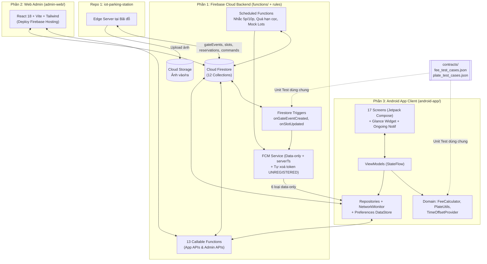
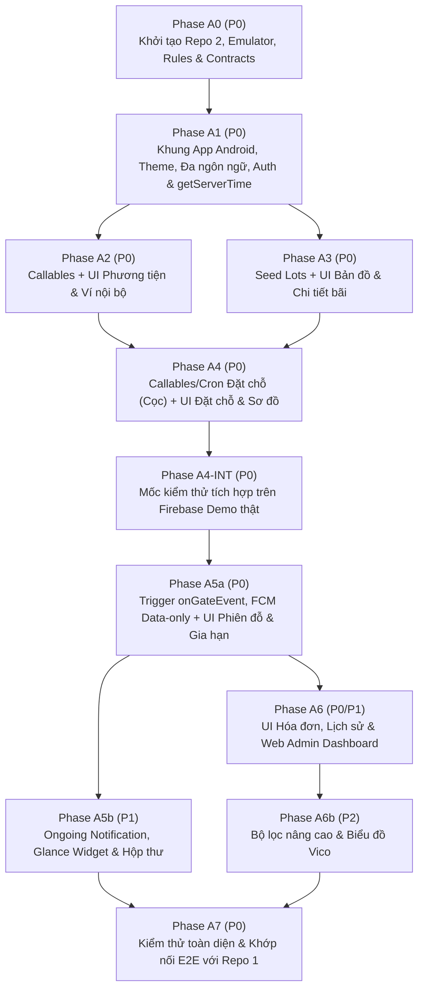

# KẾ HOẠCH PHÁT TRIỂN REPO 2: APP ANDROID & BACKEND CLOUD (`iot-parking-app`)
**Dự án:** Hệ thống Bãi đỗ xe Thông minh (Smart Parking System)  
**Tên Repository:** `iot-parking-app`  
**Phạm vi:**
1. **Backend Cloud (Firebase):** Firestore Schema/Indexes, Security Rules (Whitelist v1.1), Storage Rules, Cloud Functions TypeScript (Xử lý sự kiện cổng `onGateEventCreated`, Phiên đỗ, Tính phí, Khấu trừ/Hoàn cọc dư, Ví nội bộ, 13 Callable APIs, Cronjobs nhắc giờ & hết hạn, 6 loại FCM Data-only kèm `serverTs`), Seed Data và **Web Admin Dashboard** (React + Vite).
2. **Ứng dụng Android (`android-app/`):** Ứng dụng di động dành cho người dùng cuối (Kotlin + Jetpack Compose, Material 3, Hilt, Maps Compose, Vico Charts, Ongoing Notification, Jetpack Glance Widget).
3. **Hợp đồng dùng chung (`contracts/`):** Bộ test vector `fee_test_cases.json` và `plate_test_cases.json` dùng chung trực tiếp cho cả Cloud Functions (TypeScript) và Android App (Kotlin).  

**Ngày cập nhật:** 2026-11-06 *(Phiên bản hợp nhất v1.1 — Thiết kế theo **Phương án A**: Tập trung 100% nghiệp vụ Tiền, Phiên đỗ, Cọc & FCM tại Cloud Functions)*  
**Repository đối tác trong hệ thống 2 Repo:**
- **Repo 1 (`iot-parking-station`)** — `Plan_Repo1_IoT_And_Edge_Backend.md` (Firmware ESP32/ESP32-CAM + Mosquitto + Edge Server AI YOLO/EasyOCR)
- **Repo 2 (`iot-parking-app`)** — *Tài liệu này* (Ứng dụng Android + Firebase Cloud Backend + Web Admin)

---

> [!IMPORTANT]
> **Lợi ích của việc gộp App Android và Backend Cloud vào chung Repo 2 (`iot-parking-app`):**
> - Toàn bộ luồng tính năng của người dùng (**Firestore Schema ↔ Security Rules ↔ Cloud Functions ↔ Android UI/ViewModel**) nằm trong cùng một repository, sử dụng chung một **Firebase Emulator Suite** và dùng chung trực tiếp thư mục `contracts/` mà không lo lệch phiên bản API hay lệch công thức tính tiền.
> - Giao tiếp giữa **Repo 1 (Trạm bãi đỗ)** và **Repo 2 (App & Cloud)** chỉ đi qua 4 bảng Firestore chuẩn (`gateEvents`, `lots/slots`, `reservations`, `deviceCommands`) và Cloud Storage.

---

## 0. TỔNG HỢP CÁC QUYẾT ĐỊNH ĐÃ CHỐT (CHUẨN v1.1)

| # | Hạng mục | Quyết định thống nhất giữa Backend Cloud & App Android |
|:--:|:---|:---|
| 1 | Xác thực người dùng | **Chỉ Email/Mật khẩu** qua Firebase Auth (đăng ký, xác minh email, quên mật khẩu, đổi mật khẩu). Email chưa xác minh vẫn dùng được app kèm **banner nhắc xác minh** (không chặn đặt chỗ để demo mượt) |
| 2 | Quản lý phương tiện | Thêm nhiều xe (ô tô / xe máy), chuẩn hóa biển số (`51A-123.45` → `51A12345`), kiểm tra duy nhất toàn hệ thống qua `addVehicle`, đặt **xe mặc định** |
| 3 | Bản đồ & Phạm vi bãi | Hiển thị **1 bãi live** (`lot_live_01` đồng bộ 4 slot từ Repo 1) + **6 bãi giả lập** (seed data + job biến thiên chỗ trống) |
| 4 | Đặt chỗ & Phí cọc | Chỉ mở đặt chỗ cho bãi live. Thu cọc mặc định **5.000đ** từ ví khi đặt; giữ chỗ **15 phút** có đếm ngược. Đến đúng hạn → cọc khấu trừ vào phí đỗ; huỷ ≤ 2 phút đầu → hoàn 100%; huỷ sau 2 phút hoặc quá hạn → mất cọc. **Cloud Functions là bên quyết định hoàn/mất cọc**; hộp thoại trên app chỉ là dự báo (có vùng đệm sát mốc `110s–130s`) |
| 5 | Công thức phí & Hoàn cọc dư | Theo block **5.000đ / 30 phút**, `graceMinutes` mặc định **0**. Nếu `durationMin <= graceMinutes` thì `fee = 0`. Nếu `fee < depositApplied` thì **hoàn phần cọc dư (`depositRefund = depositApplied - fee`)** vào ví (`deposit_excess_refund`). App cập nhật phí tạm tính theo phút |
| 6 | Ví & Quy tắc khoá | **Ví nội bộ giả lập** + **thẻ giả lập** để nạp tiền ảo. Khi xe ra nếu thiếu tiền, ví được phép **âm**. Khi ví âm: App cảnh báo & khoá nút Đặt chỗ, đồng thời **Cloud Functions cũng từ chối** `createReservation` (`NEGATIVE_BALANCE`). Nếu `0 ≤ walletBalance < depositAmount`: ở màn Xác nhận, vô hiệu nút Xác nhận kèm nút phụ **"Nạp thêm"** |
| 7 | Quy tắc "Một hoạt động" & Khác biển số | Mỗi tài khoản chỉ có tối đa **1 reservation `active`** và **không được đặt mới khi đang có `session` active** (`HAS_ACTIVE_RESERVATION` / `HAS_ACTIVE_SESSION`). Nếu đặt chỗ bằng xe A nhưng mang xe B vào bãi → xe B tính như xe thường không có đặt chỗ, lượt đặt chỗ của xe A vẫn giữ nguyên |
| 8 | Nguồn sự thật giao diện & Offline | **Jetpack DataStore là nguồn duy nhất** cho `theme`, `locale`, `serverTimeOffset`, cấu hình nhắc giờ. Firestore chỉ giữ `users/{uid}.locale` làm bản sao 1 chiều; bỏ `theme` khỏi Firestore. Khi `isOnline == false`, App vô hiệu hóa mọi nút gọi Callable kèm banner *"Đang ngoại tuyến"* |
| 9 | Thông báo FCM Data-only | Cloud Functions lên lịch và gửi **6 loại FCM data-only** (không có block `notification`), mọi bản tin bắt buộc kèm `serverTs`. App tự dựng thông báo từ `strings.xml` theo ngôn ngữ hiện tại. Hỗ trợ nút **"Gia hạn"** ngay trên thanh thông báo qua Expedited `WorkManager` |
| 10 | Ongoing Notification & Widget | **Ongoing Notification** dùng `Chronometer` với `setWhen(entryTimeServer - offset)`, tự tắt khi nhận `VEHICLE_EXITED`, có cơ chế đối soát chống kẹt và tôn trọng thao tác vuốt tắt trên Android 14+. **Jetpack Glance Widget (`4×2`)** 3 chế độ (hiển thị *"Giờ vào"*, không chạy đồng hồ giây) |

---

## 1. KIẾN TRÚC TỔNG THỂ & CẤU TRÚC THƯ MỤC REPO 2

### 1.1. Sơ đồ kiến trúc bên trong Repo 2 (`iot-parking-app`)



### 1.2. Cấu trúc thư mục `iot-parking-app/`
```
iot-parking-app/
├── firebase.json                     # Cấu hình Firestore, Functions, Hosting, Storage & Emulators
├── .firebaserc                       # Alias môi trường (dev, demo)
├── firestore.rules                   # Security Rules (Whitelist 5 fields của users/{uid})
├── firestore.indexes.json            # 7 Composite Indexes
├── storage.rules                     # Phân quyền đọc ảnh biển số
├── contracts/                        # HỢP ĐỒNG TEST VECTOR DÙNG CHUNG (SINGLE SOURCE)
│   ├── fee_test_cases.json           # Test vector tính phí & hoàn cọc dư
│   └── plate_test_cases.json         # Test vector chuẩn hóa & regex biển số VN
├── functions/                        # PHẦN 1: BACKEND CLOUD (Node.js 20 + TypeScript)
│   ├── src/
│   │   ├── index.ts
│   │   ├── config.ts                 # Region asia-southeast1, hằng số nghiệp vụ
│   │   ├── domain/
│   │   │   ├── feeCalculator.ts      # Tính phí v1.1 + hoàn cọc dư (test với ../contracts/)
│   │   │   └── plateUtils.ts         # Chuẩn hóa biển số (test với ../contracts/)
│   │   ├── triggers/
│   │   │   ├── onGateEvent.ts        # Nhận gateEvents từ Repo 1 → tạo/đóng session, trừ/hoàn ví
│   │   │   └── onSlotUpdate.ts       # Suy diễn status ô đỗ, availableSlots & khớp actualSlotId
│   │   ├── callable/
│   │   │   ├── system.ts             # getServerTime
│   │   │   ├── vehicle.ts            # addVehicle, removeVehicle
│   │   │   ├── wallet.ts             # topUpWallet
│   │   │   ├── reservation.ts        # createReservation, cancelReservation, extendReservation
│   │   │   ├── session.ts            # extendPlannedDuration
│   │   │   └── admin.ts              # adminCorrectPlate, adminOpenGate, adminCloseSession,
│   │   │                             # adminAdjustBalance, adminRefundDeposit
│   │   ├── scheduled/
│   │   │   ├── reservationCron.ts    # Nhắc trước 5p & xử lý quá hạn 15p (mỗi 1 phút)
│   │   │   ├── reminderCron.ts       # Nhắc trước 10p thời lượng đỗ dự kiến (mỗi 1 phút)
│   │   │   └── mockLotsCron.ts       # Biến thiên chỗ trống bãi seed (mỗi 5 phút)
│   │   └── services/
│   │       └── fcmService.ts         # Gửi 6 loại FCM data-only kèm serverTs + dọn token lỗi
│   ├── scripts/
│   │   ├── seed.ts                   # Tạo 1 bãi live + 6 bãi seed + tài khoản Admin/User mẫu
│   │   └── mockFcmPush.ts            # Script bắn thử FCM data-only phục vụ test App Android
│   ├── test/                         # Unit test domain & Firestore Rules test
│   └── package.json
├── admin-web/                        # PHẦN 2: WEB ADMIN DASHBOARD (React + Vite + TS)
│   ├── src/
│   └── package.json
└── android-app/                      # PHẦN 3: ỨNG DỤNG ANDROID (Kotlin + Jetpack Compose)
    ├── gradle/libs.versions.toml
    └── app/src/
        ├── main/
        │   ├── java/com/iotparking/app/
        │   │   ├── core/
        │   │   │   ├── designsystem/ # Theme (Light/Dark), Color, Type, Common Components
        │   │   │   ├── domain/       # Models, FeeCalculator, PlateUtils, TimeOffsetProvider
        │   │   │   ├── data/         # Repositories & Firebase DataSources
        │   │   │   ├── network/      # NetworkMonitor (isOnline Flow)
        │   │   │   ├── location/     # FusedLocation wrapper & Haversine distance
        │   │   │   ├── notification/ # ParkingMessagingService, Channels, OngoingSessionNotifier,
        │   │   │   │                 # ActionReceiver, ExtendWorker
        │   │   │   └── di/           # Hilt Modules
        │   │   ├── feature/
        │   │   │   ├── onboarding/   # Splash & Onboarding 3 bước + xin quyền runtime
        │   │   │   ├── auth/         # Login, Register, ForgotPassword, VerifyEmail
        │   │   │   ├── home/         # Bản đồ, Search, FilterSheet, BottomSheet, ActiveBanner
        │   │   │   ├── lotdetail/    # Chi tiết bãi & Sơ đồ 4 slot Khu A/B realtime
        │   │   │   ├── reservation/  # Chọn chỗ, Xác nhận cọc, Màn đếm ngược giữ chỗ
        │   │   │   ├── session/      # Phiên đỗ hiện tại (Chronometer, phí realtime, sơ đồ)
        │   │   │   ├── history/      # Lịch sử theo tháng, Chi tiết hóa đơn, Thống kê Vico
        │   │   │   ├── wallet/       # Ví nội bộ, Nạp tiền ảo, Quản lý thẻ giả lập
        │   │   │   ├── vehicle/      # Danh sách xe, Thêm/Sửa/Xoá xe, Chọn mặc định
        │   │   │   ├── inbox/        # Hộp thư thông báo trong app
        │   │   │   └── settings/     # Hồ sơ, Đổi MK, Ngôn ngữ, Giao diện, Nhắc giờ, Đăng xuất
        │   │   ├── widget/           # ParkingGlanceWidget & ParkingWidgetReceiver
        │   │   ├── navigation/       # AppNavHost, BottomNavBar, Type-safe Routes
        │   │   ├── MainActivity.kt   # extends AppCompatActivity (bật enableEdgeToEdge)
        │   │   └── ParkingApp.kt     # @HiltAndroidApp
        │   └── res/
        │       ├── values/strings.xml
        │       ├── values-vi/strings.xml
        │       └── xml/locales_config.xml
        └── test/                     # Đọc trực tiếp ../../contracts/*.json để chạy Unit Test
```

---

## 2. THIẾT KẾ BACKEND CLOUD & HỢP ĐỒNG DỮ LIỆU (`functions/` & `firestore.rules`)

### 2.1. Schema Firestore Chuẩn hóa (12 Collections)

| Collection | Các trường dữ liệu chính (Chuẩn v1.1) | Quyền truy cập từ App Android |
|:---|:---|:---|
| `users/{uid}` | `email`, `displayName`, `defaultVehicleId`, `walletBalance`, `fcmTokens[]`, `locale` (bản sao 1 chiều), `defaultPlannedDurationMin`, `createdAt` *(Không lưu `theme`)* | Đọc realtime; chỉ được `update` đúng **5 field whitelist**: `displayName`, `defaultVehicleId`, `fcmTokens`, `locale`, `defaultPlannedDurationMin`. **Cấm ghi** `walletBalance`. |
| `users/{uid}/paymentMethods/{id}` | `brand`, `last4`, `holderName`, `isDefault`, `createdAt` | CRUD trực tiếp (thẻ giả lập). |
| `users/{uid}/notifications/{id}` | `type`, `title`, `body`, `refId`, `read`, `createdAt` | Đọc & chỉ được `update` trường `read`. |
| `vehicles/{plateNormalized}` | `ownerUid`, `plateNormalized`, `plateDisplay`, `type` (`"car"\|"motorbike"`), `nickname`, `createdAt` | Chỉ đọc xe có `ownerUid == auth.uid`; thêm/xoá qua Callable. |
| `lots/{lotId}` | `name`, `address`, `location` (`GeoPoint`), `photos[]`, `isLive`, `deviceId`, `deviceOnline`, `totalSlots`, `availableSlots`, `pricePerBlock` (5000), `blockMinutes` (30), `graceMinutes` (0), `depositAmount` (5000), `freeCancelMinutes` (2), `holdDurationMinutes` (15), `maxExtendCount` (1), `vehicleTypes[]`, `hasRoof`, `hasEv`, `openHours`, `rating`, `ratingCount` | Chỉ đọc. |
| `lots/{lotId}/slots/{slotId}` | `zone` (`"A"\|"B"`), `sensorOccupied`, `status` (`"available"\|"occupied"\|"reserved"`), `reservationId`, `sessionId`, `updatedAt` | Chỉ đọc. |
| `reservations/{reservationId}` | `uid`, `lotId`, `lotName`, `slotId`, `plate`, `plateDisplay`, `status` (`"active"\|"fulfilled"\|"expired"\|"cancelled"`), `createdAt`, `expiresAt`, `remindedExpiring`, `extendCount`, `maxExtendCount`, `depositAmount`, `depositStatus` (`"held"\|"applied"\|"refunded"\|"forfeited"`) | Chỉ đọc bản ghi của `auth.uid`. |
| `sessions/{sessionId}` | `uid?`, `plate`, `plateDisplay`, `lotId`, `lotName`, `assignedSlotId`, `actualSlotId`, `reservationId?`, `status` (`"active"\|"completed"`), `entryTime`, `exitTime`, `plannedEndTime`, `remindedLongParking`, `durationMin`, `fee`, `depositApplied`, `depositRefund`, `amountCharged`, `entryImageUrl`, `exitImageUrl`, `flags[]`, `transactionId` | Chỉ đọc bản ghi của `auth.uid`. |
| `transactions/{transactionId}` | `uid`, `type` (`"topup"\|"reservation_deposit"\|"deposit_refund"\|"deposit_excess_refund"\|"parking_fee"\|"adjustment"`), `amount`, `balanceAfter`, `sessionId?`, `reservationId?`, `methodLabel`, `invoiceNo`, `description`, `createdAt` | Chỉ đọc bản ghi của `auth.uid`. |
| `gateEvents/{eventId}` | `deviceId`, `lotId`, `seq`, `direction`, `plateRaw`, `plateNormalized`, `confidence`, `decision`, `denyReason?`, `assignedSlotId?`, `matchedReservationId?`, `status`, `imageUrl`, `cropImageUrl`, `latencyMs`, `serverTs` | Chỉ Admin đọc (Repo 1 ghi). |
| `devices/{deviceId}` | `type`, `lotId`, `online`, `lastSeen` | Chỉ Admin đọc (Repo 1 ghi). |
| `deviceCommands/{cmdId}` | `deviceId`, `action`, `payload`, `status` (`"pending"\|"sent"\|"failed"`), `createdBy`, `createdAt` | Chỉ Admin tạo/đọc (Repo 1 lắng nghe). |

### 2.2. Công thức Tính phí & Đối trừ / Hoàn cọc dư (Đồng nhất giữa `feeCalculator.ts` & `FeeCalculator.kt`)

$$
fee = \begin{cases} 
0 & \text{nếu } durationMin \le graceMinutes \\
\left\lceil \dfrac{durationMin - graceMinutes}{blockMinutes} \right\rceil \times pricePerBlock & \text{nếu } durationMin > graceMinutes
\end{cases}
$$

- **Đối trừ tiền cọc (`depositApplied`) khi kết thúc phiên đỗ:**
  - Nếu `fee >= depositApplied`:
    - `amountCharged = fee - depositApplied` (trừ thêm phần chênh lệch từ ví; cho phép ví âm).
    - `depositRefund = 0`.
  - Nếu **`fee < depositApplied` (Hoàn cọc dư theo v1.1):**
    - `amountCharged = 0`.
    - **`depositRefund = depositApplied - fee`** → Cộng lại `+depositRefund` vào `users/{uid}.walletBalance` và tạo giao dịch `deposit_excess_refund`.

### 2.3. Đặc tả 13 Callable Functions & 6 Bản tin FCM Data-only

#### A. Bảng Callable Functions (`functions/src/callable/`)
| Tên Function | Tham số đầu vào | Kết quả trả về | Mã lỗi & `details.reason` |
|:---|:---|:---|:---|
| `getServerTime` | `{}` | `{ nowMs: number }` | `unauthenticated` |
| `addVehicle` | `{ plateDisplay, type, nickname, setDefault? }` | `{ plateNormalized, plateDisplay }` | `invalid-argument`, `already-exists` |
| `removeVehicle` | `{ plateNormalized }` | `{ success: true }` | `failed-precondition` (xe đang đỗ / đang đặt chỗ) |
| `topUpWallet` | `{ amount, methodId? }` | `{ transactionId, balanceAfter }` | `invalid-argument` |
| `createReservation` | `{ lotId, slotId?, plateNormalized }` | `{ reservationId, slotId, expiresAtMs, depositAmount, balanceAfter }` | `failed-precondition` kèm `details.reason` ∈ `{ "NEGATIVE_BALANCE", "INSUFFICIENT_BALANCE", "HAS_ACTIVE_RESERVATION", "HAS_ACTIVE_SESSION" }`; `resource-exhausted` (ô vừa bị người khác đặt) |
| `cancelReservation` | `{ reservationId }` | `{ refunded: boolean, refundAmount: number, balanceAfter: number }` | `not-found`, `failed-precondition` |
| `extendReservation` | `{ reservationId }` | `{ expiresAtMs: number, extendCount: number }` | `failed-precondition` (hết lượt hoặc đã quá hạn) |
| `extendPlannedDuration` | `{ sessionId, addMinutes: 30 \| 60 }` | `{ plannedEndTimeMs: number }` | `not-found`, `permission-denied` |
| `adminCorrectPlate` | `{ gateEventId, newPlateDisplay }` | `{ sessionId, linkedUid }` | `permission-denied`, `invalid-argument` |
| `adminOpenGate` | `{ deviceId, direction? }` | `{ commandId }` | `permission-denied` |
| `adminCloseSession` | `{ sessionId, exitTimeMs?, waiveFee? }` | `{ fee, amountCharged, depositRefund }` | `permission-denied`, `not-found` |
| `adminAdjustBalance` | `{ targetUid, deltaAmount, reason }` | `{ balanceAfter, transactionId }` | `permission-denied` |
| `adminRefundDeposit` | `{ reservationId, reason }` | `{ balanceAfter, transactionId }` | `permission-denied`, `failed-precondition` |

#### B. Bảng 6 Bản tin FCM Data-only (`functions/src/services/fcmService.ts`)
Mọi bản tin gửi dạng **data-only** (`android.priority = "high"`), luôn đính kèm `"serverTs": String(Date.now())`, và tự động gỡ token trả lỗi `UNREGISTERED` khỏi `users/{uid}.fcmTokens`:

| `data.type` | Payload chính trong `data` | Hành động phía App Android |
|:---|:---|:---|
| `VEHICLE_ENTERED` | `sessionId`, `lotId`, `lotName`, `slotCode`, `plate`, `entryTimeMs`, `serverTs` | Dựng thông báo `parking_events`, bật Ongoing Notification, làm mới Widget |
| `VEHICLE_EXITED` | `sessionId`, `invoiceId`, `amountPaid`, `depositRefund`, `serverTs` | Dựng thông báo `parking_events` (mở Chi tiết Hóa đơn), **huỷ Ongoing Notification**, làm mới Widget |
| `RESERVATION_EXPIRING` | `reservationId`, `lotName`, `slotCode`, `expiresAtMs`, `canExtend`, `serverTs` | Thông báo `reservation` + nút "Gia hạn +15p" (ẩn nút nếu `canExtend="false"`) |
| `RESERVATION_EXPIRED` | `reservationId`, `lotName`, `slotCode`, `depositForfeited`, `serverTs` | Thông báo `reservation`, làm mới Widget |
| `PLANNED_DURATION_NEAR` | `sessionId`, `lotName`, `slotCode`, `plannedEndMs`, `serverTs` | Thông báo `reminders` + 2 nút "Gia hạn +30p" / "Gia hạn +1h" |
| `WALLET_CHANGED` | `delta`, `newBalance`, `reason`, `serverTs` | Thông báo `wallet` |

---

## 3. THIẾT KẾ CHI TIẾT ỨNG DỤNG ANDROID (`android-app/`)

### 3.1. Các cơ chế kỹ thuật trọng tâm trên Client (Chuẩn v1.1)
1. **Đồng bộ giờ máy chủ (`TimeOffsetProvider.kt`):**
   - Gọi `getServerTime` lúc mở app / quay lại foreground, tính `offset = nowMs - (t0 + t1) / 2` và lưu vào DataStore.
   - Mọi bộ đếm trên UI dùng `nowServer = System.currentTimeMillis() + offset`.
   - Ongoing Notification đặt `setWhen(entryTimeServer - offset)` để `Chronometer` của hệ điều hành đếm chuẩn xác.
2. **Hộp thoại Huỷ đặt chỗ (Dự báo có vùng đệm sát mốc 2 phút):**
   - `elapsed < 110s` → *"Bạn sẽ được hoàn lại 5.000đ (dự kiến)"*.
   - `110s ≤ elapsed ≤ 130s` → *"Bạn đang sát mốc 2 phút. Kết quả hoàn/mất cọc do hệ thống xác định khi xử lý."*
   - `elapsed > 130s` → Cảnh báo đỏ *"Bạn sẽ mất phí cọc 5.000đ (dự kiến)"*.
   - Sau khi `cancelReservation` trả về, hiển thị thông báo kết quả thật theo `refunded` và `refundAmount`.
3. **Vòng đời Ongoing Notification chống kẹt & hỗ trợ Android 14+:**
   - Bật khi nhận `VEHICLE_ENTERED` hoặc snapshot `session.status == active`; tắt khi nhận `VEHICLE_EXITED` hoặc snapshot `completed`.
   - **Đối soát định kỳ:** Mỗi khi mở app, nhận FCM hoặc chạy `WorkManager` 15 phút, kiểm tra lại phiên `active`; nếu không còn phiên active thì huỷ ngay thông báo ghim.
   - **Tôn trọng thao tác vuốt tắt (Android 14+):** Bắt `setDeleteIntent` để lưu cờ `ongoingDismissed(sessionId)` vào DataStore, không tự bật lại cho phiên đó.
4. **Quy trình Đăng xuất an toàn:**
   - Khi còn xác thực và online: `arrayRemove(currentToken)` khỏi `users/{uid}.fcmTokens` → `FirebaseMessaging.deleteToken()` → huỷ Ongoing Notification, xoá cache widget & `serverTimeOffset` → `FirebaseAuth.signOut()`.

### 3.2. Danh sách 17 Màn hình App Android & 8 Phân hệ Web Admin

#### A. 17 Màn hình App Android (5 Tab Bottom Bar: *Khám phá, Hoạt động, Lịch sử, Ví, Tài khoản*)
1. **Splash & Onboarding** (3 bước giới thiệu + xin quyền Vị trí & Thông báo có giải thích).
2. **Đăng nhập / Đăng ký / Quên MK / Banner xác minh email**.
3. **Trang chủ (Bản đồ Google Maps)** (Custom marker theo chỗ trống, Search, BottomSheet danh sách bãi, `ActiveBanner` ghim phiên đỗ/giữ chỗ, `OfflineBanner`).
4. **Bộ lọc & Sắp xếp** *(P2)* (Lọc giá, khoảng cách, chỗ trống, loại xe, mái che, sạc EV; Sắp xếp gần nhất/rẻ nhất/nhiều chỗ nhất).
5. **Chi tiết Bãi đỗ** (Ảnh Storage, giờ mở cửa, bảng giá + cọc, điểm sao seed, badge `deviceOnline`, chỗ trống realtime, nút **Chỉ đường** có fallback `geo:` & **Đặt chỗ**).
6. **Sơ đồ & Chọn chỗ đỗ** (Mặt bằng 4 ô `A1, A2, B1, B2` đổi màu realtime, chọn ô cụ thể hoặc tự gán).
7. **Xác nhận Đặt chỗ** (Chọn xe, tóm tắt cọc 5.000đ, cảnh báo chỉ đúng biển số đã chọn mới được vào ô đặt, nút phụ *Nạp thêm* nếu thiếu tiền).
8. **Đặt chỗ đang giữ** (Đồng hồ đếm ngược `mm:ss`, Chỉ đường, Gia hạn +15p, Huỷ đặt chỗ; khi về `00:00` hiện *"Đang xác nhận hết hạn…"* chờ server).
9. **Phiên đỗ hiện tại** (Biển số, ô đỗ kèm sơ đồ rẽ từ cổng, đồng hồ giây, phí tạm tính cập nhật theo phút, khấu trừ cọc & hoàn cọc dư, ảnh lúc vào, cài/gia hạn thời lượng đỗ dự kiến).
10. **Lịch sử đỗ xe** *(P1)* (Lọc theo Tháng/Năm & theo xe, phân trang).
11. **Chi tiết Hóa đơn** *(P0)* (Mã HĐ `INV-...`, giờ vào/ra, số block, phí gốc, trừ cọc, hoàn cọc dư, thực thu, xem phóng to 2 ảnh vào/ra).
12. **Thống kê Chi tiêu** *(P2)* (Biểu đồ cột Vico 6 tháng, tổng số lượt, thời gian đỗ trung bình).
13. **Ví nội bộ** (Số dư realtime, cảnh báo đỏ khi âm, nạp nhanh 20k–200k, lịch sử giao dịch).
14. **Quản lý Thẻ giả lập** (Thêm/xoá thẻ test Visa/Mastercard/JCB, đặt mặc định).
15. **Quản lý Phương tiện** (Danh sách xe, thêm/xoá xe có preview chuẩn hóa biển số, đặt mặc định).
16. **Hộp thư Thông báo** *(P1)* (Danh sách thông báo, chạm để đọc & điều hướng, đánh dấu đọc tất cả).
17. **Cài đặt & Hồ sơ** (Sửa tên, đổi mật khẩu, đổi ngôn ngữ Việt/Anh qua `AppCompatDelegate`, đổi giao diện Sáng/Tối/Hệ thống, cấu hình nhắc giờ, Đăng xuất).

#### B. 8 Phân hệ Web Admin Dashboard (`admin-web/`)
1. **Giám sát Realtime** (Sơ đồ 4 ô `A1..B2`, trạng thái Online/Offline của ESP32, CAM, Edge Server, doanh thu ngày).
2. **Sự kiện cổng & Đối soát OCR** (Bảng `gateEvents` kèm ảnh gốc + ảnh crop, nút **"Sửa biển số"** gọi `adminCorrectPlate`).
3. **Quản lý Phiên đỗ** (Lọc phiên đang đỗ/đã xong, nút **"Đóng phiên thủ công"** `adminCloseSession`).
4. **Quản lý Đặt chỗ & Cọc** (Theo dõi trạng thái cọc, nút **hoàn cọc thủ công** `adminRefundDeposit`).
5. **Cấu hình Bãi & Giá** (Cập nhật `pricePerBlock`, `blockMinutes`, `graceMinutes`, `depositAmount`).
6. **Người dùng & Ví** (Tra cứu user, xe, điều chỉnh số dư `adminAdjustBalance`).
7. **Điều khiển Thiết bị** (Nút **"Mở Barie khẩn cấp"** `adminOpenGate`).
8. **Báo cáo Thống kê** (Biểu đồ doanh thu phí đỗ + cọc tịch thu, tỷ lệ nhận diện OCR thành công).

---

## 4. LỘ TRÌNH PHÁT TRIỂN HỢP NHẤT REPO 2 (PHASES A0 → A7)

Mỗi giai đoạn kết hợp đồng bộ cả phần **Cloud Functions (`functions/`)** và **App Android (`android-app/`)** trong cùng repo:



### PHASE A0 — KHỞI TẠO REPO 2, EMULATOR, SECURITY RULES & CONTRACTS (P0)
- [ ] Khởi tạo `iot-parking-app/` gồm `functions/`, `admin-web/`, `android-app/`, `contracts/`.
- [ ] Viết `contracts/fee_test_cases.json` và `contracts/plate_test_cases.json`.
- [ ] Viết `firestore.rules` (whitelist 5 trường của `users/{uid}`), `firestore.indexes.json`, `storage.rules` + test phân quyền trên Emulator.
- [ ] Vẽ Wireframe 17 màn hình App, cấu hình `google-services.json` và Google Maps API Key.

### PHASE A1 — KHUNG APP, DESIGN SYSTEM, ĐA NGÔN NGỮ, AUTH & `getServerTime` (P0)
- [ ] **Cloud:** Hiện thực callable `getServerTime`.
- [ ] **App:** Khởi tạo Compose, Material 3 (`enableEdgeToEdge`), Hilt, Navigation Compose, `NetworkMonitor`, DataStore, đổi ngôn ngữ Việt/Anh (`AppCompatActivity` + `locales_config.xml`) và Sáng/Tối.
- [ ] **App:** Màn Onboarding, Đăng nhập, Đăng ký, Quên mật khẩu, Banner xác minh email, Settings cơ bản (đổi mật khẩu, đăng xuất xoá FCM token) và `TimeOffsetProvider`.

### PHASE A2 — PHƯƠNG TIỆN & VÍ NỘI BỘ (CLOUD + APP) (P0)
- [ ] **Cloud & App:** Hiện thực `plateUtils.ts` và `PlateUtils.kt` cùng chạy unit test đọc từ `contracts/plate_test_cases.json`.
- [ ] **Cloud:** Hiện thực `addVehicle`, `removeVehicle`, `topUpWallet`.
- [ ] **App:** Màn Quản lý phương tiện, Quản lý thẻ giả lập và Ví nội bộ (cảnh báo ví âm, nạp tiền ảo, lịch sử ví).

### PHASE A3 — SEED BÃI ĐỖ, BẢN ĐỒ & CHI TIẾT BÃI (CLOUD + APP) (P0)
- [ ] **Cloud:** Viết `scripts/seed.ts` tạo `lot_live_01` (4 ô `A1..B2`) + 6 bãi seed chuẩn field phẳng mục 2.1, và `simulateMockLots`.
- [ ] **App:** Tích hợp `FusedLocationProviderClient`, màn Trang chủ (`GoogleMap` Compose + BottomSheet), màn Chi tiết bãi đỗ + nút Chỉ đường (kèm fallback `geo:`).

### PHASE A4 — ĐẶT CHỖ TRƯỚC (CỌC), CRONJOBS & SƠ ĐỒ CHỈ DẪN (CLOUD + APP) (P0)
- [ ] **Cloud:** Hiện thực `createReservation` (4 mã `details.reason`, trừ cọc 5.000đ), `cancelReservation` (mốc 2 phút), `extendReservation` và `reservationScheduler` (nhắc trước 5p, quá hạn 15p → `forfeited`).
- [ ] **App:** Màn Sơ đồ 4 slot realtime, Xác nhận đặt chỗ, Đặt chỗ đang giữ (đếm ngược theo `TimeOffsetProvider`, hộp thoại dự báo huỷ cọc, xử lý hết hạn chờ snapshot) và sơ đồ chỉ dẫn rẽ Trái/Phải.

### PHASE A4-INT — MỐC TÍCH HỢP SỚM TRÊN MÔI TRƯỜNG FIREBASE DEMO THẬT (P0)
- [ ] Deploy Rules, Indexes, Seed và Functions của Phase A1–A4 lên Firebase project thật; chuyển App sang môi trường demo để kiểm thử xuyên suốt luồng Đặt chỗ, Huỷ cọc, Security Rules và `mockFcmPush.ts`.

### PHASE A5a — TRIGGER SỰ KIỆN CỔNG, FCM DATA-ONLY & MÀN PHIÊN ĐỖ (P0)
- [ ] **Cloud & App:** Hiện thực `feeCalculator.ts` và `FeeCalculator.kt` (hỗ trợ `graceMinutes` & hoàn cọc dư) cùng pass 100% `contracts/fee_test_cases.json`.
- [ ] **Cloud:** Hiện thực `fcmService.ts` (6 loại data-only kèm `serverTs`, tự xoá token `UNREGISTERED`), `onGateEventCreated`, `onSlotUpdated`, `extendPlannedDuration` và `longParkingReminder`.
- [ ] **App:** Màn Phiên đỗ hiện tại & `ActiveBanner`, `ParkingMessagingService` (bọc `Context` theo locale), Deep Link và `BroadcastReceiver` + `ExtendWorker` (expedited) cho nút **Gia hạn** trên thông báo.

### PHASE A5b — ONGOING NOTIFICATION, GLANCE WIDGET & HỘP THƯ (P1)
- [ ] **App:** `OngoingSessionNotifier` (Chronometer quy đổi offset, đối soát chống kẹt, xử lý vuốt tắt Android 14+), Jetpack Glance Widget 3 chế độ, màn Hộp thư thông báo.

### PHASE A6 — HÓA ĐƠN, LỊCH SỬ & WEB ADMIN DASHBOARD (P0/P1)
- [ ] **App:** Màn Chi tiết Hóa đơn (P0, xem ảnh vào/ra zoomable, hiển thị trừ cọc / hoàn cọc dư) và màn Lịch sử đỗ xe theo tháng (P1).
- [ ] **Web Admin (`admin-web/`):** Xây dựng 8 phân hệ quản trị + 5 Callable Admin (`adminCorrectPlate`, `adminOpenGate`, `adminCloseSession`, `adminAdjustBalance`, `adminRefundDeposit`).

### PHASE A6b — BỘ LỌC NÂNG CAO & THỐNG KÊ VICO (P2)
- [ ] **App:** Màn Bộ lọc & Sắp xếp bãi đỗ và màn Thống kê chi tiêu 6 tháng bằng biểu đồ Vico.

### PHASE A7 — KIỂM THỬ TOÀN DIỆN & KHỚP NỐI E2E VỚI REPO 1 (P0)
- [ ] Chạy toàn bộ bộ Test Cases ở mục 5 dưới đây và kết nối trực tiếp với **Repo 1 (`iot-parking-station`)** trên sa hình vật lý; đóng gói `release.apk` và deploy Web Admin lên Firebase Hosting.

---

## 5. BỘ TEST CASE KIỂM THỬ REPO 2 (CLOUD + APP ANDROID)

Loại test: **U** = Unit Test, **R** = Rules/Cloud Test, **UI** = Compose UI Test, **M** = Manual / E2E.

| Mã TC | Loại | Phạm vi | Kịch bản kiểm thử | Kết quả mong đợi |
|:---:|:--:|:---|:---|:---|
| **CA-01** | U | Contracts | Chạy Jest (`functions/`) và JUnit (`android-app/`) với `contracts/fee_test_cases.json` & `plate_test_cases.json` | Cả TypeScript và Kotlin đều pass 100% cùng bộ test vector |
| **CA-02** | R | Security Rules | Client cố tình ghi `walletBalance` hoặc cập nhật field `theme` không thuộc whitelist | Bị Firestore từ chối `PERMISSION_DENIED` |
| **CA-03** | R/UI | Đặt chỗ bị chặn | Gọi `createReservation` khi ví âm, khi thiếu tiền cọc, hoặc khi đang có `session` active | Cloud trả đúng `details.reason` (`NEGATIVE_BALANCE`, `INSUFFICIENT_BALANCE`, `HAS_ACTIVE_SESSION`); App hiển thị đúng thông điệp |
| **CA-04** | UI/M | Cảnh báo & Huỷ cọc | Đặt ô A1 (cọc 5.000đ) → huỷ ở giây 45 vs ở giây 120 vs ở phút thứ 4 | Giây 45: hoàn 5.000đ; giây 120: hiện thông báo vùng đệm sát mốc; phút 4: mất cọc 5.000đ |
| **CA-05** | R/M | Hoàn cọc dư | Bật `graceMinutes = 5`, xe đã cọc 5.000đ vào bãi và ra ở phút thứ 3 (`fee = 0 < 5.000đ`) | `amountCharged = 0`, `depositRefund = 5000`, ví được cộng lại 5.000đ (`deposit_excess_refund`), Hóa đơn hiển thị dòng *Hoàn cọc dư* |
| **CA-06** | M | Action Gia hạn | Nhận FCM `RESERVATION_EXPIRING` khi đóng app → bấm **"Gia hạn +15p"** trên thông báo | `ExtendWorker` gọi thành công `extendReservation`, thông báo cập nhật giờ mới; nếu thất bại thì báo rõ trên thông báo |
| **CA-07** | U/UI | Lệch đồng hồ máy | Chỉnh đồng hồ điện thoại lệch +5 phút / −5 phút so với giờ chuẩn | Nhờ `TimeOffsetProvider`, đồng hồ đếm ngược, phiên đỗ và Chronometer của Ongoing Notification vẫn khớp giờ server |
| **CA-08** | M | Ongoing & Android 14+ | Đang đỗ xe → vuốt tắt Ongoing Notification; sau đó kill app và cho xe ra bãi | Vuốt tắt thì không tự bật lại cho phiên đó; khi xe ra nhận `VEHICLE_EXITED` (hoặc đối soát 15p) thì mọi thông báo ghim & Widget đều về trạng thái rảnh |
| **CA-09** | UI/M | Đa ngôn ngữ & Theme | Đổi ngôn ngữ Việt ↔ Anh (trên cả Android 12 và 13+) và chế độ Sáng ↔ Tối; nhận FCM khi đóng app | Giao diện và nội dung thông báo FCM hiển thị đúng ngôn ngữ đã chọn |
| **CA-10** | UI/M | Ngoại tuyến (Offline) | Tắt Wi-Fi/4G trên điện thoại rồi thử bấm Đặt chỗ, Nạp tiền, Gia hạn | Hiện `OfflineBanner`, các nút ghi bị vô hiệu hóa ngay; dữ liệu lịch sử cũ vẫn xem được từ cache |
| **CA-11** | R/M | Đăng xuất & Dọn Token | Đăng xuất khỏi App (cả khi online và khi cưỡng bức gỡ app) rồi bắn FCM | Token được xoá khỏi `fcmTokens`; nếu token đã chết (`UNREGISTERED`), `fcmService` tự dọn sạch khỏi Firestore |
| **CA-12** | M | Khác biển số & Admin | Đặt chỗ xe A nhưng đưa xe B vào bãi; thử đưa xe không đọc được biển rồi dùng Web Admin sửa biển số | Xe B tính như xe thường, chỗ của xe A vẫn giữ; khi Admin sửa biển số qua `adminCorrectPlate`, phiên đỗ tự gắn ngay vào App của chủ xe |

